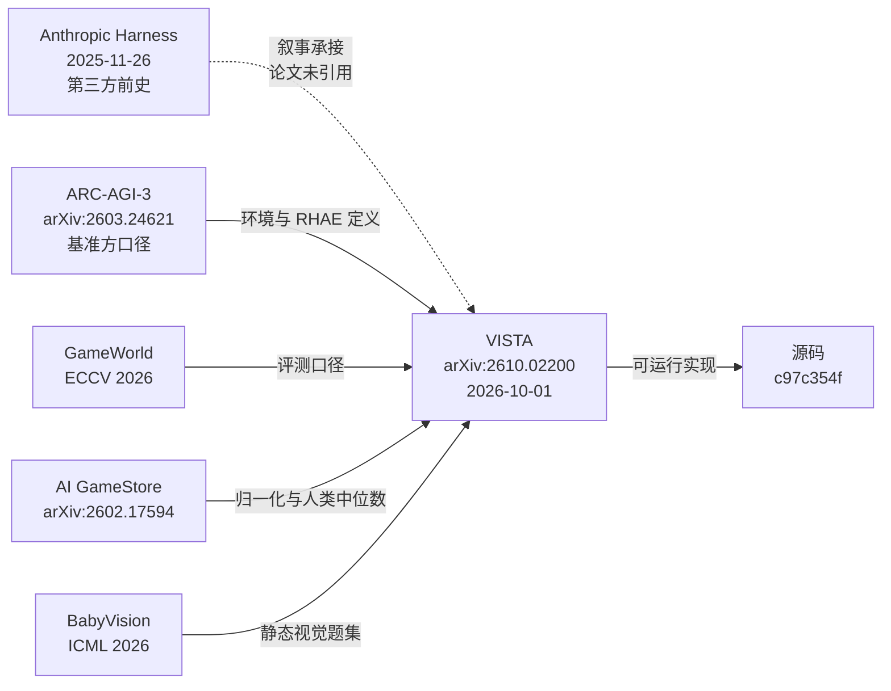

# 10 · 论文谱系与口径边界

> 本篇回答一个问题：**当你要引用"VISTA 取得了 ARC-AGI-3 满分"这个说法时，应该同时说出哪些来自其他文献的限定？**
> 文献坐标登记见 [论文谱系与阅读地图](/references/paper-reading-map.md) [F-129]。

## 一、VISTA 在文献谱系中的位置

## 二、四篇基准论文各自贡献了什么

VISTA 论文**没有重新定义**任何基准——它引用并沿用四份既有的基准定义。这一点决定了"分数该怎么读"。

### ARC-AGI-3（arXiv:2603.24621）——最重要的一篇

它同时提供了三样东西 [F-073][F-074][F-084]：

1. **RHAE 的官方定义**——单关得分 =(人类基线动作数/AI 动作数)²、单关得分上限 115%、未通关计 0、游戏分为关卡序号加权平均、总分为各游戏分平均、人类基线取每关动作数最少者的上中位数 [F-073]；
2. **数据集构成**——公开 25 / 半私有 55 / 完全私有 55，且私有集刻意与公开集**分布外** [F-074]；
3. **基准方对公开集成绩的定性**——公开集分数**永不进入官方榜**，公开集评估"绝不能视为 AGI 进展的有效度量"，社区榜成绩自报且不予核验；官方另开源一个仅以**人类回放**即可在全部公开环境上取得 100% 的 harness [F-084]。

> **第 3 条是全部限定中最强的一条**，因为它来自基准所有者而非 VISTA 作者。"满分 100"在公开集上**不是有区分度的成就信号**——人类回放也能拿满分 [F-084]。VISTA 结果的意义因此落在"**不用程序合成也能达到**"这一点上 [F-078]。

### GameWorld（ECCV 2026）——浏览器游戏的标准化

34 个浏览器游戏、跨 5 类题材（arcade / platformer / puzzle / runner / simulation）共 **170 项任务**；成功率定义为 170 项任务的完成比例 [F-056]。人类参考由**两名计算机科学研究生**产生，各自尝试全部 170 项任务，预算与智能体相同（每任务 100 动作），其中一名此前无相关经验 [F-081]。

### AI GameStore（arXiv:2602.17594）——开放游戏库与人类中位数

10 个公开浏览器游戏；每个游戏的原始分先按该游戏对应的**公开人类中位数归一化为 100**，再对 10 个游戏取**几何平均** [F-057]。人类参考来自 Prolific 参与者（平均年龄 38…）[F-081]。注意"综合得分"是几何平均而非原始分求和 [F-057]。

### BabyVision（ICML 2026）——静态视觉推理

全集 388 项任务 / 22 个子类；VISTA 只评估其中 **39 题**（20 Maze + 19 Connect the lines）[F-058]。人类参考为 Maze 95.0% 与连线 89.5%，图 11 的 92.3% 是两子类加权 [F-081]。**没有环境动作**，因此它验证的是"视觉检查"组件在无交互场景同样有效，而非交互式 Harness 的能力 [F-114]。

## 三、Anthropic harness 博文的位置：一个必须标注的叙事边界

| 项 | 事实 | F |
|----|------|---|
| 该文确实存在 | 《Effective harnesses for long-running agents》，发布 **2025-11-26** | [F-072] |
| 博文转述准确 | "通过任务清单记录尚未完成的事项，通过进度文件和代码记录保存已经完成的工作"与原文吻合 | [F-011][F-012] |
| **但论文未引用** | VISTA 论文 64 条参考文献中唯一 Anthropic 出处是 Claude Opus 5 模型公告 | [F-071] |

因此"**Anthropic 的 harness → VISTA 的视觉 harness**"是**博主的叙事承接**，不是论文主张的引用关系 [F-071]。引用时须写成"媒体叙事中的脉络关联"，而非"VISTA 沿用了 Anthropic 的思路"。

> **为什么这条值得单列**：它是本案例中最容易发生"把媒体转述当论文主张"的接缝处。论文与源码都表明，VISTA 的三层记忆结构（原始帧档案 / GUIDE.md / WORKING.md）与 Anthropic 的两层笔记法（特性清单 / 进度文件）**结构相似但介质与触发机制不同** [F-053][F-072][F-108]——相似性是真实的，引用关系是不存在的。

## 四、项目页 blogpost 的位置：版本化的必要性

论文（2026-10-01）与项目页 blogpost（2026-08-05）的数字**系统性不同** [F-082]：

| 指标 | 项目页 | 论文 |
|------|-------|------|
| Opus 5.0 总动作数 | 7,542 | **7,302** |
| 比人类少 | 56.0% | **57.4%** |
| GPT-5.6 Sol RHAE | 98.27 | **99.00** |
| 官方实现基线 | 30.16 | **40.68** |

两套数字各自内部自洽，差异源于实验迭代 [F-082]。**本束一律以论文口径为准**；引用"56%"或"98.27"时须注明来自项目页 [F-082]。

项目页还有一个时序细节：它标注 "Aug 5, 2026" 却**不链接** VISTA 的 arXiv（arXiv 上线晚约两个月）——这本身说明项目页是早期版本，不是最新口径 [F-082]。

## 五、论文未覆盖的泛化面

| 方向 | 状态 | F |
|------|------|---|
| 具身 / 更接近物理世界的任务 | 论文列为**未来工作**，尚未验证 | [F-069] |
| ARC-AGI-3 私有/半私有集 | 论文未测；源码亦无适配 | [F-130] |
| 训练数据污染 | 论文自陈无法排除 | [F-068] |
| 非 ARC 系的交互式环境 | 仅 GameWorld / AI GameStore 两个浏览器游戏基准 | [F-056][F-057] |
| BabyVision 的其余 9 个子类 | 仅评估 Visual Tracking 两子类 | [F-058] |

## 六、引用这条结论时的"限定清单"（更新版）

综合论文、基准方与源码三层，引用"VISTA 取得 ARC-AGI-3 满分 100"时应当同时给出：

| # | 限定 | 来源 | F |
|---|------|------|---|
| ① | 基线及其可比性：官方实现 Sol(max) 13.33；40.68 为 Opus **high** + 官方协议换算值，非同条件对照 | VISTA 论文 | [F-077] |
| ② | 数据污染不可排除：模型发布晚于公开基准 | VISTA 论文 §6 | [F-068] |
| ③ | 未见题目表现未知：需私有集（55+55，且分布外） | ARC-AGI-3 论文 | [F-074] |
| ④ | **基准方定性**：公开集分数永不进官方榜、不是 AGI 进展的有效度量、人类回放亦可得满分 | ARC-AGI-3 论文 | [F-084] |
| ⑤ | 分数非唯一：Tycho 亦 100.00、Retrodict 99.86 | VISTA 论文 | [F-077] |
| ⑥ | 方差：ARC ±0.17；GameWorld ±2.37%；BabyVision ±3.00% | VISTA 论文 | [F-067] |
| ⑦ | 成本：单局约 3,070 万 token（图像观测） | VISTA 论文 | [F-080] |
| ⑧ | 口径：严格同 effort 对照只有 Sol(max) 13.33 → 99.00 | VISTA 论文 + 源码 | [F-077][F-079] |

> 相比本束第一轮交付的"限定三件套"，源码与论文谱系的补充使其扩展为**八条** [F-068][F-073][F-074][F-077][F-079][F-080][F-084][F-067]。其中 ④ 来自基准所有者，是最强的一条。

## 七、下一步

- 核验与勘误全表 → [references/verification.md](/references/verification.md)
- 论文结构导航 → [论文谱系与阅读地图](/references/paper-reading-map.md)

## 相关

- [03 ARC-AGI-3 结果与计分口径](03-arc-agi3-results.md) · [04 跨基准验证](04-cross-benchmark-validation.md) · [05 局限与实践](05-limitations-and-practice.md)
- [09 论文与源码映射](09-paper-source-mapping.md)
