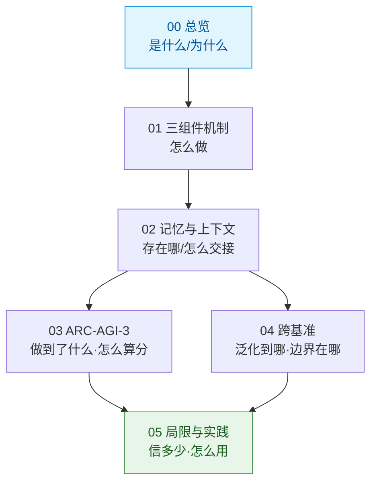

# 概念文档

本目录共 **6 篇**概念文档，按"是什么 → 怎么做 → 存在哪 → 做到了什么 → 泛化到哪 → 信多少"的顺序组织。

| # | 文档 | 内容 | 阅读时间 |
|---|------|------|---------|
| 00 | [VISTA 总览](00-vista-overview.md) | VISTA 是什么、解决什么问题、与"文本网格 + 代码世界模型"路线的根本分野、头条结果与边界 | 6 min |
| 01 | [三组件机制](01-visual-harness-components.md) | 视觉观测 / 无损视觉记忆 / 视觉检查的分工；帧索引、inspect 与 read_pixels、"显式注意力" | 8 min |
| 02 | [记忆与上下文](02-memory-and-context.md) | 三层记忆结构、GUIDE.md 与 WORKING.md 的分工、上下文交接、上下文预算分层 | 7 min |
| 03 | [ARC-AGI-3 结果与计分口径](03-arc-agi3-results.md) | RHAE 官方公式、基线与提升幅度、消融阶梯、动作数对照、方差、竞争系统、数据污染限定 | 9 min |
| 04 | [跨基准验证](04-cross-benchmark-validation.md) | GameWorld / AI GameStore / BabyVision 结果与各自口径、证据强度分析、方法适用边界 | 7 min |
| 05 | [局限、口径差异与实践建议](05-limitations-and-practice.md) | 论文自陈局限、8 项勘误逐条对照、项目页 vs 论文、分读者行动建议、开源运行要求 | 9 min |

## 学习路径



## 快速入口

| 你想知道的 | 直接跳到 |
|-----------|---------|
| VISTA 一句话是什么 | [00](00-vista-overview.md) 第一节 |
| "满分 100"到底怎么算的 | [03](03-arc-agi3-results.md) 第二节 |
| 博文漏了什么 | [05](05-limitations-and-practice.md) 第二节 |
| 我能不能在自己的 Agent 里用这套 | [02](02-memory-and-context.md) 末节 + [05](05-limitations-and-practice.md) 第四节 |
| 代码在哪、怎么跑 | [05](05-limitations-and-practice.md) 第五节 |

```{toctree}
:hidden:
:maxdepth: 2

00-vista-overview
01-visual-harness-components
02-memory-and-context
03-arc-agi3-results
04-cross-benchmark-validation
05-limitations-and-practice
```
