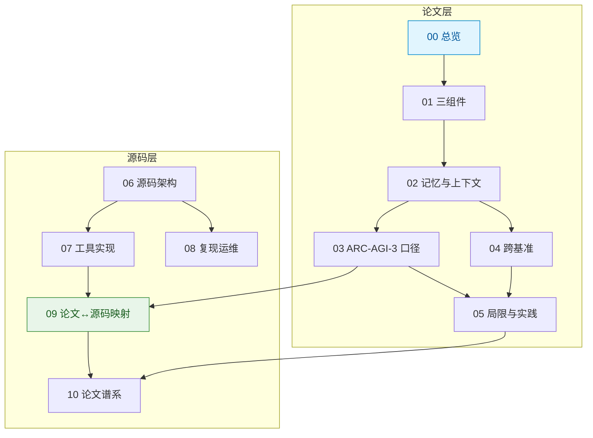

# 概念文档

本目录共 **11 篇**概念文档，分两层组织：**论文层**（00–05，读懂 VISTA 是什么、怎么做、成绩怎么算、边界在哪）与**源码层**（06–10，读懂它怎么被实现、怎么被复现、论文与代码何处一致或不同）。

## 论文层

| # | 文档 | 内容 | 阅读时间 |
|---|------|------|---------|
| 00 | [VISTA 总览](00-vista-overview.md) | VISTA 是什么、解决什么问题、与"文本网格 + 代码世界模型"路线的根本分野、ARC-AGI-3 基准规格、头条结果与限定 | 8 min |
| 01 | [三组件机制](01-visual-harness-components.md) | 视觉观测 / 无损视觉记忆 / 视觉检查的分工；帧索引、inspect 与 read_pixels、"显式注意力" | 8 min |
| 02 | [记忆与上下文](02-memory-and-context.md) | 三层记忆结构、GUIDE.md 与 WORKING.md 的分工、上下文交接、上下文预算分层、与 Anthropic harness 的结构对照 | 7 min |
| 03 | [ARC-AGI-3 结果与计分口径](03-arc-agi3-results.md) | RHAE 官方公式、基线与 effort/协议混淆、消融六步、动作数对照、方差、竞争系统、基准方立场、成本口径 | 12 min |
| 04 | [跨基准验证](04-cross-benchmark-validation.md) | GameWorld / AI GameStore / BabyVision 结果与各自口径、人类样本量、证据强度、人类仍领先的横向比较 | 8 min |
| 05 | [局限、口径差异与实践建议](05-limitations-and-practice.md) | 论文自陈局限、勘误逐条对照、项目页 vs 论文、分读者行动建议、开源运行要求 | 10 min |

## 源码层

| # | 文档 | 内容 | 阅读时间 |
|---|------|------|---------|
| 06 | [源码架构总览](06-source-architecture.md) | 四层包结构、契约层、两后端的压缩策略分叉、四个基准适配、动作语义、安全与恢复设计 | 9 min |
| 07 | [九个工具与三层记忆的实现细节](07-tooling-and-memory-implementation.md) | inspect / read_pixels / history / play 的参数边界与行为、帧档案落盘、量化符号表、双笔记职责、核心提示词三句契约 | 9 min |
| 08 | [复现与运维](08-reproduction-and-operations.md) | 环境前置、授权配置、统一 CLI、四个 profile 的运行方式、竞争模式、运行产物、失败模式与恢复 | 9 min |
| 09 | [论文与源码的逐条映射](09-paper-source-mapping.md) | 三组件与六步消融的逐条落点、附录算法与源码签名、三处论文未述细节、两处口径差异 | 9 min |
| 10 | [论文谱系与口径边界](10-paper-lineage.md) | 四篇基准论文各自贡献什么、Anthropic 博文的位置、项目页的版本意义、论文未覆盖的泛化面、引用时的八条限定 | 8 min |

## 学习路径



## 快速入口

| 你想知道的 | 直接跳到 |
|-----------|---------|
| VISTA 一句话是什么 | [00](00-vista-overview.md) 第一节 |
| "满分 100"到底怎么算的 | [03](03-arc-agi3-results.md) 第二节 |
| 博文漏了什么 | [05](05-limitations-and-practice.md) 第二节 |
| 论文没说清、源码能补什么 | [09](09-paper-source-mapping.md) 第四节 |
| 我能不能在自己的 Agent 里用这套 | [02](02-memory-and-context.md) 末节 + [05](05-limitations-and-practice.md) 第四节 |
| 代码在哪、怎么跑 | [08](08-reproduction-and-operations.md) + [examples](/examples/index.md) |
| 引用这条结论必须带什么限定 | [10](10-paper-lineage.md) 第六节 |

```{toctree}
:hidden:
:maxdepth: 2

00-vista-overview
01-visual-harness-components
02-memory-and-context
03-arc-agi3-results
04-cross-benchmark-validation
05-limitations-and-practice
06-source-architecture
07-tooling-and-memory-implementation
08-reproduction-and-operations
09-paper-source-mapping
10-paper-lineage
```
