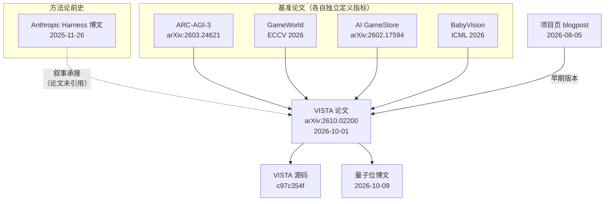

# VISTA 论文谱系与阅读地图

## 一、谱系全景

坐标登记见 [F-129]。

## 二、每份文献各自回答什么问题

| 文献 | 回答的问题 | 引用时的角色 |
|------|-----------|-------------|
| **VISTA 论文** arXiv:2610.02200 | 视觉原生 Harness 是什么、怎么工作、在四个基准上表现如何、边界在哪 | **一手事实基准**：机制与数字的最终依据 |
| **ARC-AGI-3 技术报告** arXiv:2603.24621 | 基准本身怎么定义：动作空间、观测格式、计分方法、公私集划分、官方对公开集成绩的立场 | **基准方口径**：RHAE 的定义与"公开集成绩不算 AGI 进展"的官方立场来自这里，不来自 VISTA 论文 |
| **GameWorld**（ECCV 2026） | 浏览器游戏任务的标准化评测怎么做（34 游戏 / 170 任务 / 5 类题材） | 基准定义；VISTA 只引用其口径 |
| **AI GameStore** arXiv:2602.17594 | 开放游戏库评测怎么做（人类中位数归一化 + 几何平均） | 基准定义；人类中位数来源 |
| **BabyVision**（ICML 2026） | 静态视觉推理怎么测（388 任务 / 22 子类） | 基准定义；VISTA 只评估其中 39 题 |
| **Anthropic harness 博文** 2025-11-26 | 文本/代码形态的 Harness 如何跨上下文窗口保存任务状态 | **第三方前史**；VISTA 论文并未引用它，博主的"脉络承接"是叙事而非引用 [F-071] |
| **项目页 blogpost** 2026-08-05 | 早期版本的结论与逐局成绩 | **差异对照源**：数字与论文系统性不同，一律以论文为准 [F-082] |
| **量子位博文** 2026-10-09 | 中文读者可读的科普转述 | **二手转述**：本束 F-001~F-044 的来源 |
| **VISTA 源码** c97c354f | 论文机制在工程上如何落地 | **一手实现**：F-086~F-140 的来源 |

## 三、可信度分层与"谁说了算"

| 问题 | 裁决来源 | 不采信的来源 |
|------|---------|-------------|
| "满分 100" 的分值与算法 | VISTA 论文 + ARC Prize 记分卡 [F-047][F-076] | 量子位博文的复述 |
| "100 分意味着什么" | ARC-AGI-3 技术报告的计分方法与官方立场 [F-073][F-084] | 任何媒体对"超越人类"的解读 |
| "机制怎么实现" | VISTA 源码固定 commit [F-086] | 论文叙述中的未定义细节 |
| "评测范围多大" | 各基准论文自身 | VISTA 论文的转述 |
| "Harness 概念的前史" | Anthropic 博文本身 | "VISTA 论文沿用了该思路"（论文未引） |

> **读法**：分层不是给文献排高低，而是回答"**这个具体问题该听谁的**"。同一个"VISTA 好不好"的问题，答案要由论文（机制）、基准方（分数含义）、源码（可落地性）三方共同给出。

## 四、论文结构地图（读论文时的导航）

| 章节 | 内容 | 对应本束 |
|------|------|---------|
| §1 引言 | 问题设定：显式注意力机制、长时程视觉 | [00 总览](../concepts/00-vista-overview.md) |
| §2 相关工作 | 文本网格 / 程序合成路线 | [00 总览](../concepts/00-vista-overview.md) |
| §3 方法 | §3.1 三组件；§3.2 Harness 与双笔记 | [01 三组件](../concepts/01-visual-harness-components.md)、[02 记忆与上下文](../concepts/02-memory-and-context.md) |
| §4 实验 | §4.1 模型；§4.2 主结果；§4.3 消融与成本；§4.4 定性分析 | [03 ARC-AGI-3](../concepts/03-arc-agi3-results.md)、[09 论文与源码映射](../concepts/09-paper-source-mapping.md) |
| §5 其他基准 | GameWorld / AI GameStore / BabyVision | [04 跨基准](../concepts/04-cross-benchmark-validation.md) |
| §6 局限 | 数据污染与私有集评估 | [05 局限与实践](../concepts/05-limitations-and-practice.md) |
| §7 结论 | 具身任务方向 | [05 局限与实践](../concepts/05-limitations-and-practice.md) |
| 附录 A | A.1 模型配置；A.2 消融细节；A.3 指标公式；A.4 算法 1；A.5 提示词；A.6 人类参考 | [09 论文与源码映射](../concepts/09-paper-source-mapping.md) |
| 附录 B | B.1 多次运行方差 | [03 ARC-AGI-3](../concepts/03-arc-agi3-results.md) |

## 五、论文 ↔ 源码 ↔ 附录的三方对照锚点

论文附录给出的算法与配置，在源码中都有对应落点；反之，源码里有若干论文未展开的细节。三方对照见 [09 论文与源码映射](../concepts/09-paper-source-mapping.md)，此处只列最关键的三条：

| 论文说法 | 源码落点 | 增量信息 |
|---------|---------|---------|
| 附录 A.4：算法 1 `inspect(question, views) -> images` | `core/tools.py:62` 的 JSON Schema | Schema 给出论文未写的**取值上限**（label 128 字符、question 1024 字符、views 16 项）[F-096][F-124] |
| §3.1：帧"按回合号与帧号索引" | `visuals/turn_%06d_frame_0<ext>` | 索引即**文件名约定**，落盘后 `chmod 0o400` 只读 [F-102] |
| §4.3 消融默认 200K 上下文 | `DEFAULT_MODEL_CONTEXT_WINDOW = 272000` | **论文与源码口径不同**，引用须注明来源 [F-127] |

## 六、阅读顺序建议

| 读者 | 建议顺序 |
|------|---------|
| 只想要结论 | [03 ARC-AGI-3](../concepts/03-arc-agi3-results.md) → [05 局限与实践](../concepts/05-limitations-and-practice.md) |
| 要理解机制 | [01 三组件](../concepts/01-visual-harness-components.md) → [02 记忆与上下文](../concepts/02-memory-and-context.md) → [07 工具实现](../concepts/07-tooling-and-memory-implementation.md) |
| 要落地 | [08 复现与运维](../concepts/08-reproduction-and-operations.md) → [examples](../examples/index.md) |
| 要评估可信度 | [verification 核验报告](verification.md) → 本文件 §三 → [05 局限与实践](../concepts/05-limitations-and-practice.md) |
| 要读源码 | [06 源码架构](../concepts/06-source-architecture.md) → [09 论文与源码映射](../concepts/09-paper-source-mapping.md) → [源码快照登记](source-code-map.md) |

## 七、关联

- 源码快照登记：[source-code-map.md](source-code-map.md)
- 事实登记：[article-source.md](article-source.md)
- 核验报告与勘误：[verification.md](verification.md)
- 知识地图：[knowledge-map.md](knowledge-map.md)
