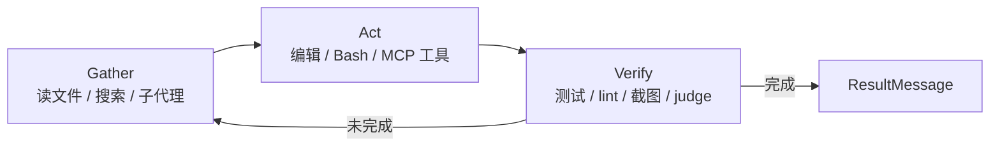

# 发布、更名与六项核心能力

## 1. 发布事实

Claude Agent SDK 于 **2025-09-29** 与 Claude Sonnet 4.5 同日提供（F-003、F-005）。它的前身是 Claude Code SDK；官方在同日工程文章中宣布更名（F-007）。Anthropic 的说法是：这套基础设施已经驱动 Claude Code 超过六个月，现在把同一套 agent loop、工具、权限、上下文管理与子代理能力开放给开发者（F-008、F-015）。

| 时间 | 事件 | 依据 |
|------|------|------|
| 2025-09-29 | Claude Sonnet 4.5 发布，Claude Agent SDK 同日提供 | F-003、F-005 |
| 2025-09-29 | 官方工程文章《Building agents with the Claude Agent SDK》发布 | F-006 |
| 同日 | Claude Code SDK 更名为 Claude Agent SDK | F-007 |
| 2026-09-26 | Stackademic 页面标注日期（与正文事件时点冲突，见 E-1） | F-004 |

> **源文日期异常**：页面写 2026-09-26，正文却把 2025-09-29 的发布当作近期事件，且未提 Sonnet 5.5 / Opus 5.5 等后续模型。判断为转载或日期标注异常，本包按 2025-09-29 的知识时点处理（E-1）。

### 1.1 发布时的模型与商业口径

| 项 | 文章口径 | 官方核验 |
|---|---|---|
| 模型推荐 | Anthropic 推荐所有 agent 用例使用 Sonnet 4.5（F-058） | 官方原文为推荐升级到 Sonnet 4.5 用于所有用途（F-061）；“all agent use cases”是转述收窄 |
| 价格 | Sonnet 4.5 是 Sonnet 4 的 drop-in replacement，$3/$15 per MTok（F-059） | 官方定价相同，$3/$15 per MTok（F-060） |
| Claude apps | 所有付费计划提供代码执行与文件创建（F-062） | 官方确认（F-063） |
| 开发者平台 | Agent SDK 对所有开发者可用（F-064） | 官方确认 Claude Developer Platform 更新对所有开发者可用（F-065） |

> 上述为 **2025-09-29 发布时口径**；2026-11-10 的模型阵容已变为 Sonnet 5.5 / Opus 5.5 / Haiku 5.5 + Fable 5.2（F-066），价格与可用性需按当期官方页复核（E-2）。

## 2. 它是什么，不是什么

| 判断 | 说明 | 依据 |
|------|------|------|
| 是 **agent harness 库** | 运行 Claude Code 二进制，把 agent loop、工具、权限、会话、hooks 暴露为 Python/TypeScript API | F-016、F-017 |
| 是 **Claude Code 的库化** | 与 CLI 共用同一套运行时，不是另起一套 agent 框架 | F-007、F-075 |
| 不是 **模型** | 模型仍需通过 `model` 指定；SDK 不附带模型能力 | F-038、F-066 |
| 不是 **托管服务** | agent 进程由开发者自己运营；托管形态是 Managed Agents，另一条产品线 | F-017、F-018 |
| 不是 **Claude API 客户端** | Client SDK 直接调 API、由你写工具循环；Agent SDK 自带工具循环与运行时 | F-018 |

## 3. 六项核心能力

文章列出六项能力（F-009~F-014），官方能力表进一步给出对应条目（F-015）。把“能力”翻译成“生产含义”如下：

| 能力 | 文章口径 | 生产含义 | 依据 |
|------|---------|---------|------|
| Agent loop | 处理多轮推理与工具调用 | 你只消费消息流，编排、工具执行、上下文管理、重试由 SDK 负责 | F-009、F-035 |
| 内置工具 | 文件操作、搜索、代码执行、Web 访问 | 开箱即有 `Read`/`Edit`/`Bash`/`Glob`/`Grep`/`WebSearch` 等工具，无需自己实现 | F-010、F-036 |
| 权限系统 | 平衡自主性与用户控制 | 可用 allow/deny 规则、权限模式、`canUseTool`、hooks 四层控制 | F-011、F-051 |
| 上下文管理 | 面向超出上下文窗口的长任务 | 会话、压缩（compact）与子代理隔离上下文共同支撑长任务 | F-012、F-015、F-082 |
| 子代理协调 | 把子任务委派给专用 agent | 并行研究与上下文隔离；子代理只回传相关结果 | F-013、F-015、F-083 |
| 记忆管理 | 跨扩展会话保留信息 | 通过 Sessions、Skills、Memory 与项目 `.claude/` 配置加载 | F-014、F-015 |

官方能力表还列出 Hooks、MCP、Plugins 等扩展点（F-015）。其中 Hooks 与权限的关系最容易误解，见 [02-permissions-and-hooks.md](02-permissions-and-hooks.md)。

## 4. Agent loop：gather → act → verify

官方工程文章把 agent 的循环概括为“收集上下文 → 采取行动 → 验证工作 → 重复”。SDK 的 `query()` 把这个循环封装为异步消息流：模型思考、发起工具调用、观察结果、决定下一步，直到任务完成或报错（F-035、F-045）。

这张图是理解后续所有配置的骨架：权限与 hooks 控制的是 **Act** 这一步；上下文管理与子代理影响的是 **Gather**；日志与测试影响的是 **Verify**。

## 5. 四种接入方式

官方 overview 用一张表区分四种接入方式（F-018）：

| 方式 | 谁运行 agent | 你得到什么 | 适用 |
|------|-------------|-----------|------|
| **Agent SDK** | 你的进程 | 运行 Claude Code 二进制的库，自带工具、权限、会话、hooks | 要把 agent 嵌进自有 Python/TS 应用 |
| **Claude Code CLI** | 你的终端 | 交互式终端界面 | 日常开发、一次性任务 |
| **Client SDK** | 你的代码 | 直接调 Claude API；工具循环由你写，或用 beta tool runner | 单轮、结构化输出、完全自控 |
| **Managed Agents** | Anthropic 托管 | 托管 agent harness，会话在 Anthropic 云沙箱或自托管沙箱 | 不想自己运营运行时 |

> **选型第一问**：agent 进程由谁运营？由你运营且需要多步工具调用 → Agent SDK；由 Anthropic 运营 → Managed Agents；只要单轮 API → Client SDK。

## 6. 适用边界

**适合**：代码审查、修 bug、研究任务、数据分析流水线，以及任何“agent 自己决定用哪些工具、按什么顺序用”的多步工作（F-073）。

**不适合**：单轮问答、严格结构化输出、需要逐步人工确认每一次调用的场景；这些用 raw Claude API 更直接（F-074）。

**硬边界**：

1. SDK 运行 Claude Code 二进制，部署环境需要能执行该二进制；pip 源码分发或跳过 npm optional dependencies 时可能不含二进制（F-026）。
2. 除非事先获批，第三方产品不得提供 claude.ai 登录或速率限制，应使用 API key（F-030）。
3. 从 Claude Code SDK 旧包迁移时，官方提供 migration guide（F-081）。

## 7. 一句话总结

Claude Agent SDK 的价值不在“又一个 agent 框架”，而在“把 Claude Code 已经跑通的运行时借给你”。理解了这一点，后面的安装、权限与生产加固都是在同一个运行时上做配置，而不是重新发明 agent 架构。
