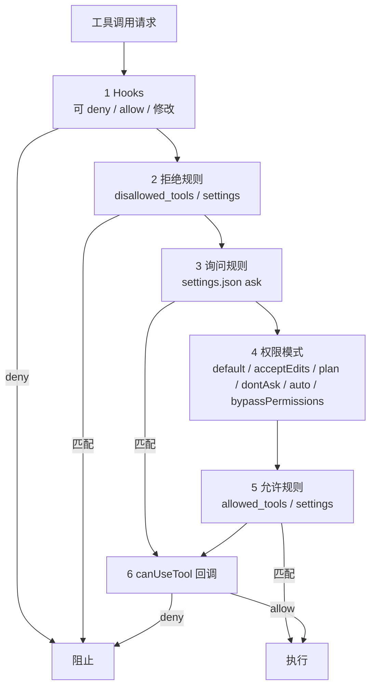

# 权限模型与 Hooks：四层护栏与一个盲区

## 1. 先纠正一个常见误解

`allowed_tools` **不是工具白名单**。官方语义是“自动批准清单”：列出的工具调用自动通过；未列出的工具仍然存在，需要批准时会继续走权限模式与 `canUseTool` 回调（F-053）。如果你要真正移除一个工具，使用 `disallowed_tools`（F-054）。

| 控制层 | 你写的配置 | 实际作用 | 依据 |
|---|---|---|---|
| 自动批准清单 | `allowed_tools=["Read","Grep"]` | 列出的调用自动通过；其他工具仍在 | F-053 |
| 拒绝规则 | `disallowed_tools=["Bash(rm *)"]` | 移除工具定义，或拒绝匹配调用 | F-054、F-080 |
| 权限模式 | `permission_mode="dontAsk"` | 决定“需要批准”的调用如何处置 | F-037、F-052 |
| 运行时回调 | `canUseTool` | 对前序步骤未决的调用做最终裁决 | F-051 |
| 生命周期 Hook | `PreToolUse` | 在工具执行前允许、拒绝或修改调用 | F-046、F-050 |

## 2. 六步评估链

官方权限文档给出的顺序是：Hooks → 拒绝规则 → 询问规则 → 权限模式 → 允许规则 → `canUseTool`（F-051）。



三个容易忽略的结论：

1. **Hook 的 allow 不跳过后续拒绝规则与询问规则**；拒绝规则在 `bypassPermissions` 下也生效（F-051）。
2. **被前序步骤自动批准的调用不会进入 `canUseTool`**；要审计这些调用，必须用 `PreToolUse`（F-055）。
3. **`PreToolUse` 的 deny 在 `bypassPermissions` 下同样生效**（F-056）。

## 3. 六种权限模式

| 模式 | 行为（官方口径） | 适用 | 风险 |
|---|---|---|---|
| `default` | 未匹配规则的调用按默认流程处理 | 日常开发 | 中 |
| `acceptEdits` | 批准其列出的文件操作（F-077） | 受控改代码 | 中 |
| `plan` | 规划模式（具体路由以官方 permissions 页为准） | 先看计划再执行 | 低 |
| `dontAsk` | 把每个会提示的调用转为拒绝（F-076） | 无人值守、只读批处理 | 低 |
| `auto` | 自动判定（具体行为以官方 permissions 页为准） | 有评测兜底的流水线 | 中 |
| `bypassPermissions` | 批准到达该步骤的调用，但“任何模式都不自动批准的动作”除外（F-078） | 一次性沙箱 | 高 |

> **`allowed_tools` 不约束 `bypassPermissions`**：在该模式下，未列出的工具调用仍会被批准（F-079）。如果你需要 `bypassPermissions` 但想挡住特定工具，必须用 `disallowed_tools`。

## 4. 规则怎么写

最小权限组合（官方推荐的 locked-down 形态，F-053、F-076）：

```python
options = ClaudeAgentOptions(
    allowed_tools=["Read", "Glob", "Grep"],
    permission_mode="dontAsk",
)
```

带作用域的拒绝规则（F-054、F-080）：

```python
options = ClaudeAgentOptions(
    allowed_tools=["Read", "Edit", "Bash"],
    disallowed_tools=["Bash(rm *)", "Bash(curl *)"],
    permission_mode="acceptEdits",
)
```

`disallowed_tools=["*"]` 会匹配所有工具；`mcp__<server>__*` 可匹配某个 MCP 服务器的全部工具（F-080）。作用域规则只拒绝匹配的调用，未匹配的调用继续走权限模式。

## 5. Hooks：在工具执行前拦截

文章把 hooks 描述为“在工具执行前拦截”的机制，PreToolUse 可以限制文件写入目录或阻止特定 bash 命令，并把 hooks 视为默认权限系统之外的生产护栏（F-046、F-047、F-048）。官方 hooks 文档列出五类用途：阻止危险操作、记录与审计、转换输入输出、要求人工批准、跟踪会话生命周期（F-050）。

下面示例改写自官方 PyPI README（F-049），用于阻止包含 `foo.sh` 的 Bash 命令。**未在本库环境实测**：

```python
from claude_agent_sdk import ClaudeAgentOptions, ClaudeSDKClient, HookMatcher

async def block_foo(input_data, tool_use_id, context):
    if input_data["tool_name"] != "Bash":
        return {}
    command = input_data["tool_input"].get("command", "")
    if "foo.sh" in command:
        return {
            "hookSpecificOutput": {
                "hookEventName": "PreToolUse",
                "permissionDecision": "deny",
                "permissionDecisionReason": "blocked pattern: foo.sh",
            }
        }
    return {}

options = ClaudeAgentOptions(
    allowed_tools=["Bash"],
    hooks={
        "PreToolUse": [
            HookMatcher(matcher="Bash", hooks=[block_foo]),
        ],
    },
)
```

## 6. 审计盲区：自动批准的调用

这是生产落地最容易漏的一条：**自动批准的调用不会进入 `canUseTool`**（F-055）。如果你的审计逻辑写在 `canUseTool`，那么 `allowed_tools` 里的高频工具、`acceptEdits` 批准的文件操作、`bypassPermissions` 放行的调用都可能被漏记。

正确做法：

1. 审计与硬阻断放在 `PreToolUse`，它对自动批准的调用同样运行（F-055）。
2. `PreToolUse` 的 deny 在 `bypassPermissions` 下也生效（F-056）。
3. 记录 `tool_name`、`tool_input`、`permissionDecision`、`session_id`、时间戳，形成可回放的工具调用账本。

## 7. Hook 的第二个盲区：matcher

官方 hooks 文档明确提示：`Write|Edit` matcher 不会在 Claude 通过 **Bash** 写入文件时触发；要覆盖这类写入，需要配合沙箱配置（F-057）。

这意味着：

- 只挡 `Write|Edit` 挡不住 `echo ... > .env`。
- 只挡 `Bash(rm *)` 挡不住 `python -c "import shutil; shutil.rmtree(...)"`。
- Hook 是“已知模式”的护栏，不是完整沙箱；真正的隔离要靠容器/用户/文件系统权限。

## 8. 护栏设计清单

1. 默认 `allowed_tools` 只放只读工具（`Read`、`Glob`、`Grep`）（F-085）。
2. 用 `disallowed_tools` 明确挡住 `Bash(rm *)`、`Bash(curl *)` 等高风险模式（F-054）。
3. 无人值守场景用 `dontAsk`，把提示转为拒绝（F-076）。
4. 所有审计与硬阻断放 `PreToolUse`，不要只依赖 `canUseTool`（F-055）。
5. 对 `Write|Edit` 与 `Bash` 分别设规则，并假设两者都可能写文件（F-057）。
6. 在沙箱内才开 `Bash`；`bypassPermissions` 只用于一次性、无凭据的环境（F-078、F-079）。
7. 每次扩权前跑一遍权限边界测试（见 [03-production-hardening.md](03-production-hardening.md)）。
