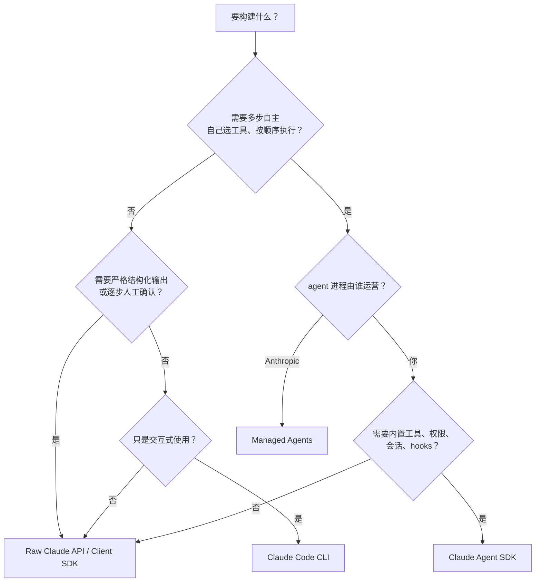

# SDK、Raw API、CLI 与 Managed Agents：怎么选、怎么上

## 1. 四种接入方式

官方 overview 用“谁运行 agent、内置什么、怎么接入”三个维度区分四种方式（F-018）：

| 维度 | Agent SDK | Claude Code CLI | Client SDK | Managed Agents |
|---|---|---|---|---|
| 谁运行 agent | 你的进程 | 你的终端 | 你的代码 | Anthropic 托管 |
| 内置 agent loop | ✅ | ✅ | ❌（你写工具循环） | ✅ |
| 内置工具/权限/会话 | ✅ | ✅ | ❌ | ✅ |
| 接入方式 | Python/TS 库 | 命令行 | Claude API 客户端 | SDK / `ant` CLI / REST |
| 适合 | 嵌入自有应用的多步 agent | 交互式开发、一次性任务 | 单轮、结构化输出、完全自控 | 不想运营运行时 |

> 第四种方式是官方文档的补充，不在博文原文中；文章只对比了 Agent SDK 与 raw API（F-073、F-074）。

## 2. 决策树

## 3. SDK vs raw API

| 维度 | Agent SDK | Raw Claude API |
|---|---|---|
| 工具循环 | SDK 内置，自动执行工具、观察结果、继续推理（F-035、F-084） | 你实现循环、工具调用与结果回填 |
| 控制粒度 | 通过配置、权限、hooks 控制（F-051） | 每一步由你的代码决定 |
| 适用任务 | 代码审查、修 bug、研究、数据分析流水线（F-073） | 单轮响应、结构化输出、逐步严格控制（F-074） |
| 运维面 | 需要运行 Claude Code 二进制、管版本、管权限（F-017、F-026） | 只需管 API 调用 |
| 安全面 | 工具执行带来文件/命令/网络权限，需要沙箱与 hooks（F-068） | 工具由你实现，攻击面取决于你的代码 |
| 成本可预测性 | 多轮工具调用，token 与时长波动更大 | 单轮或固定轮次，较易估算 |
| 退出成本 | 依赖 SDK 的运行时与配置语义 | 低，纯 API 调用 |

**一句话**：需要“agent 自己决定怎么干” → SDK；需要“每一步我说了算” → raw API。

## 4. 分阶段采用路径

| 阶段 | 目标 | 配置 | 退出条件 |
|---|---|---|---|
| 0. 评估 | 验证 SDK 能否完成目标任务 | 官方 quickstart，只读工具，沙箱 | 任务成功率可接受 |
| 1. 内部只读 | 在真实代码库上做审查/问答 | L0 工具、`dontAsk`、审计日志 | 无越权、输出可审 |
| 2. 沙箱改文件 | 受控修复、文档更新 | L1 工具、`acceptEdits`、容器 | 回归测试通过 |
| 3. 沙箱命令 | 测试、构建、格式化 | L2 工具、作用域 `Bash`、无生产凭据 | 边界测试 8 项通过 |
| 4. 有限生产 | 接入内部系统 | 白名单 MCP、人工审批、kill switch | 事故演练通过 |

每个阶段都保留上一阶段的权限配置作为回退；不要跳过阶段 1 直接开 `Bash`。

## 5. 六类反模式

| # | 反模式 | 后果 | 正确做法 |
|---|---|---|---|
| 1 | 单轮任务也上 SDK | 多一层运行时与权限面，收益低 | 单轮/结构化用 raw API（F-074） |
| 2 | 把 `allowed_tools` 当白名单 | 未列出的工具仍可被调用（F-053） | 用 `disallowed_tools` 移除/拒绝 |
| 3 | 用 `bypassPermissions` 图省事 | 未列出的工具也会被批准（F-079） | 沙箱 + `dontAsk` + 作用域规则 |
| 4 | 只审 `canUseTool` | 自动批准的调用漏记（F-055） | 审计放 `PreToolUse` |
| 5 | 不开沙箱就开 `Bash` | 命令可读写宿主机、访问网络（F-057） | 容器/VM + 非 root + 网络白名单 |
| 6 | 用 `latest` 模型别名上线 | 模型行为随别名漂移（F-066） | 锁定完整模型 ID |

## 6. 采用检查表

1. 任务是否真的需要多步自主？否 → raw API。
2. agent 进程由谁运营？Anthropic → Managed Agents；你 → SDK。
3. 是否能在沙箱中运行？否 → 先解决隔离，再谈上线。
4. 是否接受 SDK 的运行时依赖与版本升级成本？否 → raw API。
5. 是否有审计与 kill switch？否 → 不上生产。
6. 是否有人负责模型/权限/依赖的持续更新？否 → 先定 Owner。

## 7. 结论

Claude Agent SDK 的定位是“把 Claude Code 的运行时借给自有应用”（F-075）。它适合多步、工具密集、需要内置权限与会话的 agent；不适合单轮、强结构化、每一步都要人工控制的场景。选型不是“先上 SDK 再说”，而是先回答“谁运营、要不要工具循环、能不能隔离”三个问题，再决定用哪一层。
