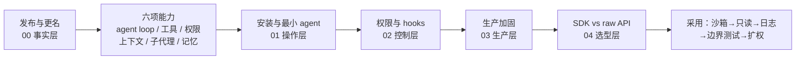

# Claude Agent SDK 生产级智能体构建指南

> **类型**：技术综述/快速上手解读（**非操作教程，无 examples/**）。信源为 Stackademic 博文（页面标注 2026-09-26，正文事件时点 2025-09-29）；SDK 事实已回到 Anthropic 官方新闻、官方工程文章与 Agent SDK 文档核验。本包共登记 87 条事实（F-001 至 F-087），11 个 P0 集群 ✅8 / ⚠️3 / ❌0。

> **一句话**：Claude Agent SDK 不是新模型，而是把驱动 Claude Code 的 agent loop、内置工具、权限、上下文管理、子代理与 hooks 做成 Python/TypeScript 库，让开发者在自己的进程里跑生产级 agent。

## 阅读须知（已知边界）

1. **日期异常（E-1）**：页面标注 2026-09-26，但正文把 2025-09-29 的发布当作近期事件，且未提此后模型迭代。本包按 **2025-09-29 知识时点**呈现文章原口径，页面日期仅作为源文元信息保留。
2. **模型建议过期（E-2）**：文章建议 `claude-sonnet-4-5` 作为“最新模型”；截至 2026-11-10，官方 `sonnet` 别名已解析为 Sonnet 5.5，`opus` 为 Opus 5.5，`haiku` 为 Haiku 5.5，Fable 5.2 为单独可选模型。实际选型请看 [claude-model-selection](../claude-model-selection/index.md)。
3. **代码未实测**：安装命令与最小 agent 代码来自博文与官方 quickstart 片段，本库环境未执行，不能视为“实测通过”。
4. **Darktrace 单源（E-4）**：文章“agents hacking their own test environments”的 Darktrace 研究在核验环境未能独立定位，标“仅博文单源”，不作为硬事实使用。
5. **版本快照**：npm `@anthropic-ai/claude-agent-sdk` 0.3.322（Node ≥18.14.0）、PyPI `claude-agent-sdk` 0.2.180（Python 3.10–3.13，Alpha）为 2026-11-10 查询值；版本迭代快，落地前请复核。
6. **认证边界**：官方文档明确，除非事先获批，第三方开发者不得在其产品中提供 claude.ai 登录或速率限制，应使用 API key 认证（F-030）。

## 本文概要

文章分四段展开：先交代 SDK 与 Sonnet 4.5 同日发布、它继承 Claude Code 的哪些能力；再给 TypeScript/Python 安装与一个最小 `query()` agent；随后列 7 项配置与 PreToolUse hooks；最后给生产建议与“何时用 SDK、何时用 raw API”的边界。本知识包在保留文章骨架的同时，补入官方文档的权限评估链、hooks 盲区、认证限制与当前版本快照，使“能跑”与“能上生产”分开呈现。

## 知识地图



## 文档结构

### concepts/ — 概念文档

| 文档 | 主题 | 适合读者 |
|------|------|---------|
| [00-release-and-capabilities.md](concepts/00-release-and-capabilities.md) | 发布日、Claude Code SDK 更名、六项能力、四种接入方式与 agent loop | 第一次接触 SDK 的开发者、技术选型者 |
| [01-quickstart-and-configuration.md](concepts/01-quickstart-and-configuration.md) | npm/pip 安装、API key、最小 agent、7 项配置、版本与打包边界 | 准备写第一个 agent 的工程师 |
| [02-permissions-and-hooks.md](concepts/02-permissions-and-hooks.md) | 权限模式、allow/deny 规则、六步评估链、PreToolUse 示例与审计盲区 | 需要设护栏的平台/安全工程师 |
| [03-production-hardening.md](concepts/03-production-hardening.md) | 沙箱、日志、最小权限、权限边界测试、版本锁定、五条上线纪律 | 负责上线的 Tech Lead / SRE |
| [04-sdk-vs-raw-api-and-adoption.md](concepts/04-sdk-vs-raw-api-and-adoption.md) | SDK / raw API / CLI / Managed Agents 四选一、决策树、分阶段采用路径 | 架构师、产品技术负责人 |

### references/ — 信源登记

| 文档 | 说明 |
|------|------|
| [article-source.md](references/article-source.md) | 博文事实清单 F-001 至 F-087（与 spec `facts.md` 双份一致） |
| [verification.md](references/verification.md) | P0 核验报告：11 个集群 ✅8 / ⚠️3 / ❌0、勘误 E-1~E-4、核验边界 |

## 五条生产纪律（速查）

1. **先沙箱，后接生产**：agent 在隔离环境运行，默认不接触生产系统（F-068）。
2. **默认只读，按证据扩权**：从 `Read`/`Glob`/`Grep` 起步，验证行为后再加 `Edit`/`Bash`（F-071）。
3. **日志即审计**：持久化 SDK 消息流；需要覆盖被自动批准的调用时，用 `PreToolUse` hook（F-070、F-055）。
4. **主动打边界**：把“诱导 agent 越权”当成常规测试项，失败就收紧 hooks/权限（F-072）。
5. **版本与模型写死**：生产锁定 SDK 版本与模型 ID，不依赖“latest”语义（F-027、F-028、F-066）。

> **最容易踩的坑**：把 `allowed_tools` 当成“工具白名单”。官方语义是“自动批准清单”——未列出的工具仍然存在，需要批准时会继续走权限模式与 `canUseTool`；要真正移除工具，用 `disallowed_tools`（F-053、F-054）。

## 术语速查

| 术语 | 含义 | 依据 |
|---|---|---|
| Agent loop | 多轮推理 + 工具调用 + 观察结果 + 继续决策的循环 | F-009、F-035 |
| Agent SDK | 运行 Claude Code 二进制、自带工具/权限/会话的库 | F-016、F-017 |
| Hook | 生命周期回调；`PreToolUse` 可在工具执行前允许/拒绝/修改 | F-046、F-050 |
| Permission mode | 决定“需要批准”的调用如何处置的模式 | F-037、F-052 |
| `allowed_tools` | 自动批准清单，不是工具白名单 | F-053 |
| `disallowed_tools` | 移除工具定义或拒绝匹配调用 | F-054 |
| MCP | Model Context Protocol，用于接入外部工具与数据源 | F-042 |
| Subagent | 使用隔离上下文、只回传相关结果的子代理 | F-083 |
| Compact | 上下文接近上限时自动总结先前消息 | F-082 |
| Raw API | 直接调 Claude API，工具循环由调用方实现 | F-018 |

## 主题关联

- [anthropic/python-sdk](../../ecosystems/anthropic/python-sdk/index.md)：Anthropic 官方 Python SDK 源码教程——本包讲 Agent SDK 运行时，二者是“客户端 SDK vs agent harness”的分工。
- [anthropic/claude-code](../../ecosystems/anthropic/claude-code/index.md)：Claude Code CLI 与插件体系——Agent SDK 的同一套运行时来源。
- [anthropic/cookbooks](../../ecosystems/anthropic/cookbooks/index.md)：官方 Agent SDK / Tool Use 食谱，可与本包的最小 agent 对照。
- [claude-model-selection](../claude-model-selection/index.md)：当前模型阵容与选型矩阵——修正本包文章中的 Sonnet 4.5 时效建议。
- [codex-agent-workflow-practices](../codex-agent-workflow-practices/index.md)：另一条 agent 工作流实践线，可对照“并行/大闭环/降本”策略。
- [ai-engineering-methodology](../ai-engineering-methodology/index.md)：Harness 工程、提示词工程与评测方法论。
- [microsoft-mxc-agent-containment](../microsoft-mxc-agent-containment/index.md)：Windows 上的 agent 执行隔离，可与本包“沙箱”一节互参。

```{toctree}
:hidden:
:maxdepth: 2

concepts/index
references/index
log
```
