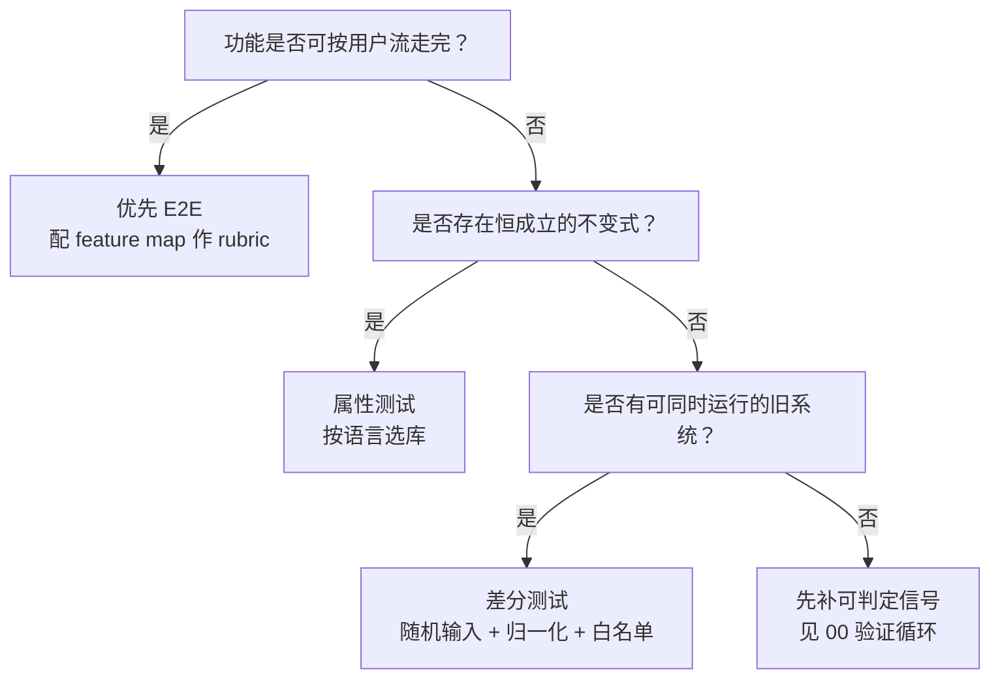

# 三类测试与前置失败模式

## 先排除失败模式，再选测试类型

原文在列测试类型之前先给了三条反面前置条件（F-010—F-012），这个顺序本身就是判据：

| 失败模式 | 对 Agent 行为的实际影响 | 处置 |
|---|---|---|
| 测试 flaky | 训练 Agent **重跑测试**而不是修失败的代码 | 先治抖，再谈覆盖 |
| 测试太慢 | Agent 跨批次少跑测试，问题难以定位 | 把慢测试移出高频循环 |
| 测试很重 | 适合在改动提交**之前**部署，而非每轮都跑 | 分层放置 |

这与 [验证循环四要素](00-verification-loops.md) 呼应：一个会随机失败的信号不是信号，是噪声源。

## 三类测试判据

作者认为最值得投资的是三类（F-013）；若只能选一类，选 E2E（F-014）。

### E2E：难糊弄 + 有确定完成判据

E2E 描述真实用户流，如「加商品到购物车 → 结账 → 到确认页」（F-014）。它有效有两个独立理由：要么整个功能可用、要么不可用，难以被局部通过糊弄；同时它有确定的 done 判据，能**具体指出坏在哪里**（F-015）。原文的图 A 把差别说得很直白：单测可能只报 `Error: Timeout after 30 seconds`，E2E 能给出截图和「哪里坏了」的描述（F-016）。

单测更快更稳，但可能全绿而功能已坏——因为写代码的 Agent 和写测试的都没有理解完整任务（F-017）。落地要点是给 Agent 在真实运行系统上的「手和眼」：用 CDP、模拟器或 API harness 让 skill 启动、驱动、检查应用（F-018）；**feature map** 则从用户视角列出功能、路径、快捷键、选择器与预期结果，兼作向导与评分 rubric（F-019）。

### 属性测试：用不带同源偏置的边界让 Agent 保持诚实

做法是写一条「不可能失败」的陈述，再用库生成数千个输入试图证伪（F-021）。工具按语言分：JS/TS 用 fast-check，Python 用 Hypothesis，Rust 用 proptest（F-022）。四类常见属性（F-023—F-026）：

| 属性 | 陈述形式 | 典型场景 |
|---|---|---|
| Round-trip encoding | 编码 X 再解码，仍得 X | 解析、序列化 |
| Invariants | 恒成立，如「账户余额永不为负」 | 状态机、账目 |
| Idempotency | 做两次等同做一次 | 迁移、归一化、重试 |
| Equivalence | 优化版与朴素正确版结果相同 | 性能优化、重写 |

真正的方法论要点在 F-027：这些边界输入**不带着生成原代码的同一套偏置**，所以能抓到 Agent 自己想不到的边角。也因此，属性测试在重写场景特别有用——当规格已从生产行为漂移、不再是可靠验证源时，属性仍可充当锚（F-028）。

### 差分测试：旧系统就是 oracle

适用于大规模迁移且功能预期不变的场景（F-029）：同一输入分别喂给旧系统与新系统，结果不同即是 bug 或 breaking change（F-030）。三个落地要件（F-031、F-032）：随机生成输入或采样生产流量；归一化空白等无关因素；维护一份 **approved changes** 清单，登记新环境「应当」与旧环境不同的情形。缺了第三项，合法的预期差异会被当成回归，噪声很快淹没信号。

## 选型决策树

## 可迁移模式与反模式

- **触发场景**：为 Agent 产出挑验证物；或重写/迁移时需要一个不受规格漂移影响的判据。
- **核心步骤**：先治 flaky/慢/重 → 按上表选类型 → 给 E2E 配真实运行入口与 feature map → 给差分配归一化与白名单。
- **反模式**：只堆单测数量；用与生成代码同源的示例当边界；差分测试不设 approved changes；把重测试放进每轮高频循环。
- **迁移验证**：换语言/框架时，只要仍保留「难糊弄的真用户流」「不带同源偏置的边界」「旧系统作 oracle」三者之一，模式成立。

> 事实编号与来源层级见 [博文事实清单](../references/article-source.md)；本页涉及 F-010—F-032。
