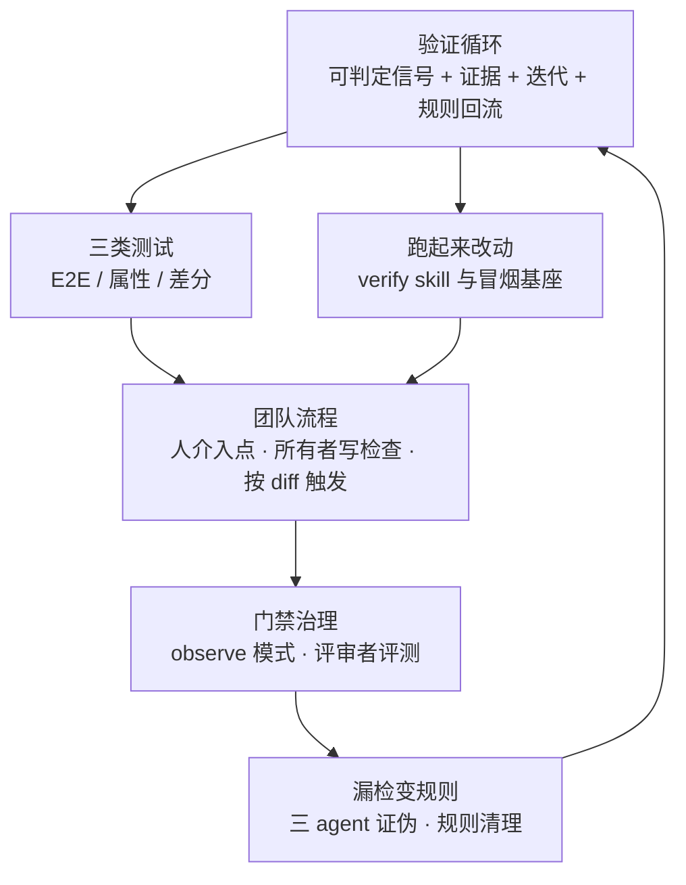

# Claude Code 团队的验证方法论：让 Coding Agent 用证据自证

> **内容性质**：技术方法论教程。`route: chaptered-summary`——深度摘要加原创改写，**不是逐字转录**；原文段落顺序被重组为「为什么验证 → 用什么测 → 怎么落地 → 怎么管住验证器」四层，并补入官方文档交叉核验。全包登记 **71 条事实（F-001 至 F-071）**，见 [博文事实清单](references/article-source.md)；口径边界与勘误见 [核验报告](references/verification.md)。

> **一句话结论**：验证不是给 Agent 多加一道检查，而是把「什么叫做完」从人的脑子里搬进可重复运行的软件里。搬完之后，人的工作从读每一个 diff 变成定义完成条件、审阅证据（F-070、F-071）。

## 为什么值得单独立一束

原文的前提相当极端：Claude Code 团队约 **90% 的代码由 Claude 编写并评审**（F-003）。在这个比例下，「人逐行看」不再是质量保障手段，而是吞吐量瓶颈。作者的判断是：**验证循环是委派规模化的基石**——没有它，一个人只能同时盯一两个 Claude；有了它，可以并行跑几十到几百个（F-004）。

更关键的是成本结构变了。测试、基准、规格、真实端到端运行过去昂贵，现在可以由 Agent 快速生成；生成之后它们作为软件运行，反复执行几乎不再消耗 token（F-006、F-007）。于是「让 Agent 自己证明工作完成」第一次变得比「让人复查」便宜。

这束与 [AI 工程方法论](../ai-engineering-methodology/index.md) 的差别在于：那一束讲方法论谱系，这一束只讲**一条可落地的验证链路**，从测试类型一路到「谁有权修改检查规则」的治理问题。

## 知识地图



## 核心结论速览

| # | 结论 | 依据 |
|---|---|---|
| 1 | 先给 Agent 一个能读的通过/失败信号，再谈并行规模 | F-004、F-007 |
| 2 | 只能选一类测试就选 E2E：难糊弄、有确定的完成判据 | F-014、F-015 |
| 3 | 属性测试的价值在于「边界输入不带生成代码的同源偏置」 | F-020、F-027 |
| 4 | 检查必须放在被判改动够不着的分支，否则检查已坏 | F-048、F-049 |
| 5 | 新门禁先跑 observe，评审者本身也要按漏掉过的 bug 评分 | F-053—F-058 |

## 阅读路径

```{toctree}
:hidden:
:maxdepth: 2

concepts/index
examples/index
references/index
log
```

1. [验证循环与委派规模化](concepts/00-verification-loops.md)：先建立「为什么」的模型。
2. [三类测试与前置失败模式](concepts/01-three-test-types.md)：E2E、属性、差分各自的判据与选型。
3. [验证就是跑起来改动](concepts/02-run-the-change.md)：`verify` skill 与冒烟基座的工程做法。
4. [团队验证流水线](concepts/03-team-pipeline.md)：人在哪里介入、39 项清单如何按 diff 触发。
5. [门禁治理与评审者评测](concepts/04-gate-governance.md)：observe 三态、召回率分层与标签口径。
6. [把漏检变成规则](concepts/05-misses-into-rules.md)：两条规则化路径、flaky 处置与规则清理。
7. [搭建 verify skill](examples/00-verify-skill-blueprint.md) 与 [observe 模式门禁落地](examples/01-observe-mode-gate.md)：两篇可照做的实践。
8. [博文事实清单](references/article-source.md) 与 [核验报告](references/verification.md)：查编号、查口径。

## 已知边界

- **单一主源**：全包以 2026-11-16 的 claude.dev 博文为主源；原站正文为动态渲染，首轮抓取只返回头部，缺失段落由全文转载镜像补齐，两处文本逐段比对一致（见 [E-0](references/verification.md)）。
- **内部数据未独立复算**：约 90% 代码占比、结构化文件生成「最多提升 10 个百分点」、39 项清单、三轮失败阈值等均为团队自述，不代表行业基线（F-003、F-005、F-039、F-042）。
- **官方口径与博文有差异**：`REVIEW.md` 从 base 分支读取在官方文档中带分支保护前提；`/goal` 评估器不独立执行命令；Code Review 服务与本地 `/code-review` 读不同文件。三处均已在核验报告列为 E-1 至 E-3，正文按「博文主张 + 官方文档补充」并列呈现。
- **两篇实践未实测**：examples 是按原文与官方文档整理的可复现配方，本库环境未执行，不作为「已验证通过」使用。
- **时效**：工具链与文档迭代快，`stale_after` 设为 2027-05-17；落地前请复核官方文档。

## 主题关联

- [Claude 模型选型](../claude-model-selection/index.md)：同属 claude.dev 博文转化束，可对照「先让 Agent 能自验、再考虑升级模型」的同一思路。
- [AI 工程方法论](../ai-engineering-methodology/index.md)：Harness 工程与对抗审查的上位框架。
- [ub-mode 编码纪律](../ub-mode-coding-discipline/index.md)：把编码纪律压成可打分检查的另一条路线，可与本束「可判定信号」互参。
- [通用 Agent 的 Coding Harness](../coding-harness-general-purpose-agents/index.md)：运行时与沙箱边界，是本束验证链路的执行环境。
- [anthropic/claude-code](../../ecosystems/anthropic/claude-code/index.md)：Claude Code CLI 与插件体系，本束 `verify` skill 的宿主。
