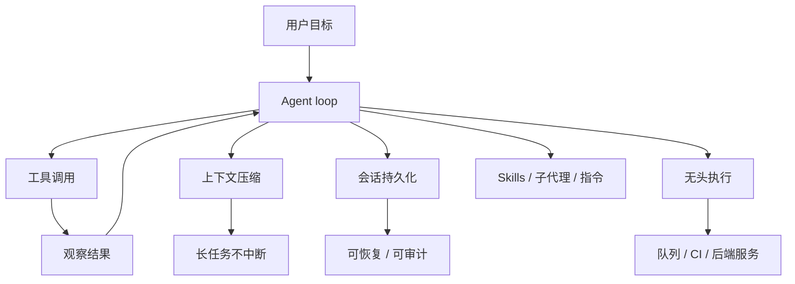

# 运行时替你做了什么：循环、压缩、会话与无头执行

> 文章把 harness 的价值压缩成一句话：长任务上下文压缩、会话持久化、无头运行，以及复用交互式编码会话里的 skills、子代理与指令（F-011～F-013）。这句话背后是四类很具体的工程问题。

## 1. 总览：四层能力

这四层不是并列的功能点，而是互相支撑的。

1. 没有压缩，长任务会撞上下文窗口。
2. 没有会话持久化，压缩后的状态无法恢复。
3. 没有无头执行，运行时只能待在人的终端里。
4. 没有 skills 与指令，运行时无法携带领域知识。

## 2. Agent loop：最容易被低估的部分

一个看起来简单的 loop，实际要处理很多边界。

1. 模型返回工具调用时，如何执行、如何把结果塞回上下文。
2. 工具失败、超时、权限被拒时，如何重试或改道。
3. 模型陷入循环时，如何止损。
4. 一轮结束后，如何判断“任务完成”而不是“模型不想干了”。
5. 多个子代理并行时，如何汇总与冲突消解。

Claude Agent SDK 的官方描述是“same tools, agent loop, and context management that power Claude Code”（F-037）。这句话的含金量在于：loop 不是 demo 级，而是每天被真实编码任务使用的实现。

采用时不要只看“有没有 loop”，要问：

1. 工具失败会不会自动重试？重试上限是多少？
2. 权限被拒时，模型能否看到拒绝原因并改道？
3. 子代理失败会不会拖垮主会话？
4. 有没有最大轮数、最大 token、最大时长之类的熔断？

## 3. 上下文压缩：长任务的生命线

长任务的上下文会同时被三类内容挤占。

1. 系统提示与工具定义，每轮都在（F-024）。
2. 历史对话与工具输出，越滚越大。
3. 技能、指令、检索结果，按需注入。

Harness 的压缩策略通常包括：摘要旧对话、丢弃低价值工具输出、保留关键决策与文件状态、在压缩后重建最小可继续上下文（F-011）。Pi 的 SDK 文档把 compaction state 列为会话持有的状态之一（F-042），说明压缩不是一次性操作，而是会话生命周期的一部分。

采用时要核对。

1. 压缩触发条件是什么？按 token 比例、轮数，还是手动？
2. 压缩后会不会丢掉工具调用的中间结果？
3. 压缩本身是否可观测？有没有日志或事件？
4. 压缩失败时，任务会不会静默降质？

## 4. 会话持久化：从“一次运行”到“一个任务”

没有持久化，agent 只是一次函数调用；有了持久化，agent 才像一个可管理的任务。

四家的实现方式不同，但都指向同一组能力。

| 能力 | Claude Agent SDK | Codex SDK | OpenCode | Pi |
|---|---|---|---|---|
| 持久化 | sessions，可恢复/分叉（F-038） | `~/.codex/sessions`，`resumeThread()`（F-039） | session API（F-041） | `SessionManager`，文件或内存（F-042） |
| 继续对话 | 支持（F-038） | 同一 `Thread` 多次 `run()`（F-039） | session prompt（F-041） | 同一 session 多次 `prompt()`（F-042） |
| 分叉/分支 | 支持（F-038） | 新线程（F-039） | 子会话（F-041） | 分支切换（F-042） |
| 审计 | 会话记录落盘（F-045） | JSONL 事件（F-039） | server 事件流（F-041） | JSONL / 事件订阅（F-042） |

采用时要核对。

1. 会话存储在哪里？本地磁盘、数据库，还是对象存储？
2. 多实例部署时，会话能不能跨节点恢复？
3. 会话里有没有敏感数据？是否需要加密或脱敏？
4. 删除、归档、保留期谁负责？

## 5. 无头执行：从终端走向生产

“无头”不是“没有界面”这么简单，它意味着运行时可以被别的系统驱动。

四家的无头入口。

1. Claude：CLI 的 `-p` 与 JSON 输出，或 SDK 子进程（F-045）。
2. Codex：SDK 包装 CLI；app-server 提供 JSON-RPC（F-039、F-040）。
3. OpenCode：`opencode serve` 无头 HTTP server（F-041）。
4. Pi：print、JSON、RPC 三种非交互模式（F-042）。

采用时要核对。

1. 退出码是否可靠？失败和“模型拒绝”能否区分？
2. 输出是最终文本，还是结构化事件流？
3. 能否中途取消、暂停、恢复？
4. 日志、指标、追踪是否够用？

## 6. Skills、子代理与指令：把领域知识带进去

文章特别强调“复用交互式编码会话中的 agent skills、子代理与指令”（F-013）。这三样东西决定了 harness 能不能从“通用 loop”变成“你的 loop”。

1. **Skills**：把操作手册、脚本、资源打包，按描述按需加载，降低 token 消耗（F-036）。
2. **子代理**：把检索、审阅、批处理拆到独立上下文，主会话只保留结论（F-013）。
3. **指令文件**：`CLAUDE.md`、`AGENTS.md` 一类的项目约定，让 agent 遵守团队规则（F-013）。

采用时要核对。

1. 现有 skills 能否直接复用？格式是否兼容？
2. 子代理的上下文是否隔离？失败是否可恢复？
3. 指令文件的优先级、覆盖规则是什么？
4. 技能与指令的版本如何管理？

## 7. 一张采用核对表

| 能力 | 最低要求 | 加分项 |
|---|---|---|
| Agent loop | 工具失败可重试、有熔断 | 子代理编排、动态工具选择 |
| 上下文压缩 | 自动触发、压缩后可继续 | 压缩可观测、可手动干预 |
| 会话持久化 | 跨请求恢复 | 跨节点、分叉、审计导出 |
| 无头执行 | 可靠退出码、结构化输出 | 取消/暂停/恢复、追踪 |
| Skills | 按需加载、版本可管理 | 市场分发、权限控制 |
| 子代理 | 上下文隔离 | 并行、结果汇总、失败隔离 |
| 指令 | 项目级覆盖 | 组织级分层、冲突检测 |

## 8. 小结

Harness 替你做的，不是“调用模型”，而是把 agent 从一次函数调用变成可运行、可恢复、可观测的任务系统。采用时不要被“支持 skills”“支持子代理”这样的功能名迷惑，要逐项核对：失败怎么办、状态存哪里、怎么取消、怎么审计。

这些能力越完整，运行时越重；越轻，越需要自己补。下一篇看四家在护栏与扩展性上的差异，以及这些差异如何影响选型。
