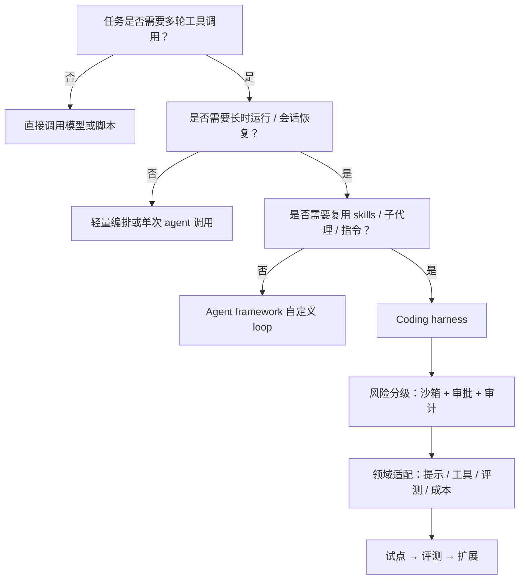

# 采用路径：从试点到生产治理

> 文章给出的不是“立刻全量替换”，而是一种技术选择：当任务是工具密集、长时运行、需要会话与技能时，复用成熟编码运行时（F-006）。采用路径要解决的是“怎么试、怎么评、怎么管”。

## 1. 先做一次决策

这张图不能替你决策，但能快速排除明显不适用的场景。

## 2. 五步采用路径

### 第一步：定义任务 loop 与风险边界

不要从“选哪个 SDK”开始，从任务开始。

1. 任务输入是什么？结构化数据、文档、工单，还是自然语言目标？
2. 任务需要哪些工具？读文件、查数据库、调 API、发消息、改配置？
3. 一次任务大概几轮？几分钟？是否需要跨请求恢复？
4. 失败后果是什么？可回滚，还是不可逆？
5. 哪些动作必须人工审批？

输出一张“任务—工具—风险”表，作为后续选型依据。

### 第二步：按五个轴选 harness

| 轴 | 问题 | 权重建议 |
|---|---|---|
| 进程边界 | 库、子进程、HTTP，还是 JSON-RPC？ | 高 |
| 语言生态 | 团队主力语言是否被支持？ | 高 |
| 会话能力 | 是否需要恢复、分叉、审计？ | 高 |
| 护栏 | 沙箱、审批、权限在哪一层？ | 高 |
| 扩展性 | 技能、工具、子代理能否按需接入？ | 中 |
| 成本 | 内置提示与 loop 开销是否可接受？ | 中 |
| 社区/维护 | 文档、版本节奏、问题响应 | 中 |

四家入口的差异见 [四个编程入口](01-four-programmatic-surfaces.md)，护栏差异见 [护栏与能力差异](03-guardrails-and-capability-differences.md)。

### 第三步：加领域适配层

不要在 harness 内核里改，优先在外面包一层。

1. **领域提示**：说明任务性质、禁止行为、输出格式（F-021）。
2. **工具白名单**：只暴露必要工具，业务能力用 MCP/自定义工具。
3. **输出契约**：JSON schema、字段校验、失败重试。
4. **技能包**：把操作手册、脚本、样例打包成 skills（F-036）。
5. **评测集**：正常、边界、对抗、失败、成本五类样本。
6. **成本预算**：token、轮数、时长上限与告警（F-022）。

### 第四步：建评测与成本闸门

1. 每次提示、工具、模型变更都跑评测集。
2. 记录准确率、token、轮数、时长、失败率。
3. 对高风险任务加人工抽检。
4. 把评测接入 CI 或夜间任务（F-033）。
5. 设定“成本/质量”双阈值，超过就回滚。

### 第五步：按生产标准运行

Thoughtworks 的建议是把 agent 运行时当生产基础设施，而不是开发工具（F-035）。

1. 沙箱隔离，最小权限（F-034）。
2. 审批流可审计，审批人可追溯（F-017）。
3. 会话、日志、指标、追踪齐全（F-012）。
4. 版本化 agent 定义：提示、工具、技能、模型都可回滚。
5. 有 kill switch 与降级路径。

## 3. 选型评分卡

| 维度 | 1 分 | 3 分 | 5 分 |
|---|---|---|---|
| 进程模型匹配 | 需要大量胶水 | 可用但需适配 | 原生匹配 |
| 语言支持 | 不支持主力语言 | 有非官方绑定 | 官方支持 |
| 会话能力 | 无持久化 | 基础恢复 | 恢复/分叉/审计 |
| 护栏 | 全要自建 | 部分内置 | 沙箱+审批+审计 |
| 扩展性 | 难接入 | 可接入 | 技能/工具/子代理完整 |
| 成本可控 | 无预算手段 | 有上限 | 可观测+可熔断 |
| 运维成熟 | 无文档 | 基础文档 | 生产案例与工具链 |

用法：先设权重，再打分；不要追求总分最高，追求“关键轴不低分”。

## 4. 从既有框架迁移

如果已经有 agent framework，迁移不要推倒重来。

1. **保留领域层**：业务规则、工具适配、数据契约不动。
2. **替换 loop 层**：把自建循环换成 harness 的 session/run。
3. **双跑对比**：同一批评测集，比较质量、成本、延迟。
4. **逐步切流**：先低风险任务，再高风险任务。
5. **保留回退**：harness 不可用时能切回旧路径。

迁移的边界。

1. 强状态机流程不要硬塞进 agent loop。
2. 自定义记忆/调度逻辑要么保留在外层，要么确认 harness 支持。
3. 原有审批流要能映射到新护栏，而不是绕过。

## 5. 企业级治理接口

当多个团队同时采用，单机配置会迅速失控。Thoughtworks 提出的 **enterprise harness** 是组织级、由编码 agent 集体消费的层，包含 skills、工具、内部上下文连接器、批准技术、架构决策记录、path-to-production 指南、hooks 与安全策略（F-032）。

落地建议。

1. **薄而联邦**：中央只统一标准、模板、安全策略；团队保留实验空间。
2. **开放标准**：技能、插件、指令用通用格式，避免锁死单一厂商。
3. **市场分发**：通过 agent plugin marketplace 版本化与分发资产（F-031）。
4. **质量评估**：把 harness quality evaluation 纳入常规 CI（F-030、F-033）。
5. **运行时治理**：高风险任务走 managed agents runtime 或自建托管平台（F-028、F-035）。

## 6. 常见失败模式

1. **先买工具，后想任务**：选了一个功能最多的 harness，却发现任务根本不需要 agent loop。
2. **只做 Demo，不做评测**：演示效果很好，上线后准确率与成本失控。
3. **把审批当安全**：审批疲劳让用户习惯性放行，沙箱与最小权限缺失。
4. **在内核里改**：直接 fork harness 改 loop，升级困难，安全补丁无法跟进。
5. **没有回滚**：agent 改坏了配置或数据，无法恢复。
6. **组织级失控**：每个团队各自接一套，技能、工具、策略无法复用。

## 7. 90 天试点节奏

| 阶段 | 时间 | 目标 | 产出 |
|---|---|---|---|
| 选型 | 第 1～2 周 | 明确任务与风险，选定 1～2 个候选 | 任务—工具—风险表、评分卡 |
| 打通 | 第 3～4 周 | 跑通最小闭环 | 可运行 demo、工具白名单 |
| 评测 | 第 5～8 周 | 建评测集，测质量/成本/延迟 | 评测报告、成本基线 |
| 加固 | 第 9～10 周 | 沙箱、审批、日志、回滚 | 安全检查清单 |
| 扩展 | 第 11～12 周 | 扩到第二个场景或团队 | 复用模板、治理建议 |

## 8. 小结

采用 coding harness 的关键不是“接哪个 SDK”，而是**先把任务与风险讲清楚，再按进程边界、语言、会话、护栏、扩展性选型，最后用评测与成本闸门决定是否扩展**。企业级采用要把技能、工具、策略收敛到一层薄而联邦的 harness，而不是让每个团队各自为战。
