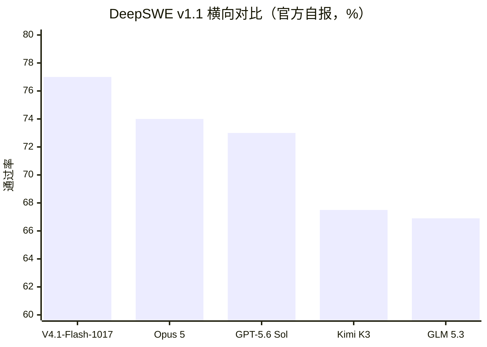

# V4.1-Flash-1017 发布事实与规格

> 本篇为**发布事实层（What/When）**：版本事件、开源信息、规格卡与基准测试全景。事实编号 F-0xx 对应 [references/article-source.md](../references/article-source.md)。
> **数据时点**：官方公告与博文口径 2026-10-17；规格/价格为 2026-10-20 核验时点。

## 1. 发布事件

2026-10-17 16:11，DeepSeek 官方公众号发布公告《DeepSeek V4.1 Flash新版本：许愿式编程一键成真》：DeepSeek V4.1 Flash 更新至 **V4.1-Flash-1017** 版本，官方网页端、App 与 API 模型同步换新（F-002/F-005）。版本号 1017 对应 10 月 17 日快照，符合 DeepSeek 用日期标记模型快照的惯例；发布前数小时有用户在模型列表短暂见到该条目（F-012，第三方单源，仅作背景）。

同日 16:32，微信公众号「赛博禅心」发布转述文章《DeepSeek V4.1 Flash 新版发布：api 自带搜索能力》（即本 bundle 的目标信源）；腾讯新闻、澎湃新闻、央视财经等媒体同日报道（F-001/F-003）。

**这次更新的不变与变**（官方公告口径）：

| 维度 | 状态 |
|------|------|
| API 模型名 | 不变，仍为 `deepseek-flash`（F-011） |
| API 调用方式与价格 | 不变（F-011，定价明细见 [01 成本篇](01-pareto-cost.md)） |
| 基准测试 | 11 项对比上一版全部上涨（F-013～F-023） |
| 任务运行时间与输出长度 | 官方称双双缩短（F-039） |
| 附带更新 | 搜索 API 开放（见 [03 搜索 API 篇](03-search-fetch-api.md)）、Harness 0.2.1（见 [04 适配篇](04-harness-migration.md)） |

## 2. 开源信息

- 权重上线 **HuggingFace** 与 **魔搭（ModelScope）**，仓库名 `deepseek-ai/DeepSeek-V4.1-Flash-1017`（F-006）
- 总参数 **763B**（MoE），**MIT** 开源协议（F-007）
- HuggingFace 模型卡元数据：Image-Text-to-Text 类型，Transformers + Safetensors 格式，张量类型 BF16·F32·F8_E4M3·I8（F-008；HF 页面直连受限，以搜索快照 + 官方公告双源采信）
- 763B 体量决定了这是数据中心级选项，消费级显卡不在讨论范围（工程常识，随 F-007 采信）

## 3. 规格卡（2026-10-20 API 文档核验）

| 规格项 | 值 | 出处 |
|--------|-----|------|
| 上下文窗口 | 1M tokens | F-009/F-041 |
| 最大输出 | 384K tokens（API）；官方推荐 max_tokens 不低于 256K | F-009/F-010/F-041 |
| 输入模态 | 图文交错输入（图像理解支持） | F-009/F-046 |
| 思考模式 | 支持非思考与思考模式（默认思考）；FIM 补全仅非思考模式支持 | F-046 |
| 推荐采样参数 | temperature 1.0、top_p 1.0 | F-010 |
| 并发限制 | 2500 | F-046 |
| 旧模型名迁移 | `deepseek-v4-flash`、`deepseek-v4-flash-vision-exp` 仍可调用，但对应模型已下线，请求由 V4.1-Flash-1017 服务并按 Flash 价格计费 | F-011 |

## 4. 基准测试：纵向 11 项全涨

官方公告给出的版本对比（V4.1-Flash-1017 vs 上一版 V4.1-Flash，F-013～F-023）：

| 基准 | 1017 版 | 上一版 | 提升 |
|------|--------|--------|------|
| HLE (w/o tools) | 42.6（文本子集 44.0） | 36.8（文本子集 39.1） | +5.8 |
| Terminal-Bench 4.0 | 42.3 | 31.2 | **+11.1** |
| DeepSWE v1.1 | 77.0 | 74.2 | +2.8 |
| ProgramBench | 29.1 | 20.3 | +8.8 |
| NL2Repo-Bench | 68.2 | 65.4 | +2.8 |
| Automation-Bench V1.0.6 | 60.5 | 54.8 | +5.7 |
| Agents' Last Exam | 35.4 | 31.8 | +3.6 |
| Apex Bench v1.1 | 72.1 | 64.6 | +7.5 |
| Chartography (w/ tools) | 83.0 | 78.9 | +4.1 |
| BabyVision (w/ tools) | 92.5 | 89.6 | +2.9 |
| ZeroBench-main (w/ tools) | 51.0 | 49.0 | +2.0 |

测试框架口径（官方脚注，F-024）：Terminal-Bench 4.0 使用 Claude Code 框架、DeepSWE 使用 Mini-SWE-V2 框架、ZeroBench-main 使用 Pass@5 评测；HLE 标注 * 的为文本子集成绩。

**纵向对比的可信度高于横向**：纵向为同一测试框架的版本迭代；横向各家评测配置未必对齐（F-025 核验说明）。

## 5. 基准测试：横向对比精选

与 Kimi K3、GLM 5.3、GPT-5.6 Sol、Claude Opus 5 的同场对比（官方公告图表，F-026～F-032）：

四项拿到对照最高分（F-026～F-029）：

| 基准 | 1017 版 | 对照第二名 | 领先幅度 |
|------|--------|-----------|---------|
| DeepSWE v1.1 | 77.0 | Opus 5 74.0 | +3.0 |
| Automation-Bench V1.0.6 | 60.5 | Opus 5 50.3 | +10.2 |
| Agents' Last Exam | 35.4 | Opus 5 28.6 | +6.8 |
| Apex Bench v1.1 | 72.1 | Opus 5 65.8 | +6.3 |

明确落后项（F-030～F-032）：

| 基准 | 1017 版 | 对照最高 | 差距 |
|------|--------|---------|------|
| HLE (w/o tools) | 42.6 | Opus 5 56.3 | **-13.7** |
| Terminal-Bench 4.0 | 42.3 | Opus 5 51.8 | -9.5 |
| NL2Repo-Bench | 68.2 | Opus 5 75.3 | -7.1 |
| ProgramBench | 29.1 | Opus 5 37.0 | -7.9 |

**能力画像**：终端执行、软件工程、自动化任务、Agent 综合考试是主战场；纯推理深度（HLE）是明确短板。官方 HuggingFace 模型卡将此版本称为 V4.1 Flash 的 "a minor update"（explainx 转述，F-025 口径内）。

## 6. ⚠️ 自报口径声明

表中全部跑分均为 **DeepSeek 自报**，发布时点未见独立第三方复现（F-025）。引用时：

- 纵向版本对比（31.2→42.3 等）为同一套测试框架，可信度较高；
- 横向对比（vs Opus 5 等）各家评测配置未必对齐，宜作参考而非裁决；
- 框架差异需注明：Terminal-Bench 用 Claude Code 框架、DeepSWE 用 Mini-SWE-V2 框架（F-024）。

## 7. 术语与口径速查

| 术语 | 含义 |
|------|------|
| **帕累托改进** | 官方对本次更新的定性：多目标同时改善且没有任何一项指标付出代价——性能涨的同时用时更短、输出更短（见 [01 成本篇](01-pareto-cost.md)） |
| **Agent** | 能自主调用工具、循环执行多步任务并自查结果的智能体程序；本 bundle 讨论的成本单位是「每任务」而非「每 token」 |
| **mini-swe-v2 / Mini-SWE-V2 框架** | 评测软件工程任务通过率所用的测试框架（F-024），本 bundle 全部单任务成本数字均基于此框架 |
| **Pass@5** | 同一任务最多尝试 5 次、任一次通过即算通过的口径，用于 ZeroBench-main（F-023） |
| **HLE** | Humanity's Last Exam，考察高难知识与推理的基准（F-030） |
| **Terminal-Bench 4.0** | 考察模型在真实终端中完成任务的基准（F-031） |
| **DeepSWE v1.1** | 考察真实软件工程仓库级修复的基准（F-015/F-026） |
| **SEO 作弊 / GEO 操纵** | 前者指针对搜索排名规则的作弊；后者指专门让 AI 在回答中引用自家内容的优化手段（见 [03 搜索 API 篇](03-search-fetch-api.md)） |
| **思考档位** | 模型推理强度档位（low / high / max 等），影响单任务成本与通过率（F-033～F-035） |
| **空闲时段 / 高峰时段** | DeepSeek API 的两档计价时段（见 [01 成本篇](01-pareto-cost.md) §4） |

## 8. 后续观察点（本 bundle 的时效边界）

1. **快照节奏**：版本号 1017 = 2026-10-17 快照（F-012），本 bundle 的分数与成本数字会随下一个快照漂移，引用时须核对当日官方公告。
2. **计费状态**：Search/Fetch 的免费窗口截止 2026-11-01 00:00（F-062），本 bundle 到期即部分失效——已把 `stale_after` 设为 2027-04-20，但**计费结论以官方定价页当日口径为准**。
3. **单任务成本作为长期指标**：比具体分数更耐久的观察对象是「同一任务完成成本」这个评估单位是否成为行业共识（本 bundle 观点层判断，非官方口径）。
4. **独立复现**：若出现第三方对 11 项基准的独立复现结论，本 bundle 的「自报口径」声明应同步更新。

---

下一篇：[02 帕累托改进与单任务成本](01-pareto-cost.md)——同样的分、更薄的账单，钱从哪里省出来。
