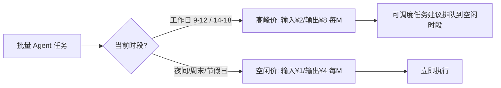

# 帕累托改进与单任务成本模型

> 本篇为**成本账层（How much）**：官方定性、三档成本对照、API 峰谷定价全表与「每任务成本」评估方法。事实编号 F-0xx 对应 [references/article-source.md](../references/article-source.md)。

## 1. 洞察一：性价比竞争的单位已从「每 token 单价」切换到「每任务成本」

**官方定性（F-038）**：本次更新被官方称为「性能—费用的帕累托改进」——性能全面提升的同时，任务运行时间和输出长度双双缩短，没有任何一项指标付出代价。**本 bundle 的归纳（F-067）**：这次更新 API 单价一分未降，单任务成本却下降约 60%，省钱的机制是输出 token 总量与循环轮数下降，不是降价。

> 口径分离：F-038 是官方原话；F-067 是本 bundle 基于 F-033/F-036/F-039/F-043/F-044 的推论，引用时不应混为官方表述。

**证据**：1017 max 档每任务约 ¥1.3（通过率 77.0%），上一版 max 档约 ¥3.3（通过率 74.2%）；而 API 价格表与上一版完全一致（输入缓存未命中空闲 ¥1/M、输出 ¥4/M）。

**反常识**：行业习惯把「性价比」理解为单价战争；官方这次给出的是另一条路径——模型「少说废话、少绕路」，账单大头（输出 token × 循环轮数）直接缩小。

**行动**：评估 Agent 工作流选型时，用「每任务成本 = 输出 token × 轮数 × 输出单价 + 输入 token × 输入单价」做基准，而不是只比价目表。

## 2. DeepSWE v1.1 成本账（mini-swe-v2 框架，官方图表口径）

| 模型（思考档位） | 通过率 | 每任务费用 |
|----------------|--------|-----------|
| **V4.1-Flash-1017（max）** | **77.0%** | **约 ¥1.3** |
| V4.1-Flash-1017（high） | 73.0% | 约 ¥1.0 |
| V4.1-Flash-1017（low） | 72.6% | 约 ¥0.75 |
| V4.1-Flash 上一版（max） | 74.2% | 约 ¥3.3 |
| GPT-6 Luna（max） | 66.6% | 约 ¥1.5 |
| GLM-5.3 Flash（max） | 63.5% | 约 ¥1.6 |
| V4 Flash（max） | 53.5% | 约 ¥3.1 |
| GPT-6.1 Sol（high） | 75.2% | 约 ¥4.3 |
| V4 Pro（max） | 63.0% | 约 ¥11 |
| Gemini 3.8 Flash（high） | 73.8% | 约 ¥16 |
| GPT-6 Sol（max） | 68.9% | 约 ¥18 |
| GLM-5.3（max） | 69.1% | 约 ¥27 |
| GPT-6 Astra（xhigh） | 74.1% | 约 ¥30 |
| Kimi K3（max） | 68.6% | 约 ¥31 |
| Claude Opus 5（max） | 73.7% | 约 ¥79 |
| Claude Fable 5（xhigh） | 70.0% | 约 ¥90 |

> 口径说明：通过率与费用均为官方「性能-费用帕累托图」读取的**近似值**（图上读数，非官方逐项公布），美元按 1USD=6.6862CNY 折算；博文表述「Opus 5 将近 80 元」「low 档不到 8 毛钱」与此一致（F-033～F-037/F-040）。**跨厂商对比还叠加了评测框架与汇率折算两层不确定性，不宜直接换算成倍数结论。**

## 3. 洞察二：low 与 max 只差 4.4 个百分点，成本差约 40%——档位路由是被低估的杠杆

**陈述**：1017 三档中，low（72.6%/¥0.75）与 max（77.0%/¥1.3）通过率相差 4.4 个百分点，每任务成本相差约 40%；high 档（73.0%/¥1.0）处于中间（F-033/F-034/F-035/F-068）。

**反常识**：「开到最高档求稳」的默认设置，在 Flash 这个模型上大概率是浪费——大多数任务不需要满推理档位。

**行动**：按任务难度路由——简单任务（代码巡检、数据清洗、批量测试）路由 low，疑难任务才开 max；先以小批量任务实测自家工作负载的档位-通过率曲线再定路由策略。

## 4. API 定价全表（2026-10-20 官方文档核验）

`deepseek-flash` 模型，按百万 tokens 计价（F-041～F-045）：

| 计费项 | 空闲时段 | 高峰时段 |
|--------|---------|---------|
| 输入（缓存命中） | ¥0.02 | ¥0.04 |
| 输入（缓存未命中） | ¥1 | ¥2 |
| 输出 | ¥4 | ¥8 |

**高峰时段定义**：北京时间周一至周五（不含中国法定节假日）9:00-12:00、14:00-18:00；其余时段（含周末及法定节假日全天）均为空闲时段，空闲价为高峰价一半（F-045）。



**工程含义**：批量任务调度到非高峰时段，token 成本直接减半——这是官方文档写明、但容易未用足的优化项（F-045）。

## 5. 成本模型速用

对 Agent 工作流，把「每任务成本」拆开估算（F-067 归纳）：

```
每任务成本 ≈ 输入 tokens × 输入单价 + 输出 tokens × 输出单价 + Search/Fetch 次数 × ¥0.005
```

- 输入侧善用**缓存命中价**（¥0.02/M，为未命中价的 1/50）：稳定的系统提示词前缀能显著摊薄输入成本；
- 输出侧是 1017 版的主战场：同样的活，输出更短 = 账单更薄；
- Search/Fetch 每千次成功请求 ¥5，已与 token 费用同量级，必须纳入模型——详见 [03 搜索 API 篇](03-search-fetch-api.md)。

## 6. 横向成本坐标

把 1017 max 档放进官方图表的对照系（F-037/F-040）：约 ¥1.3/任务、77.0% 通过率的组合，位于「更便宜且分数更高」的区间；同表中比它便宜的只有 GPT-6 Luna（66.6%/¥1.5 之外无）、GLM-5.3 Flash（63.5%/¥1.6）等低分或低价选项。对跑批量的 Agent 工作流（代码巡检、数据清洗、批量测试）而言，这一量级的成本差足以改变架构决策——许多「因为太贵而不敢自动化」的流程重新变得可算（F-037 归纳）。

---

上一篇：[00 发布事实与规格](00-release-facts.md) | 下一篇：[02 许愿式编程](02-wishful-programming.md)——能力侧的同一枚硬币。
