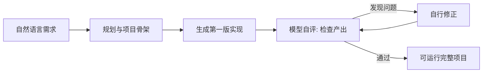

# 许愿式编程与自反馈强化学习

> 本篇为**能力层（Can it）**：官方新能力「许愿式编程」的定义、训练方法、demo 与边界。事实编号 F-0xx 对应 [references/article-source.md](../references/article-source.md)。

## 1. 官方定义

官方公告标题即为《DeepSeek V4.1 Flash新版本：**许愿式编程一键成真**》（F-051）。其含义是：以前做完整项目，需要把功能、结构、交互、技术栈一项项讲给模型听；现在只要说清楚想要什么，模型能自己往下推——规划、写代码、运行、检查、修改，一路接住（F-051）。

可量化的差异表述：**更少的提示词、更少的参考素材，在 DeepSeek Harness 里交互几轮，模型就从零搭出一个完整项目**（F-051）。

## 2. 训练方法：基于自反馈的强化学习（RL）

官方口径（F-052）：

> 训练上用的是基于自反馈的强化学习（RL）——模型写完第一版不会立刻下班，会继续检查、发现不对再回头修。

配套的能力方向（F-053）：**游戏开发、3D 建模**这类「从零搭项目」的能力。

与「补全式」编程的关键差异在闭环位置：补全式模型只在**单次生成**内优化下一个 token；自反馈 RL 把「产出 → 自评 → 修正」纳入训练目标，闭环发生在**整个项目层面**。

## 3. 官方四个 demo

| demo | 内容 | 考察点 |
|------|------|--------|
| 3D 故宫 | 可实时浏览的 3D 建模 | 从零建模 + 资源组织 |
| 网页版赛车游戏 | 从零构建网页赛车游戏 | 实时渲染 + 游戏循环 + 交互 |
| Godot 复刻《传送门 2》 | 基于开源游戏引擎 Godot 复刻 | 跨工程规范 + 物理/关卡结构 |
| Valley of Ages | 同一片 3D 河谷，从史前时代一路演到现代 | 资产复用 + 时间轴演化 |

以上均为官方公告所列（F-054）。博文以「V 社至今还没数到 3」玩梗（作者修辞，F-066）。

## 4. 洞察三：少写提示词的底气来自训练期闭环，不来自提示词工程

**陈述**：「更少提示词搭出完整项目」的能力来源是自反馈 RL 训练（F-052），而非某个提示词技巧。

**证据**：官方将能力描述为训练方法的直接结果，并点名游戏开发、3D 建模两个「从零搭项目」方向（F-052/F-053）；四个 demo 全部落在该方向（F-054）。

**反常识**：社区讨论「从零生成项目」时习惯归因于提示词模板与上下文工程；本例中提示词反而是**被减少**的那一环——省下来的注意力来自训练期的自我纠错能力。

**行动**：从零搭项目的场景不必再堆砌需求清单与参考素材，把预算投在「想要什么」这一句话的清晰度上；但对已有代码库的改造型任务，模型自反馈并不能替代工程约束（见 §5 边界）。

## 5. 能力边界

1. **方向性**：官方明示的能力提升集中在游戏开发、3D 建模等从零构建完整项目（F-053）；官方 demo 也全部落在该域（F-054）。把「许愿式编程」外推为通用工程能力，超出官方口径。
2. **纯推理不是本次重点**：HLE 42.6 明显落后 Claude Opus 5 的 56.3（F-030），纯推理深度仍是短板——见 [00 发布事实篇](00-release-facts.md) §5。
3. **demo ≠ 泛化证据**：四个 demo 是厂商精选案例，未提供对照实验或独立复现（F-025）。
4. **工程含金量在结构而非画面**：第三方解读指出，这类 demo 的含金量在于多文件工程结构、资源管理与可运行性——传统补全式模型很难一次给全（F-055）。看 demo 时应看**能否跑起来**，而不是截图好不好看。
5. **成本与可复现**：单个 demo 的生成成本、迭代轮次与是否可重现，官方与博文均未披露。

## 6. 落地建议

| 场景 | 建议 |
|------|------|
| 从零搭建小型可运行项目（游戏、3D 场景、小工具） | 值得试：先一句需求试跑，再按需补约束 |
| 已有代码库的功能开发/重构 | 不适用该能力叙事：仍需工程约束与上下文供给，参见 [planning-with-files](../planning-with-files/index.md) 与 [context-optimization](../context-optimization/index.md) |
| 深度推理/研究型任务 | 不适用：HLE 落后明显（F-030） |
| 批量跑批（巡检、清洗、测试） | 适用且成本可算：见 [01 成本篇](01-pareto-cost.md) 的档位路由建议 |

在哪个环境里跑：官方对 **DeepSeek Harness、腾讯 CodeBuddy、WorkBuddy** 三个平台框架做了专项优化（F-048），Harness 需升级到 0.2.1-rc.1 及以上（F-049）——详见 [04 适配篇](04-harness-migration.md)。

---

上一篇：[01 帕累托改进与单任务成本](01-pareto-cost.md) | 下一篇：[03 搜索 API 开放](03-search-fetch-api.md)——第三个变化：联网搜索从搭赠变成计费项。
