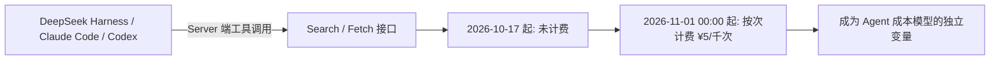

# 自研搜索 API 开放：Search 与 Fetch 的计费结构

> 本篇为**新能力层（What's new）**：搜索/抓取双接口开放与计费结构。事实编号 F-0xx 对应 [references/article-source.md](../references/article-source.md)。
> **时效提醒**：本篇含 2026-11-01 00:00 的计费切换时点，读取时已过期（本文 st_after 为 2027-01-20，但**计费状态须以官方定价页当日口径为准**）。

## 1. 背景：自研搜索一直在线，这次是开放成 API

- DeepSeek 网页端和 API 里的联网搜索，一直用的是**自家的搜索引擎**，每天处理来自全球的**数亿次请求**（F-056）
- 该搜索引擎是 **AI 原生的通用搜索引擎**：索引全球**千亿级网页**、支持多语言、实时返回结果（F-057）
- 过滤机制：针对 **SEO 作弊**、**GEO 操纵**（专门让 AI 在回答里引用自家内容的优化）和**低质量 AI 生成内容**，有识别过滤机制（F-058）

## 2. 本次开放：两个独立接口

| 接口 | 作用 | 计费 | 出处 |
|------|------|------|------|
| **Search** | 搜索网页 | 每 1,000 次成功请求 **5 元** | F-059 |
| **Fetch** | 抓取网页 | 每 1,000 次成功请求 **5 元** | F-059 |

官方定价页口径原文：「Search 和 Fetch 是独立的 API，按请求次数计费」（F-059）。用法见 DeepSeek API 文档《网页搜索与抓取》指南（F-060）。

Fetch 的具体形态（第三方信源补充，F-063 同源）：把选中网页**抓成 Markdown 交给模型分析**，支持限定网站、语言和发布时间。

> 接口的完整参数、搜索语法、错误码与重试策略，见仓库内独立束 [DeepSeek 网页搜索与抓取 API（Search / Fetch）](../../ecosystems/deepseek-search-fetch/index.md)。

## 3. 计费倒计时

官方定价页 Note 原文（F-061/F-062）：

> 当前用户在 DeepSeek Harness / Claude Code / Codex 中使用 DeepSeek API 时，已经会通过 Server 端工具调用访问到 Search/Fetch 接口，这部分 Search/Fetch 接口调用**目前未计费**，并将于**北京时间 2026 年 11 月 1 日 00:00 起按次收取调用费用**。

**扣费规则**（官方，F-063）：

- Search 和 Fetch 按**成功请求次数**计费；失败、无结果或超时不收费（后半条为第三方信源补充）
- 费用直接从充值余额或赠送余额扣减；**两者同时存在时优先扣减赠送余额**
- 产品价格可能变动，官方保留修改价格的权利

## 4. 洞察四：联网搜索从「免费搭赠」变成 Agent 成本模型里的独立变量

**陈述**：Search/Fetch 开放前，联网搜索是网页端与 API 的内建能力；开放后它成为按次计费的独立 API，并在 11 月 1 日起对已经在用它的 Harness/Claude Code/Codex 用户生效（F-061/F-062）。

**证据**：官方定价页明确「这部分调用目前未计费，并将于 2026-11-01 00:00 起按次收取费用」；单价为每千次成功请求 5 元，即 **¥0.005/次**。

**反常识**：多数使用者的第一反应是「搜索是模型自带的」，直到账单出现；实际上服务端工具调用早就在消耗 Search/Fetch 配额，计费只是把隐形成本显性化。

**行动**：11 月 1 日前完成两件事——①在代码里埋点统计 Search/Fetch 调用量；②把搜索密度纳入成本模型（见 §5）。

## 5. 搜索密度怎么算账

按 ¥0.005/次计（F-059），Agent 循环中的搜索调用非常频繁：

| 场景 | 循环轮数 | 每轮搜索次数 | Search/Fetch 费用 | 量级判断 |
|------|---------|------------|-------------------|---------|
| 单次事实核查 | 1 | 2 | ¥0.01 | 可忽略 |
| 常规代码任务 | 10 | 2 | ¥0.10 | 仍低于 token 费 |
| 深研型任务 | 50 | 2 | ¥0.50 | **与 token 费用同量级** |
| 深研型任务 | 50 | 4 | ¥1.00 | 超过部分单任务的全部模型费（对比 01 成本篇 max 档 ¥1.3） |

工程结论：在高轮次、多搜索的工作流里，Search/Fetch 不是「零钱」，而是与模型 token 费并列的成本项。降低手段有三类——缓存重复查询结果、减少每轮无条件搜索、把批量检索移出 Agent 主循环。

## 6. 这次开放的位置：国内头部厂商首次将自研搜索作为独立计费 API 开放

第三方观点层（F-064）：这是国内头部模型厂商第一次把自研搜索能力作为独立计费 API 开放，对标海外 Perplexity、OpenAI 的搜索接口体系。官方公告本身未做此定位陈述，引用时按观点标注。

## 7. ⚠️ 引用边界

1. **自研搜索的排序质量未做独立评估**：官方只描述了索引规模（千亿级网页）、多语言、实时返回与过滤机制（F-056～F-058），未提供召回率、时延或与主流搜索引擎的对比数据。
2. **GEO 过滤是双刃剑**：对使用方而言，官方宣称能过滤「让 AI 引用自家内容」的操纵行为（F-058），但过滤规则本身不公开，其边界与召回影响不可外部验证。
3. **计费状态以官方定价页当日口径为准**：本 bundle 记录的免费窗口截止于 2026-11-01 00:00（北京时区），逾期请以 [api-docs.deepseek.com 定价页](https://api-docs.deepseek.com/zh-cn/quick_start/pricing) 为准。

---

上一篇：[02 许愿式编程](02-wishful-programming.md) | 下一篇：[04 平台适配与迁移清单](04-harness-migration.md)
