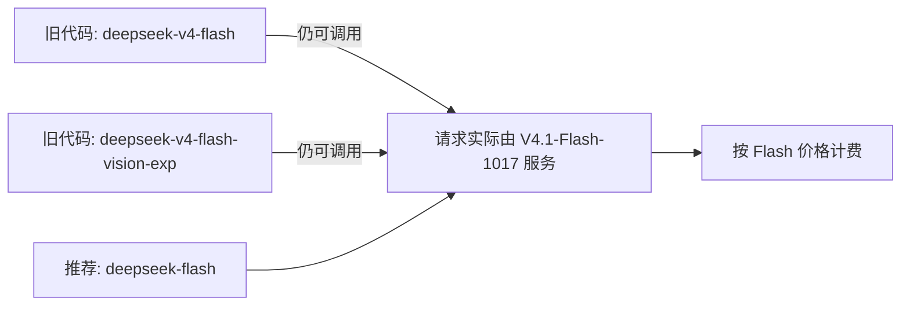

# 平台适配、版本迁移与行动清单

> 本篇为**落地层（Do）**：三个平台框架的适配口径、模型名下线迁移、赠金活动与可执行清单。事实编号 F-0xx 对应 [references/article-source.md](../references/article-source.md)。

## 1. 三个平台框架的专项优化

官方公告原文（F-048）：

> 本次我们着重针对 **DeepSeek Harness、腾讯 CodeBuddy、WorkBuddy** 等平台框架进行了优化。

含义：模型侧（输出更短、跑得更快）与框架侧（提示词组织、工具调度、循环轮数）做了联合适配。官方要求（F-049）：

> 请升级到 **DeepSeek Harness 0.2.1-rc.1 及以上版本**，以获得适配新版模型的最优体验。

| 平台 | 需要做什么 | 相关束 |
|------|-----------|--------|
| DeepSeek Harness | 升级到 0.2.1-rc.1 及以上（0.2.1 同步发布） | [DeepSeek Harness 2.0 桌面应用](../../ecosystems/deepseek-harness/index.md) |
| 腾讯 CodeBuddy | 平台侧已适配，随版本更新生效 | [CodeBuddy](../../ecosystems/tencent/codebuddy/index.md) |
| WorkBuddy | 平台侧已适配，随版本更新生效 | [WorkBuddy 官方文档](../../ecosystems/tencent/workbuddy-official-docs/index.md) |

## 2. 版本迁移：旧模型名仍可调用，但背后已是新模型

官方 API 文档脚注（F-011）：

> 模型名请使用 `deepseek-flash`。旧模型名 `deepseek-v4-flash`、`deepseek-v4-flash-vision-exp` 仍可调用，但对应模型已下线，请求将由 **DeepSeek-V4.1-Flash-1017** 模型提供服务，并按 Flash 价格计费。

**迁移含义**：不需为改模型名而停机，但**行为基线已经变了**——旧代码会静默获得新模型的输出风格与能力表现。凡是做回归测试、输出断言、提示词调优的流程，都应在升级后重跑一次，而不是沿用升级前的基线。

## 3. 赠金活动

官方公告与博文一致（F-050）：

- 符合活动条件的用户**首次登录 DeepSeek Harness** 可获得 **6 元赠金**
- **无需充值**，**限量发放**
- 到账后 **7 天内有效**

按 01 成本篇的单任务成本口径，¥6 ≈ 1017 max 档约 4.6 个任务、或 low 档约 8 个任务的量级——适合用来零成本试跑「许愿式编程」流程与档位路由曲线（见 [02 许愿式编程](02-wishful-programming.md)）。

## 4. 行动清单（三件必做 + 两件可选）

### 必做

| # | 事项 | 依据 | 完成判据 |
|---|------|------|---------|
| 1 | **11 月 1 日前统计 Search/Fetch 调用量**，确认自己是否已在被计费 | F-061/F-062 | 埋点数据可查，账单预估有数字 |
| 2 | **批量任务调度到空闲时段**（非工作日 9-12/14-18），token 成本直接减半 | F-045 | 调度器时段策略已改 |
| 3 | **简单任务降档到 low**，用小批量实测自家工作负载的档位-通过率曲线 | F-033～F-035/F-068 | 有自家任务的 low/max 对照数据 |

### 可选

| # | 事项 | 依据 |
|---|------|------|
| 4 | 升级 DeepSeek Harness 至 0.2.1-rc.1 及以上 | F-049 |
| 5 | 领取 6 元赠金，零成本试跑许愿式编程 | F-050 |

## 5. 何时**不该**动（不适用条件）

| 情形 | 判断 |
|------|------|
| 任务量小、每日几十次调用 | 峰谷价差（2 倍）绝对金额有限，改造调度的收益低于改造成本 |
| 主力是深度推理/研究型任务 | HLE 落后 Opus 5 13.7 个点（F-030），Flash 并非该场景的更优解 |
| 无法埋点统计 Search/Fetch | 只能被动接受 11 月 1 日后的计费，无法量化影响；此时先做「限制单任务搜索次数」的兜底 |
| 已在用 Opus 5 且对质量要求极高 | 77.0% 与 73.7% 的通过率差距不足以覆盖 60 倍成本差的场景才值得迁移 |
| 需要自托管权重 | 763B 体量意味着数据中心级硬件条件（F-007），多数团队应直接用 API |

## 6. 预期周期与风险边界

**预期周期**：① 埋点与账单预估——当天可完成；② 档位路由曲线实测——建议取自家 20～50 个真实任务，约一周；③ 调度时段改造——半天工作量；④ Harness 升级——即时生效。

**风险边界**：

- 官方保留修改价格的权利，费用估算需按当期定价页复核（F-063）；
- 旧模型名仍可调用但底层已换模型，旧基线（回归断言、提示词调优结果）需重跑（F-011）；
- 本 bundle 全部跑分为厂商自报，未经独立复现（F-025）；
- 使用 DeepSeek 自研搜索的接入方需自行承担检索内容的版权与合规责任，官方仅声明其过滤机制（F-058）；
- 赠金有条件：「符合活动条件的用户」的具体门槛官方未在公告中展开，需以 Harness 客户端实际显示为准（F-050）；
- 官方未披露 CodeBuddy / WorkBuddy 两侧的具体适配点、所需版本号与收益量化，仅给出了 Harness 的版本要求（F-048/F-049）。

---

上一篇：[03 搜索 API 开放](03-search-fetch-api.md) | 回到目录：[concepts/index](index.md)
