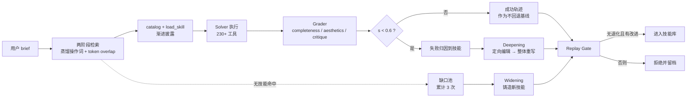

# Designer-RSI 速览：冻结模型之外的程序记忆

## 本章要点

1. Designer-RSI 不训练模型，而是把“做事方法”写成可检索、可编辑、可回放的技能文件，让冻结模型在真实流量中持续改进。
2. 改进沿两条轴发生：**Widening** 补上反复缺失的技能，**Deepening** 修好经常失败的技能；两者必须耦合才有效。
3. 真正的安全阀不是“平均分变高”，而是**匹配回放门控**：同一批、同上下文、双臂成对比较，不允许任何已见案例退化。
4. 收益主要在“把要求做全、把工具链跑通”，不在审美；论文自己给出了六条明确边界。
5. 这是一篇**机制与评测论文**，不是可直接安装的框架文档；本包是解读教程，不是复现指南。

## 论文档案

| 项 | 内容 |
|---|---|
| 英文标题 | Designer-RSI: Evolving Procedural Memory from User Traffic for Agentic Graphic Design |
| arXiv | 2609.22086（cs.AI；cs.CV），v1 2026-09-18（F-001、F-002） |
| 作者 | Hongyang Du、Lan Yan、Christian Flores、Asim Kadav（F-003） |
| 机构 | Adobe；通讯作者关联 Brown University（F-004） |
| 篇幅 / 许可 | 9 页、7 图；CC BY 4.0（F-005、F-006） |
| 中文解读 | 微信公众号「符智汇」，2026-09-25 23:02（F-007、F-008） |

## 它要解决的不是“生成一张图”

论文把问题放在**专业图形设计**上：产物必须是结构化、可编辑的文档，而不是一张扁平图片（F-010）。这带来三重困难：

1. **长时程**：一次设计可能包含数十个相互依赖的操作，终端分数无法指出是哪一步坏了（F-013）。
2. **不可完全验证**：brief 里既有“文字必须齐全、尺寸必须正确”这类可检查要求，也有“构图平衡、风格统一”这类只能部分自动判断的要求（F-012）。
3. **一次做对不等于掌握方法**：偶发成功不能证明 Agent 面对下一类相似任务时能稳定复用（F-009）。

所以论文没有继续训练图形模型，而是把**模型周围的程序记忆**当成学习对象：模型权重冻结，只有 SKILL.md 在变（F-018、F-019）。

## 机制如何咬合

| 机制 | 一句话作用 | 关键数字 | 详见 |
|---|---|---|---|
| 技能库表示 | 把流程写成可版本化的 SKILL.md | 三子库、五节正文、description 200–600 字符 | [程序记忆与技能库](01-procedural-memory.md) |
| 两阶段检索 | 先用操作词收窄，再按词重叠排序 | ≤6 个操作词、2–4 个候选、τ=0.2 | [检索与渐进披露](02-retrieval-and-injection.md) |
| Widening | 为反复缺口铸造新技能 | 缺口累计 3 次 | [双轴演化](03-evolution-widening-deepening.md) |
| Deepening | 用成功/失败对照修技能 | 分数 <0.6 记失败、2 次失败入选、每轮 ≤50 | [双轴演化](03-evolution-widening-deepening.md) |
| Replay Gate | 只放行不退化且有改进的候选 | 2 高 + 2 低、逐 prompt 多数、全平拒绝 | [匹配回放门控](04-replay-gate.md) |
| Graphic-Eval | 统一评分口径 | 0.7×完整度 + 0.3×美学、τ=0.6 | [评分体系](05-graphic-eval.md) |

## 关键数字快照

| 指标 | 结果 | 口径 |
|---|---|---|
| 技能库规模 | 76 → 139，净增 63 | 五轮演化（F-075） |
| 演化数据 | 1,406 条 brief、1,869 条评分轨迹 | 无人工标签、无权重更新（F-069） |
| GenEval2 成功率（Sonnet 4） | 72.7% → 99.3% | 900 秒内有效设计比例（F-083） |
| 通用 T2I 平均质量（Sonnet 4） | 51.63 → 59.33 | 四基准平均（F-083） |
| 专业设计总体胜率 | 67.6% / 61.8% / 62.8% | Opus / Sonnet / Qwen 对 Base（F-088–F-090） |
| 消融：完整 Evolve | 完整度 74.04、胜率 58.5% | 对 Base，p=0.025（F-096） |
| 单轴对照 | 只重写 48.6%、只新增 49.4% | 均未明显超过冷启动（F-095） |
| 美学变化 | 65.92 → 66.53 | 基本不变（F-096） |

## 三个必须记住的边界

1. **不是模型自我进化**：权重、工具、渲染器都没变；变的是外部文本记忆（F-015、F-018）。
2. **不是通用 Agent 结论**：实验限定在专业图形设计 Agent 与三个 backbone；作者明确说回放安全只是局部安全（F-059、F-098）。
3. **不是审美训练**：收益集中在完整度；像素级几何与超长流程仍是瓶颈（F-101、F-102）。

## 建议阅读顺序

| 读者目标 | 路径 |
|---|---|
| 只想判断这篇论文值不值得读 | 本页 → [结果与读法](06-results.md) → [边界](07-limits-and-adoption.md) |
| 想理解机制 | 本页 → [程序记忆](01-procedural-memory.md) → [检索](02-retrieval-and-injection.md) → [双轴演化](03-evolution-widening-deepening.md) → [回放门控](04-replay-gate.md) |
| 想迁移到自己系统 | [检索](02-retrieval-and-injection.md) → [回放门控](04-replay-gate.md) → [边界与落地清单](07-limits-and-adoption.md) |
| 想核对数字 | [结果与读法](06-results.md) → [核验报告](../references/verification.md) |

## 常见误读

| 误读 | 纠正 |
|---|---|
| “Agent 会自己变聪明了” | 变的是外部技能文本；模型能力未变（F-009、F-018） |
| “技能越多越好” | 只新增的技能库胜率 49.4%，与冷启动无显著差别；R4 还出现回退（F-095、F-079） |
| “平均分提高就说明改进” | 发布门控刻意不看绝对平均分，只看配对比较（F-052、F-058） |
| “审美也一起提升了” | 美学 65.92→66.53，论文自述收益集中在完整度（F-096） |

## 自检问题

1. 为什么论文把“技能”而不是“模型权重”当作学习对象？
2. Widening 与 Deepening 各自解决哪类失败？为什么单轴不够？
3. 回放门控为什么拒绝“全部打平”的候选？
4. 如果只看平均质量分，会漏掉哪两类信息？
