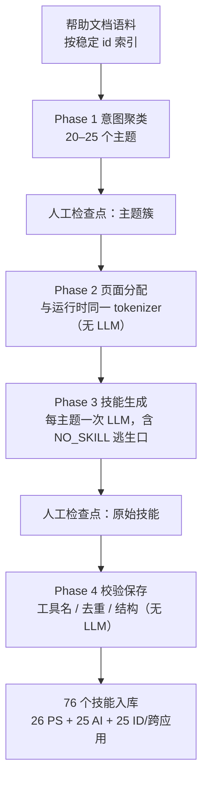

# 程序记忆与技能库：把“怎么做”写成可版本化的文件

## 本章要点

1. 参数记忆决定“大致会什么”，程序记忆决定“这类任务具体怎么把工具链跑通”（F-009）。
2. 技能不是提示词片段，也不是固定宏：它是一个带元数据的 Markdown 文件，模型可以调整、重排或部分采用（F-019、F-025）。
3. `description` 是唯一检索信号；正文只影响被检索到之后读到什么（F-020）。这使“写触发短语”成为一项独立工程。
4. 每个技能的运行统计**不写在技能文件里**，而在外部 store（F-026；源文此处有偏差，见 E-1）。
5. 冷启动用产品帮助文档播种 76 个技能，只提供初始召回下限，不等于已经优化（F-031、F-032）。

## 三种记忆，三种问题

| 记忆类型 | 回答的问题 | 载体 | 本论文中的角色 |
|---|---|---|---|
| 参数记忆 | 模型大致会什么 | 权重 | 完全冻结，不更新（F-018） |
| 聊天/情景记忆 | 之前发生了什么 | 对话历史、向量库 | 不是本工作的对象 |
| 程序记忆 | 这类任务通常应该怎么做 | SKILL.md 技能库 | 唯一被演化的对象（F-019） |

这个区分解释了论文的标题：**RSI 发生在模型外部**。模型仍然是原来那个模型，但面对同一类 brief 时，它可以先检索到一份经过回放验证的流程，再决定是否采用。

> 注意：论文没有声称“模型能力提升”。它测量的是同一冻结 backbone 在有无技能库时的差异；关闭技能检索就恢复原始 Agent（F-016）。

## SKILL.md 的结构

一个技能对应一个文件夹，文件夹名必须等于技能名；文件由 YAML front matter 与五节正文组成（F-019、F-025）。

| 部分 | 字段 / 章节 | 作用 | 关键约束 |
|---|---|---|---|
| front matter | `description` | 触发短语，检索唯一信号 | 200–600 字符（F-020） |
| front matter | `app_mode` | 限定 raster / vector / page_layout·any 子库 | 不匹配时评分记 0（F-021） |
| front matter | `tool_sequence` | 5–10 个工具的关键路径 | 可选附 scoped tool list（F-022） |
| front matter | `prerequisites` | 匹配时自动一跳拉入的前置技能 | 只拉一跳（F-023） |
| front matter | `status` / `version` | candidate / stable / deprecated | 支持灰度与回滚（F-024） |
| 正文 | when to use | 适用情境 | 必填（F-025） |
| 正文 | clarify before starting | 开工前需要澄清什么 | 必填（F-025） |
| 正文 | steps | 每步点名工具与关键参数 | 必填（F-025） |
| 正文 | tips | 模型原本不具备的领域知识 | 必填（F-025） |
| 正文 | error handling | 情境 → 动作表 | 必填（F-025） |

### 为什么统计要外置

源文说 SKILL.md 内含“规避计数”。论文的口径是：**per-skill 统计存放在文件外的独立 store**，这样技能文件保持干净、可发布（F-026）。

这不是吹毛求疵。若把失败次数、成功率写进文件：

1. 技能文件会随运行不断变化，难以做内容 diff 与代码评审。
2. 同一份技能在不同部署间无法直接复用。
3. 统计更新会污染版本号语义，回滚时无法区分“内容回滚”与“计数回滚”。

本包正文统一采用“统计外置”的口径；读者若看到“技能文件内含规避计数”的说法，应以论文附录 C.1 为准（详见 `references/verification.md` E-1）。

## 冷启动：没有流量时先种一片森林

空技能库什么都检索不到。论文用四阶段流水线从产品帮助文档播种（F-028、F-029）：

| 阶段 | 是否用 LLM | 关键设计 | 为什么重要 |
|---|---|---|---|
| Phase 1 意图聚类 | 是（少量调用） | 主题数控制在 20–25 | 主题太细会碎片化，太粗会覆盖不足 |
| Phase 2 页面分配 | 否 | 复用运行时 tokenizer | 保证“播种时能写进去的短语，运行时也能检索到” |
| Phase 3 技能生成 | 是（每主题一次） | 工具白名单来自真实目录；NO_SKILL 允许空输出 | 避免为纯 UI 说明硬造技能 |
| Phase 4 校验保存 | 否 | 工具名存在性、描述去重、五节完整性 | 把结构错误挡在入库前 |

冷启动产出 **76 个技能**：26 个 Photoshop、25 个 Illustrator、25 个 InDesign 或跨应用（F-031）。人工检查点设在 Phase 1 后与 Phase 3 后（F-030）。

## 与相邻概念的差别

| 做法 | 与 SKILL.md 的差别 |
|---|---|
| Prompt 模板 | 模板通常全量注入；技能是**按需检索 + 渐进披露**，只把 catalog 放进系统提示（F-027、F-038） |
| RAG 文档 | RAG 检索事实片段；技能检索的是**可执行流程**，且带工具序列与错误处理（F-022、F-025） |
| 固定宏 / 脚本 | 宏要求确定性执行；技能是自然语言指导，模型可调整或部分采用（F-019） |
| 微调 | 微调改权重；技能库不改权重，可逐条审计、回滚（F-018） |

## 设计取舍：为什么是自然语言，而不是代码

| 取舍 | 收益 | 代价 |
|---|---|---|
| 自然语言 | 可读、可编辑、可审计；Reflector 能直接改写 | 无法强制模型遵守；长流程会逐步偏离（F-100、F-102） |
| 短小自包含 | 单步流程可靠复现 | 数百步长图案只保住大致布局（F-102） |
| 文件化 | 版本化、可 diff、可灰度 | 需要额外的统计 store 与检索层（F-026） |

## 常见误读

| 误读 | 纠正 |
|---|---|
| “技能就是更长的 system prompt” | 技能默认不注入全文，只进 catalog；模型要主动 `load_skill`（F-038） |
| “技能库等于知识库” | 它存的是流程，不是事实；description 写的是操作词而非主题词（F-020、F-034） |
| “冷启动的 76 个技能已经可用” | 冷启动完整度 68.62，低于无技能的 69.08（F-094） |
| “技能文件应该记录失败次数” | 统计在外部 store；文件保持干净（F-026） |

## 自检问题

1. 为什么 `description` 是唯一检索信号，而正文不是？这会对技能作者提出什么要求？
2. 冷启动 Phase 2 为什么坚持用与运行时相同的 tokenizer？
3. 如果把统计写进 SKILL.md，会破坏哪些工程属性？
4. 自然语言技能相比固定宏，优势与代价各是什么？
