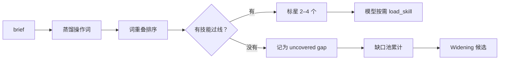

# 两阶段检索与渐进披露：让 139 个技能只露冰山一角

## 本章要点

1. 技能库变大后，最大风险不是“找不到”，而是“找错”和“塞满上下文”。
2. 检索分两步：先把 brief 蒸馏成最多 6 个**操作词**，再按词重叠排序（F-033、F-034）。
3. 每轮只标 2–4 个候选；分数只排序，不构成可见性门槛（F-036、F-037）。
4. 全文不注入：系统提示只放 catalog，模型需要时调用 `load_skill(name)`（F-038）。
5. 没有任何技能被标星，这一轮就被记为一个覆盖缺口（F-040）——检索失败会反过来驱动演化。

## 为什么不能把技能库塞进上下文

技能库从 76 增长到 139（F-075）。若每轮把全部技能正文注入：

1. **token 成本线性增长**，而论文只在 top-k=3 时做到“演化无边际 token 成本”（F-097）。
2. **注意力被稀释**，模型更容易选错流程。
3. **技能之间互相干扰**，尤其是同一应用的相邻流程。

所以论文采用“**检索排序 + 渐进披露**”：先决定哪几个可能相关，再让模型自己决定读不读。

## 阶段一：把 brief 蒸馏成操作词

冻结 LLM 接收用户 brief，输出**最多 6 个操作词**，并被明确要求忽略（F-034）：

| 忽略项 | 例子 | 原因 |
|---|---|---|
| 主体名称 | 人物、产品名 | 主体不决定用哪套工具链 |
| 地点 | 城市、场景 | 同上 |
| 品牌 | logo、品牌名 | 会误导检索到品牌模板 |
| 形容词 | “高级感”“温暖” | 属于审美目标，不是操作 |
| 颜色值 | 具体色号 | 颜色是参数，不是流程 |

这样做的结果是：一条“给咖啡店做一张秋季新品海报，要求暖色调、有手写体标题”的 brief，可能被蒸馏为“海报排版、手写体、图像合成、文字描边”之类的操作词。

> 这一步是**有损压缩**。它的目标不是保留所有信息，而是让查询与技能 `description` 的“操作中心”对齐（F-020）。

## 阶段二：按词重叠排序

每个技能按查询词与 description 的词重叠比例打分：

$$\text{score}(s)=\frac{\left|\text{tokens}(q)\cap\text{tokens}(\text{desc}(s))\right|}{\left|\text{tokens}(q)\right|}$$

规则细节（F-035、F-036）：

1. 每个蒸馏出的操作词独立评分。
2. 技能名匹配有额外加分，避免“只是共享一个词”的技能抢占。
3. `app_mode` 不匹配直接记 0：raster 技能在 vector 会话中不可能入选。
4. 候选筛选涉及三项条件：名称匹配优先、分数超过 τ=0.2、位于最高分的 0.6 倍以内。
5. 每轮标 2–4 个，最多 4 个；不足 2 个时补到 2 个。

### 为什么用词重叠而不是向量检索

论文给的理由很工程化：冷启动的 Phase 2 用**同一个 tokenizer** 做页面分配（F-029）。如果运行时改用 embedding：

1. 播种阶段无法知道 embedding 空间偏好什么，只能猜。
2. 技能作者写的触发短语与检索器实际使用的信号脱节。
3. 一旦换 embedding 模型，整个技能库的 `description` 都需要重写。

词重叠把“写作”和“路由”绑在同一套词汇上，代价是**无法处理同义改写**。这是一个明确的取舍，不是疏忽。

## 从排序到注入：catalog + load_skill

| 步骤 | 发生什么 | 上下文变化 |
|---|---|---|
| 1. 每轮检索 | 运行一次排序 | 无 |
| 2. 生成 catalog | 全部技能的名称、app_mode 标签、一行 description | system prompt 增加一个受 token 预算约束的清单 |
| 3. 标星置顶 | 2–4 个候选加星并浮到顶部 | 仍只是清单 |
| 4. 模型判断 | 认为某技能相关 | 调用 `load_skill(name)` |
| 5. 注入全文 | 返回 steps、tool_sequence、tips、error handling | 作为工具结果进入对话历史 |

关键点：**catalog 是应用无关的**，三个应用的技能都会出现并带标签，所以跨应用任务可以在规划阶段就组合；真正的应用隔离发生在执行时，工具列表已经按当前文档的应用收窄（F-038）。

## 工具面收窄：一个默认关闭的选项

论文还描述了一个可选机制：把工具列表收窄为“已加载技能的 `tool_sequence` 并集 + 少量常开核心”，从而把 230+ 工具目录缩到任务真正需要的几个（F-039）。

但它在实验中**默认关闭**。原因不难推断：收窄会限制模型的临场替代方案，而论文的主要变量是技能库本身；把工具面也变成变量，会污染归因。这一点源文没有提，读者容易误以为系统默认就在收窄工具。

## 检索失败也是一等公民

当没有任何技能被标星时，这一轮被记录为 **uncovered coverage gap**（F-040）。这条记录会进入缺口池，累计 3 次后触发 Widening（F-043）。

也就是说，检索层不只是“找技能”，它还是**演化信号的采集器**：

## 一个 illustrative 例子（非论文案例）

假设 brief 是：“给一款极简香水做电商主图，白色背景，产品居中，标题用手写体，整体要高级。”

| 阶段 | 可能输出 |
|---|---|
| 蒸馏 | `product cutout`、`centered composition`、`handwritten type`、`soft shadow`、`white background` |
| 排序 | `cutout-and-shadow`（名称匹配）、`typography-handwritten`、`layout-centered-hero` |
| 未入选 | 某个“秋季暖色调海报”技能——虽然共享 `poster` 词，但操作不匹配 |

这个例子只用于说明流程，不代表论文的实际检索日志（论文未公开内部 prompt 与轨迹，F-104）。

## 三个失效模式

| 失效 | 表现 | 根因 | 论文中的对应 |
|---|---|---|---|
| 同义改写漏检 | 用户说“抠图”，技能写“主体分离” | 词重叠不看语义 | 未单独量化；R4 的簇外误触发是另一类检索问题（F-079） |
| 相邻技能误触发 | 新技能在相似 brief 上被错误选中 | mint 只对原缺口簇做过门控 | R4 完整度 ≥0.3 回退到 90% vs 94%（F-079） |
| 候选过多 | 2–4 个技能同时注入，模型难以取舍 | catalog 排序接近 | 论文用 0.6× top 与最多 4 个约束（F-036） |

## 常见误读

| 误读 | 纠正 |
|---|---|
| “分数低就看不到这个技能” | 分数只排序；catalog 仍列出全部技能（F-037、F-038） |
| “技能全文会自动进上下文” | 只有 catalog 自动进；全文要 `load_skill`（F-038） |
| “检索用 embedding” | 用 token overlap，且刻意与冷启动 tokenizer 对齐（F-035、F-029） |
| “工具面默认已收窄” | 收窄是可选选项，实验中默认关闭（F-039） |

## 自检问题

1. 查询蒸馏为什么要求忽略主体、地点、品牌、形容词和颜色？
2. 词重叠检索的最大代价是什么？论文为什么仍选择它？
3. 为什么“没有技能被标星”要被记录，而不是静默返回空？
4. 工具面收窄如果默认开启，会让实验归因变得多难？
