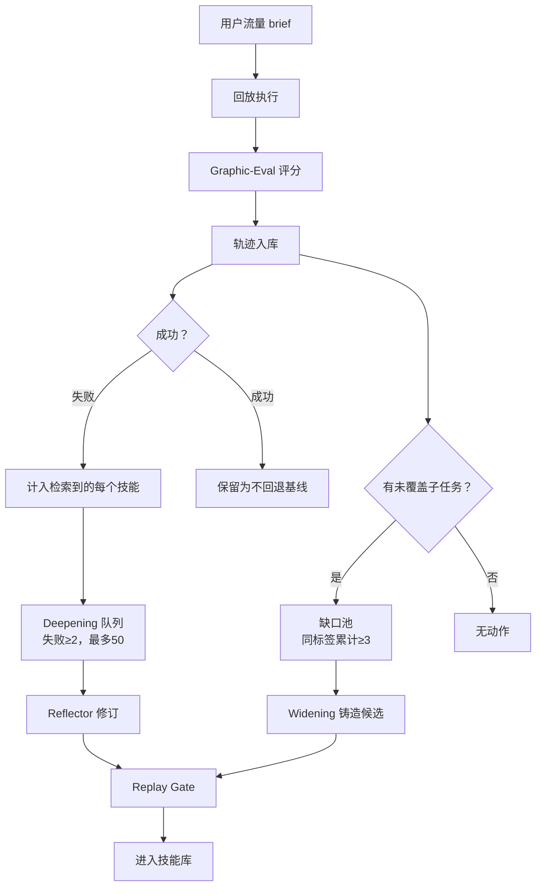
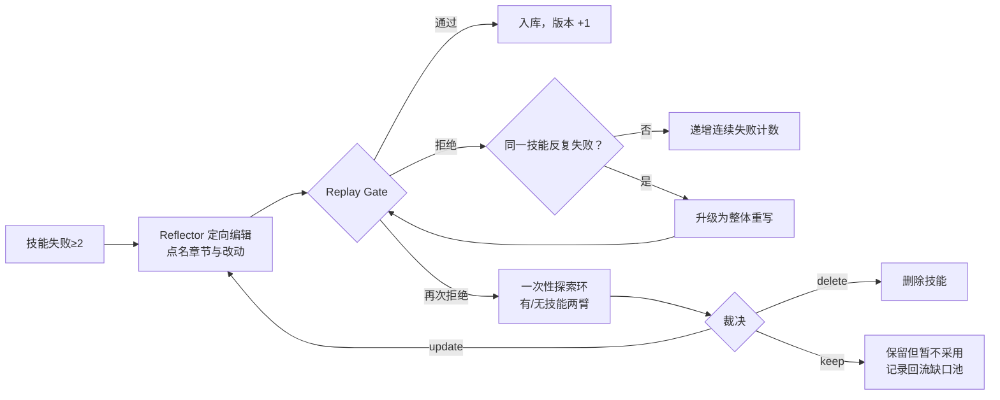

# 双轴演化：Widening 补缺口，Deepening 修旧流程

## 本章要点

1. 演化不是“不断加技能”，而是两个方向：**补上不存在的流程**（Widening）与**修好已有但常失败的流程**（Deepening）。
2. 两者的选择规则都很宽松，真正的质量控制在后面的 Replay Gate。这是刻意的非对称设计（F-046、F-047、F-058）。
3. Widening 需要**复发证据**：同一缺口标签累计 3 次才铸造候选（F-043）。
4. Deepening 需要**对照证据**：Reflector 同时看失败原因与成功调用轨迹，先定向改，再整体重写（F-049、F-050）。
5. 单轴最多把胜率推到 49% 左右；两轴合用达到 58.5%，并有 +3.85 完整度的超加性收益（F-095、F-096）。

## 演化循环的位置

论文的循环是**离线**的：用户流量先被回放、评分，再驱动技能修改；修改通过门控后才进入部署库（F-018、F-053）。这意味着：

1. 线上服务不需要暂停；
2. 每轮演化都基于一批固定轨迹，便于复现与审计；
3. 技能库是版本化对象，可以回滚。

## Widening：从复发缺口铸造新技能

### 四步流程

| 步骤 | 动作 | 判定 | 信源 |
|---|---|---|---|
| 1. 子任务抽取 | 冻结 LLM 从 brief 与工具调用序列抽取并规范化实际执行的子任务 | 每条轨迹都做 | F-041 |
| 2. 判未覆盖 | 检索为空；检索到的技能覆盖任务别的部分；或技能被归因于失败 | 任一成立即 uncovered | F-042 |
| 3. 累积证据 | 按 canonical label 写入持久缺口池 | 同标签累计 3 次 | F-043 |
| 4. 铸造与门控 | 冻结 LLM 把案例蒸馏为候选技能；候选对 no-skill 回放 | 通过门控才入库 | F-043、F-044、F-053 |

### 两个反直觉点

**第一，候选不是“有缺口就造”。** 单次缺失可能只是长尾；只有同一 canonical label 反复出现，才值得占用技能库位置（F-043）。

**第二，被拒的候选不会消失。** mint 被拒后，occurrences 仍保留在缺口池，等更多证据再试（F-044）。这与“失败即丢弃”的直觉相反，但对稀有流程很重要。

论文还验证了 mint 技能不是同义改写：新技能到冷启动库的最近邻距离为 0.215，大于种子库内部间距 0.158（Mann-Whitney p<1e-8，Cliff's δ=0.58）（F-045）。换句话说，Widening 补的是种子库真正没覆盖的意图。

## Deepening：用成功与失败对照修技能

### 失败如何归因

1. 轨迹标量分低于 τ=0.6，即判失败（F-046）。
2. 失败**计入该轨迹检索到的每个技能**，不做 blame 权重（F-046）。
3. 某技能失败计数达到 2，进入修订队列，最失败优先，每轮最多 50 个（F-047）。
4. 每累计 50 条新评分记录，触发一轮 evolve（F-048）。

> 这套选择规则是**廉价且偏宽松**的启发式。论文明确说：它只负责排序候选，不负责判断质量；质量由门控决定（F-047、F-058）。

### Reflector 看到什么

Reflector 的输入不是“失败日志”那么简单，而是一组对照材料（F-049）：

| 输入 | 作用 |
|---|---|
| brief | 还原任务目标 |
| 逐项要求结果 | 知道哪条 met / partial / not_met |
| why-bad 理由 | 知道为什么没满足 |
| 当前 SKILL.md | 知道要改哪一版 |
| 相似任务中成功调用该技能的工具序列 | 作为“不要改坏”的基线 |
| 中间结果与 thinking | 看到真正奏效的路径，而不只是失败文本 |

这使 Reflector 能在“成功↔失败”的具体分歧上推理，而不是凭失败描述猜。

### 三级修订策略

1. **定向编辑**：点名章节与具体改动，保留已奏效的部分（F-050）。
2. **整体重写**：同一技能反复失败时才升级，避免一开始就推倒重来（F-050）。
3. **探索环**：重写再被拒时，在失败 prompt 上比较“有技能/无技能”两臂，裁决 update / delete / keep；keep 会把不可改进的记录重新路由到缺口池（F-050）。

第三点是两轴耦合的关键：**Deepening 修不好的东西，会变成 Widening 的输入**。

## 为什么单轴不够

消融实验给出三组对照（F-093–F-096）：

| 技能库 | 技能数 | 完整度 | 对 Base 胜率 | 成功率 |
|---|---|---|---|---|
| Base（无技能） | 0 | 69.08 | — | 95.0% |
| 冷启动 | 76 | 68.62 | 46.4% | 96.5% |
| 只重写 | 76 | 69.02 | 48.6% | 97.5% |
| 只新增 | 139 | 69.79 | 49.4% | 98.5% |
| 完整 Evolve | 139 | 74.04 | 58.5% | 98.0% |

两个单轴方法的胜率都在 50% 附近，完整方法跳到 58.5%（p=0.025），完整度还比冷启动高 5.42，比两单轴之和多出 3.85（F-096）。

论文的解释是双向的（F-096）：

1. **新技能需要被修订过的描述才能被正确检索**：mint 只对原缺口簇做过门控，`description` 未必覆盖邻近请求；Deepening 会把这些描述磨到可检索。
2. **修不好的失败会被转回缺口池**：Deepening 的 keep 路径把“现有技能无法覆盖”的记录送回 Widening（F-050）。

所以覆盖与可靠性不是二选一，而是一个闭环的两端。

## 五轮演化的节奏

| 轮次 | 主要动作 | 过门数量 | 观察 |
|---|---|---|---|
| R1 | 几乎全是修复 | 39/59 重写、4/10 新增 | 缺口池还没积累足够复发证据（F-051） |
| R2 | 新增达峰 | 22/46 新增 | R2–R3 期间库从 77 增至 124（F-051） |
| R3 | 新增仍高 | 26/40 新增 | 覆盖快速扩张（F-051） |
| R4 | 新增减少 | 13 个新增 | 未修订 v1 技能最多，出现低端回退（F-079） |
| R5 | 以重写为主 | 21 重写 + 4 新增 | 各阈值最强，低端恢复（F-077、F-080） |

这条曲线说明：**技能库不是越大越好**。扩容先带来覆盖，再带来误触发；只有后续修订才能把覆盖转成可靠性。

## 设计取舍

| 选择 | 收益 | 代价 |
|---|---|---|
| 选择规则宽松（2 次失败即入选） | 不漏掉潜在可修技能 | 产生大量候选，依赖门控兜底 |
| 每轮最多 50 个 | 控制演化成本 | 长尾技能可能排队很久 |
| 先定向后整体重写 | 保留已奏效部分 | 反复失败时要多轮才升级 |
| 缺口需累计 3 次 | 抑制长尾噪声 | 新意图响应慢 |

## 常见误读

| 误读 | 纠正 |
|---|---|
| “失败一次就该重写技能” | 需累计 2 次失败才入选；且先定向编辑（F-047、F-050） |
| “新增技能越多越好” | 只新增胜率 49.4%，与冷启动无显著差别（F-095） |
| “Deepening 只修不删” | 探索环可裁决 delete；五轮共 6 个技能被删除或合并（F-050、F-076） |
| “演化是单调上升” | R4 在 ≥0.3 完整度上低于基线（F-079） |

## 自检问题

1. 为什么缺口要累计 3 次才铸造，而失败只要 2 次就进入修订？
2. Reflector 为什么必须看到成功轨迹，而不能只看失败原因？
3. “keep” 为什么要把记录送回缺口池，而不是直接丢弃？
4. 用消融表解释：为什么“只新增”无法获得完整 Evolve 的收益？
