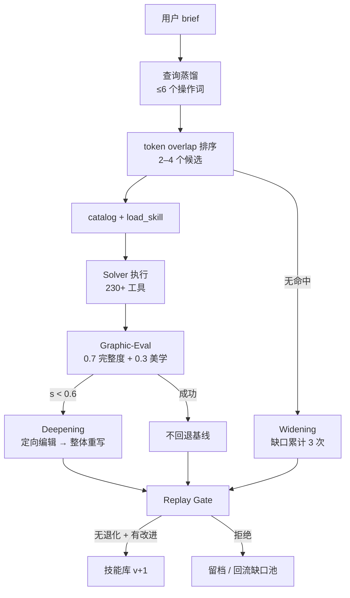

# Designer-RSI：用外部程序记忆演化图形设计 Agent

> **状态**：`stable`。核心数字与机制声明已逐项回查 arXiv:2609.22086 原文；发现 2 处源文次级表述偏差（技能统计字段位置、用户研究措辞），已在正文按论文口径修正并留痕。详见 [核验报告](references/verification.md)。

这是一份**机制解读型教程，不是操作或复现教程**。论文没有公开数据集与代码，本包也不提供安装、配置或实验复现步骤。它回答的是：一个冻结模型如何靠外部文本记忆，把“缺技能”和“常失败”变成可审计的改进。

## 一句话结论

Designer-RSI 把“Agent 自我改进”从权重训练改写成**外部程序记忆的版本演化**：新技能从复发缺口铸造，旧技能用成功/失败对照修订，所有候选必须通过匹配回放门控——不允许任何已见案例退化——才进入部署库（F-009、F-043、F-050、F-058）。

## 学习路径

| 读者问题 | 内容 |
|---|---|
| 这篇论文到底做了什么，值不值得读 | [速览：冻结模型之外的程序记忆](concepts/00-overview.md) |
| 程序记忆与参数记忆、聊天记忆有何不同 | [程序记忆与技能库](concepts/01-procedural-memory.md) |
| 139 个技能如何只暴露 2–4 个 | [两阶段检索与渐进披露](concepts/02-retrieval-and-injection.md) |
| 新技能怎么加，旧技能怎么修 | [双轴演化](concepts/03-evolution-widening-deepening.md) |
| 为什么平均分提高不能上线 | [匹配回放门控](concepts/04-replay-gate.md) |
| 设计质量怎么评分 | [Graphic-Eval](concepts/05-graphic-eval.md) |
| 五轮实验到底提升了什么 | [结果与读法](concepts/06-results.md) |
| 哪些边界不能越过，怎么落地 | [边界与落地](concepts/07-limits-and-adoption.md) |

## 机制全景



## 核心认识

1. **进化对象是记忆，不是模型**：权重、工具与渲染器都不变，只有 SKILL.md 在变（F-015、F-018）。
2. **技能不是提示词**：`description` 是唯一检索信号，正文按需加载；统计存放在文件外（F-020、F-026、F-038）。
3. **双轴必须耦合**：只重写胜率 48.6%，只新增 49.4%，合用 58.5%，完整度还有 +3.85 的超加性收益（F-095、F-096）。
4. **门控是保守的**：同一批、同上下文、成对比较；无退化且有改进才接受；全部打平也拒绝（F-053–F-058）。
5. **收益在完整性，不在审美**：完整度显著提升，美学仅 65.92→66.53（F-096）。
6. **非单调**：R4 在完整度 ≥0.3 上低于基线（90% vs 94%），R5 才恢复（F-079、F-080）。
7. **边界明确**：回放只保局部、自动分不等于人类偏好、像素几何与超长流程仍是瓶颈（F-098–F-102）。

## 质量记录

| 阶段 | 结果 |
|---|---|
| 信源获取 | 微信文章经浏览器渲染取全文（6,328 字）；论文 abs 页 + HTML 全文（约 120 KB） |
| 事实登记 | F-001 至 F-105，共 105 条；spec 与 bundle 双份登记 |
| P0 核验 | 17 组：全部通过；2 处 ⚠️ 次级表述、1 处口径混用风险、0 处 ❌ |
| 结构判定 | 操作可复现性两问皆否 → 不设 `examples/` |
| 知识拆分 | 4 层 8 篇：事实 / 机制 / 证据 / 边界 |
| 对抗审查 | 四视角（溯源、结构、可用性、时效）已执行，见 [核验报告](references/verification.md) |
| 机械门禁 | 双份 F 编号一致、三级 toctree 可达、计数同步、UTF-8 严格、链接可达（见 [log](log.md)） |

## 已知边界

1. 本包是二手解读 + 论文原文核验，不是作者访谈或独立复现。
2. 论文为 v1（2026-09-18），后续版本可能补充实验或修正数字；`stale_after` 设为 2027-03-31。
3. 论文未公开数据与代码，所有“可复现性”讨论仅限机制描述（F-104）。
4. 源文两处次级偏差已修正：技能统计字段位置（E-1）、用户研究措辞（E-2）；引用时请以本包正文与论文原文为准。

## 主题关联

| 关联知识包 | 分工 |
|---|---|
| [Agent 自我进化评测：LIFT 与 Loaded Impact](../agent-self-evolution-evaluation/index.md) | 那一束回答“如何测量自我进化的增益”（配对 Holdout、Loaded Impact）；本束回答“如何让外部记忆安全演化”（双轴 + 回放门控） |
| [AI 工程方法论](../ai-engineering-methodology/index.md) | 方法论谱系与 Harness 工程；本束提供一个具体论文案例，可与其中的评测与对抗审查章节对读 |

## 引用建议

引用本包时，请优先引用论文原文（arXiv:2609.22086）与本包的 F 编号事实；源文的具体措辞（如“规避计数”“计划中的用户研究”）不作为论文事实引用。

```{toctree}
:hidden:
:maxdepth: 2

concepts/index
references/index
log
```
