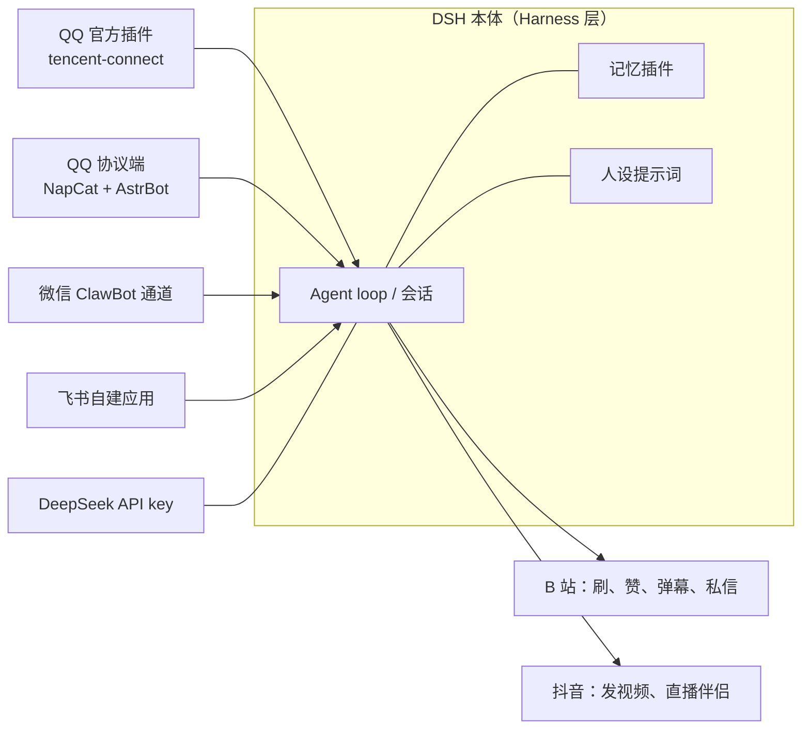

# 四通道拓扑与共享记忆

原文的顺序是「先在一个平台上养熟，再搬去别的平台」：QQ 起步，然后微信、飞书，最后放出去到 B 站和抖音。[F-005](../references/facts.md) 这个顺序有道理——先验证人格像不像，再扩大暴露面。

## 拓扑

## 各通道的证据等级

| 通道 | 接入方式 | 证据 | 读者可以拿去用的结论 |
|---|---|---|---|
| QQ（官方插件） | 插件面板装 `@tencent-connect/dsh-qqbot`，扫码绑定 | ✔ 官方三步与作者步骤一致[F-009、F-010](../references/facts.md)，能力有官方说明[F-013 至 F-015](../references/facts.md) | 这是唯一有官方文档兜底的通道，适合作为第一条路径 |
| QQ（协议端） | 小号扫码，NapCat 转 OneBot v11，AstrBot 接模型 | ⚠️ 两个项目真实存在且确常组合[F-022 至 F-024](../references/facts.md)；「DSH 代劳配置」单源[F-019](../references/facts.md) | 能拿到独立号与主动性，代价是账号风险由平台规则而非代码决定 |
| 微信 | 复用既有的 ClawBot 通道形态 | ⚠️ 通道存在已核（2026-03-22 起）[F-025](../references/facts.md)；DSH 能否直接接管未核[F-027](../references/facts.md) | 先按「同一 DSH 宿主 + 已有微信通道」理解，别预设一键可用 |
| 飞书 | DSH 创建自建应用并发布 | ✘ 单源[F-028](../references/facts.md) | 当待验证项处理，流程细节需自己去飞书开放平台核 |

表中「证据等级」是阅读优先级，不是可用性排序——微信与飞书在真实环境里可能完全跑得通，只是本包没有独立材料证明它。

## 共享层：记忆比人设难

原文最关键的一句承诺是：装上对应的记忆插件后，三个通道共享相同的人设、档期、插件工具与短期记忆，在 QQ 说过的事微信也记得。[F-029、F-030](../references/facts.md) 这条是单源，但它点出了正确的工程直觉：

- 人设是**无状态配置**，同一段文本可以喂给三个通道，天然一致。
- 记忆是**有状态存储**，默认情况下每个通道的会话是隔离的——官方明确说「每个单聊、每个群聊各有独立会话记忆」。[F-013](../references/facts.md) 也就是说，默认行为恰好与「共享」相反。
- 所以跨通道一致不是复制人设能解决的，必须有一个宿主侧的记忆组件把上下文汇总起来。

一致性失效有三种典型表现，可以用来验收：

| 现象 | 更像是什么问题 |
|---|---|
| 语气、称呼、口头禅在另一通道变了 | 人设没进那一侧的系统提示 |
| 语气对，但完全不记得刚才聊过的事 | 记忆没共享，会话各自隔离 |
| 记得事，但记成了别人的事 | 记忆共享了却没有按会话或用户区分，等于串档 |

## 三个反直觉点

- **通道差异会反噬人设**。原文人设要求「每条不超过 30 字、一次 1 至 3 条」[F-033](../references/facts.md)，这在 QQ 的聊天流里自然，在飞书这类偏文档化的界面里可能显得碎片化。人设模板要按通道微调，而不是复制。
- **一个通道掉线，记忆会缺一块**。共享记忆意味着任一侧的空窗都会在整体叙事里留白，家长式地「它昨天没理我」往往只是通道挂了。
- **曝光面随通道数线性增长**。每多接一个平台，就多一套账号规则、多一份可被陌生人触达的入口。[F-017](../references/facts.md) 这也是下一章[安全边界](safety-boundaries.md)要放在「放出去之前」讲的原因。

想直接动手，先看[最小可行路径](../examples/qq-bot-minimal-path.md)；想理解人格怎么写得像，读[人设设计](persona-design.md)。
