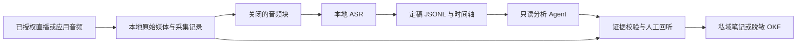

# 从直播信号到可追溯知识

一条可复查的分析结论，需要连回原始媒体中的具体片段。只有摘要，没有媒体、时间戳和来源身份，读者无法判断一句话是主播说过、ASR 误听，还是 Agent 推断。本教程的设计目标是把这条引用链保存下来；它是工程建议，不是任一工具已经整体提供的功能。

## 五层分工

| 层 | 输入与输出 | 应留存的信息 |
|---|---|---|
| 采集 | 获授权直播或应用声音 → 原始媒体 | 来源别名、授权范围、录制起止、轨道、缺口 |
| 识别 | 已关闭音频文件 → 带时间戳文字 | 原文件摘要、模型与版本、识别参数、语言 |
| 归一化 | 引擎输出 → 稳定的 JSONL 片段 | 会话/片段 ID、时轴、修订、质量标记 |
| 分析 | 已定稿片段 → 主题、论点、行动候选 | 证据 ID、引用原文、推断标记、覆盖范围 |
| 发布 | 复核过的分析 → 私人笔记或公开知识 | 版权检查、脱敏结果、审核状态、来源 |

图中保留原媒体到复核环节的直接路径。即使以后换识别模型或分析模型，也不必重新录直播。

## 三种时间要求

- **离线批处理**：直播结束、文件关闭后转写。最容易重跑和核对，适合课程、访谈复盘与资料整理。
- **准实时分块**：持续保存短音频块，每个块关闭后送 ASR。延迟包括块长、排队、识别和定稿等待；切成短块不自动变成低延迟流式模型。
- **流式识别**：引擎持续接收音频并输出中间结果，最终结果另行定稿。适合实时字幕、无障碍辅助和需要当场提示的应用。

Whisper 类滚动窗口方案也能提供实时体验，但机制和专门的流式模型不同。产品标注“实时”时，应查看其输入方式、中间结果修订和延迟口径，而非只看名字。[ASR 核验事实](../references/facts.md)

## “本地”的四个不同含义

| 说法 | 真正需要检查的条件 |
|---|---|
| 保存本地 | 媒体或文本写入本机；不说明生成过程在哪里 |
| 本地 ASR | 音频由本机模型识别；首次下载模型仍可能联网 |
| 本地分析 | 文本、图片、embedding 均进入本地推理后端 |
| 离线处理 | 已有媒体和模型缓存，断网后仍可完成识别、分析与检索 |

直播接收本身通常依赖网络。因此更精确的目标是“直播联网接收，媒体和分析不外发”，而非“联网看直播同时全程离线”。IDE 中的 Agent 可能调用云模型；让它读取本地文件同样可能把文件内容发往模型服务。[隐私边界](06-reliability-security.md)

## 从事实到方案的三条洞察

| 洞察 | 现象与证据 | 根因及影响 | 反常识点与行动 |
|---|---|---|---|
| 先保全再识别 | 采集器和 ASR 工具有不同输入、重试与输出接口；见 F-001—F-018 | 采集失败丢失信号，识别失败通常还能重跑；两者绑死会扩大故障范围 | 不必让识别模型追着每个采集包跑；先可靠落盘，再独立消费 |
| 先统一时轴再总结 | FFmpeg 分段可重置时间戳，识别结果有局部时间；见 F-008、F-014 | 相同的 00:10 可属于不同块，拼接后引用失去定位 | 字幕看起来连续不等于证据连续；保留片段与会话两套时间 |
| 先固定证据再扩展 Agent | 本地 ASR、结构化输出和工具权限是不同机制；见 F-014、F-026—F-028 | JSON 格式正确不代表内容正确，文本可携带不可信指令 | 先做只读主题拆解和引用检查，再考虑检索、联网核验和行动建议 |

上述是基于官方接口约束的设计推论，不是生产案例效果证明。迁移到访谈、内部培训或播客时，五层分工可沿用；录制授权、隐私和发布权限必须重新确认。
