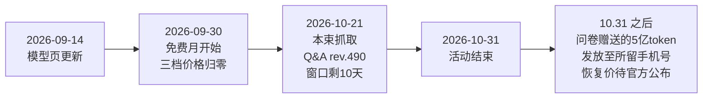

# U2Flash 免费月：活动事实与模型规格

> 本篇为**事件事实层（What/When）**：活动规则、主体定位、价格规格与时间窗。事实编号 F-0xx 对应 [references/article-source.md](../references/article-source.md)，核验过程见 [verification.md](../references/verification.md)。
> **数据时点**：全部参数为 **2026-10-21** 抓取的官方页面/Q&A（Q&A rev.490）值；活动 2026-10-31 结束，参数可能调整，调用前以官方页面实时值为准。

## 1. 活动一屏看懂

| 项 | 内容 |
|----|------|
| 活动主体 | 云知声（Unisound）MaaS 平台，模型 **U2Flash**，模型 ID `u2-flash`（F-004） |
| 活动时间 | **2026-09-30 – 2026-10-31**（共 32 天；官方模型页横幅，F-002） |
| 免费范围 | 活动期内**新老用户均免费调用** U2Flash，三档价格全为 ¥0（F-002/F-003） |
| 是否需要"领取" | **不需要**。登录 + 电脑端完成实名认证即可；公告"一键领取"链接就是模型页本身（F-001/F-018） |
| 调用前提 | ① 电脑端实名认证（手机端暂不支持调用）；② 账户余额非负；③ 模型名逐字填 `u2-flash`（F-018/F-019） |
| 活动入口 | https://maas.unisound.com/model-hub/u2-flash |
| 在线试用 | 平台 Playground：`/playground/text?modelId=u2-flash`（F-027） |

> 截至本束抓取日（10-21），免费窗口**仅剩 10 天**。11-01 起的价格策略见 [02 篇](02-token-economics-and-funnel.md)。

## 2. 价格：活动价与恢复价

官方模型页定价表（F-003，人民币元 / 百万 tokens）：

| 计费项 | 活动价（9.30–10.31） | 页面标注原价 |
|--------|--------------------:|------------:|
| 输入 | **¥0** | ¥1 |
| 输入（缓存命中） | **¥0** | ¥0.2 |
| 输出 | **¥0** | ¥2 |

- 活动价在页面以活动标签呈现，原价以划线价呈现（F-003）。
- 若账户里有此前领取的 **1 亿 U2Flash 存量 token**，活动期内**先扣存量、再扣免费额度**——所以账单上仍可能看到 token 扣减，这不代表活动失效（F-023）。
- **11 月成本预案**：若活动后恢复原价，典型"输入多输出少"的 Agent 工作流应按 ¥1/¥2 每百万 tokens 重算单任务成本，不要把 10 月的零成本外推（分析者建议，非官方承诺）。

## 3. 模型规格与限流（"无限量"的真实边界）

官方参数卡（F-007/F-008）：

| 维度 | 参数 |
|------|------|
| 最大输入 | 512K tokens |
| 上下文长度 | 512K tokens |
| 最大输出 | 128K tokens |
| RPM（每分钟请求数） | **100** |
| TPM（每分钟 tokens 数） | **10,000,000** |

> ⚠️ **勘误 E-1：公告"无限制，无限量"不等于速率无限制。** 公告修辞（F-001）与官方限流参数（F-008）并存。正确理解："无限量"指**活动期不按 token 总量计费、不设总量配额**；但每分钟 **100 次请求 / 1000 万 tokens** 的速率上限仍然存在。多步 Agent 一次任务可能触发数十轮调用，RPM 100 约等于每分钟支撑 1 个高频 Agent 会话的连续运转（V8 意见）——批量跑任务前务必实测限速拐点（见 [02 篇行动清单](02-token-economics-and-funnel.md#四窗口行动清单)）。

**协议兼容性**（F-009）：

- OpenAI 兼容端点：`https://maas-api.unisound.com/v1`
- Anthropic 兼容端点：`https://maas-api.unisound.com/anthropic`
- 官方调用示例为标准 OpenAI Chat Completions 结构：`POST {base_url}/v1/chat/completions`，Header `Authorization: Bearer <api_key>`，`model: u2-flash`（F-010）。

## 4. 模型定位（厂商自述）

官方模型页的定位表述（F-005）：**聚焦 Agent 与 Coding 核心场景**，支持复杂推理、代码生成、任务执行、长上下文，面向复杂工程开发、长程任务与多步 Agent 工作流。

> ⚠️ 以上为**厂商自述**：截至 2026-10-21，本束未检索到第三方榜单或独立评测对该模型代码/推理能力的横向验证。云知声以语音技术（ASR/TTS）见长（平台另预置 U2-ASR、U2-TTS、U1-OCR 等模型 Skill，F-017），文本大模型的实际表现建议以 10 月窗口内自测为准，不要直接把官方定位写入采购/变现决策依据。

## 5. 时间线

事实依据：F-002/F-004/F-006/F-025。活动结束后价格是否恢复为页面划线原价、5 亿 token 是否如期发放，均为**待 11 月验证项**，已在 [verification.md](../references/verification.md) 登记。

## 6. 术语对照

| 术语 | 含义（据官方页面） |
|------|--------------------|
| MaaS | Model-as-a-Service，云知声大模型服务平台（maas.unisound.com） |
| RPM / TPM | 每分钟请求数 / 每分钟 token 数，活动期上限 100 / 1000 万（F-008） |
| `sk-` Key | 按量付费 API Key，API Key 管理页创建（F-014） |
| `tp-` Key | Token Plan 订阅 Key，订阅管理页获取（F-014） |
| Token Plan | 平台订阅制套餐，与"按量付费 + 资源包"并列的第二条计费路径（F-011） |
| WorkBuddy | 腾讯出品的 all-in-one AI 工作平台（workbuddy.ai），本活动主推的第三方接入工具（F-013） |

---

**下一篇**：[01 · 接入实操与八问排障](01-access-and-troubleshooting.md)——资格三检、API/WorkBuddy 配置与 Q&A 故障对照表。
