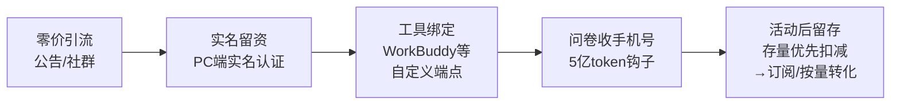

# 计费机制、免费漏斗与限免模型淘金法

> 本篇为**机制与趋势层（Why）**。第 1 节为官方口径（F 编号溯源）；第 2 节起为**分析者洞察与方法沉淀**，不代表云知声官方立场，已逐节标注。

## 一、计费机制：三条钱流与扣费顺序（官方口径）

1. **免费额度（活动期）**：9.30–10.31 三档价格 ¥0，新老用户同权（F-002/F-003）。
2. **存量资源包**：账户内若有此前领取的 1 亿 U2Flash token，**先扣存量、再走免费额度**（F-023）。
3. **两条常态付费路径**：按量付费/模型资源包（`sk-` Key）与 Token Plan 订阅（`tp-` Key）（F-011/F-014）。
4. **欠费联锁**：任何模型造成的账户负余额都会锁死 U2Flash（F-019/F-020）——余额检查是账户级、非模型级。

**恢复价锚点**（据模型页划线原价，F-003，活动后是否照此执行以官方公布为准）：输入 ¥1/M、缓存命中 ¥0.2/M、输出 ¥2/M。做 11 月预算时按此值上限估算。

## 二、"5 亿 token"赠品的真实分量（分析者测算，非官方）

> 本节为分析者基于官方原价（F-003）与官方赠送规则（F-025/F-026）的**推算**，云知声未公布该赠品的货币价值，禁止当作官方数字引用。

- **数量**：5 亿 tokens = 500M。
- **按原价折算区间**：若全为缓存命中输入，约 ¥100；全为输出，约 ¥1,000；混合负载通常落在 ¥300–600 量级。
- **三重约束削弱其经济价值**：① **仅限 U2-Flash 单模型**，不能用于全平台（F-026）；② **10.31 活动结束后才发放**到问卷所留手机号（F-025），本质是"活动后留存钩子"；③ 11 月若恢复价格，5 亿存量会像本次的"1 亿存量"一样被优先扣减（F-023 的同款机制），把用户锁在该模型上继续使用。
- **结论（分析者观点）**："5 亿"是心理计价数字，真实货币价值约百元量级；它的商业作用是**延长留存窗口**而非赠送高额资产。是否填问卷，取决于你本来就打算用 U2Flash，而不是被数字锚定。

## 三、免费月的商业漏斗拆解（分析者洞察）

依据：F-001/F-018/F-012/F-024/F-025/F-011。解读要点：

- 对用户最反直觉的设计是**欠费联锁**（F-020）：新用户用赠送资源包探索其他模型→欠费→免费模型不可用→充值。首次"充值"动作是漏斗的关键转化点。
- 对厂商，32 天零价换取的是：实名账户、默认端点配置、Agent/Coding 工作负载的迁移测试，以及活动后存量 token 形成的迁移惰性。
- 对用户，免费月的正确用法是**零成本获取评测数据与迁移演练**，而不是建立长期供应依赖。

## 四、限免模型淘金五查法（本束沉淀的可迁移方法 · L1 待验证）

从本案例提炼，适用于评估一切厂商"限时免费 API/云服务"活动；单案例模式，迁移前请再验证。

1. **拆话术**：把营销宣称（"无限制/无限量"）与官方参数表（RPM/TPM/上下文/输出上限）逐项对表。本案例对照结果见 [00 篇勘误 E-1](00-free-month-event.md#3-模型规格与限流无限量的真实边界)。
2. **查资格**：实名认证、端侧限制（本例不支持手机端调用）、账户级余额/欠费规则、黑白名单。
3. **翻牌价**：记录活动后恢复价、存量与免费额度的**扣费顺序**、凭证类型（本例 sk-/tp- 两套）。
4. **识钩子**：赠品的可用范围（单模型/全平台）、到账时点、留资成本（手机号）、货币价值独立测算。
5. **排窗口**：按截止日倒排"评测 → 演练 → 回切/付费预案"；代码走供应商抽象层，模型 ID/Base URL 配置化，不硬编码。

**五条反模式（均出自本案例）**：① 见"无限量"就切生产流量（无视 RPM 100 与 32 天窗口）；② 新用户乱调赠送的其他模型资源包（欠费反锁免费模型）；③ 把"5 亿 token"当全平台额度做架构；④ 只收藏公告不读 Q&A（关键坑只在 Q&A）；⑤ 在手机端反复尝试调用（官方暂不支持）。

## 五、窗口行动清单（10 月 21–31 日）

| # | 动作 | 验收标准 |
|---|------|----------|
| 1 | 完成资格三检（实名/余额/模型名） | Playground 能成功返回一轮对话 |
| 2 | 创建 `sk-` Key，用 curl/OpenAI SDK 跑通直连 | 拿到非空 completion，账单 ¥0 |
| 3 | 在一款支持自定义端点的工具中配置并跑一个真实 Coding/Agent 任务 | 多轮任务成功；记录实际 RPM 占用与限速拐点（V1/V8） |
| 4 | 用你自己的任务集做能力评测（代码生成/长上下文/工具调用） | 产出与现有模型的横向对比表，不轻信厂商定位（V3） |
| 5 | 按恢复价 ¥1/¥2 每百万 tokens 测算 11 月单任务成本 | 得到"付费后是否仍划算"的结论（V9） |
| 6 | 模型调用走抽象层（base_url/model 配置化） | 11.1 可在 10 分钟内切回原供应商 |
| 7 | 如要 5 亿赠品，用副号/小号填问卷 | 11 月初核对到账且范围确为 U2-Flash（V4/F-025） |

## 六、使用边界与风险

- **企业/敏感项目**：代码与数据外发到新厂商前过合规评估；活动窗口内仅用非敏感项目试跑（V7）。
- **供应连续性**：活动 10.31 结束，恢复价、限流是否调整均未承诺；Q&A 已迭代到 rev.490，本束事实时效到 **2026-11-15**（V10）。
- **能力风险**：U2Flash 的 Agent/Coding 能力目前仅有厂商自述（F-005），在看到你自己的评测数据前，不要把关键工作流单点绑定（V3）。

---

**返回**：[束索引](../index.md) ｜ **事实与核验**：[article-source.md](../references/article-source.md) · [verification.md](../references/verification.md)
