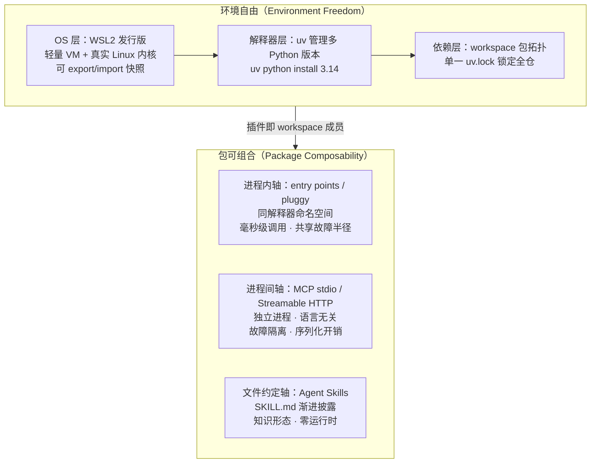

# 技术栈总架构：环境自由三层栈与包可组合双轴

## 一个决策图看懂全栈

两个维度不是并列清单，而是**纵（环境）横（组合）交织**：组合轴上的每一个插件包，都落在环境轴的依赖层里（workspace 成员），于是「包可组合」免费获得了「环境可重建」——这是本架构的核心联动。

## 环境自由三层栈

| 层 | 承载资产 | 声明文件 | 自由度含义 |
|----|---------|---------|-----------|
| **OS 层（WSL2）** | Ubuntu 等发行版 + systemd 服务 | `wsl --export` 产物（tar/VHDX）+ `/etc/wsl.conf` | 整机环境可快照、可复制、可销毁重建 |
| **解释器层（uv）** | 多版本 Python（3.10/3.12/3.14 并存） | `.python-version` + `requires-python` | 每项目锁定解释器版本，切换零成本 |
| **依赖层（uv workspace）** | 多包拓扑 + 传递依赖闭包 | 根 `pyproject.toml`（members）+ `uv.lock` | 全仓单一锁文件，成员间 editable 直连 |

**「环境自由」的操作性定义**：拿到一台全新 Win11 机器，只凭 git 仓库（含 `.wslconfig` 建议稿、`.python-version`、`pyproject.toml`、`uv.lock`）+ `wsl --import` 的发行版快照（可选），在半小时内恢复完全一致的开发环境。凡是不能用文件表达的（Windows 注册表、全局 site-packages、手工 `pip install` 的孤儿包），都不属于自由资产。

## 包可组合双轴（+文件约定轴）

| 轴 | 机制 | 调用形态 | 故障半径 | 信任模型 |
|----|------|---------|---------|---------|
| **进程内** | entry points（`importlib.metadata`） | 函数级导入调用 | 插件崩溃 = 宿主崩溃 | 完全信任（同进程同权限） |
| **进程内（钩子）** | pluggy（hookspec/hookimpl） | 钩子总线调用 | 同上，但调用顺序受管 | 宿主定义扩展点契约 |
| **进程间** | MCP（stdio / Streamable HTTP） | JSON-RPC 2.0 消息 | 插件崩溃 = 该能力降级 | 协议级：用户同意、工具描述视为不可信 |
| **文件约定** | Agent Skills（SKILL.md） | 无运行时，按需读取 | 无代码执行（脚本显式执行） | 内容级：渐进披露控制上下文 |

**第一决策轴是进程边界**：先回答「这个插件与宿主是否共享生死」，再选具体机制。MCP 的安全三原则（用户同意与控制、数据隐私、工具安全）建立在独立进程与独立权限之上——把不可信能力塞进 entry points 等于放弃协议提供的隔离层。

## 三声明文件：环境重建的最小集

1. **`.wslconfig`（Windows 侧）**：VM 资源上限、网络模式、内存回收策略——决定 WSL2 的「硬件面」。
2. **`pyproject.toml` 网络（workspace 根 + 各成员）**：包拓扑、entry points 注册、extras 分组——决定组合的「结构面」。
3. **`uv.lock`**：全仓依赖闭包的精确解析结果——决定复现的「内容面」。

这三份文件 + git 仓库本身，构成环境的**完整可重建描述**；`wsl --export` 的发行版快照是可选加速项（省去 apt 层重装），不是必需项。

## 与本库其他束的关系

- WSL 安装与基础操作：[WSL 子系统中文教程](../../../systems/wsl/index.md)（systems 组）
- Windows 原生路线的 Agent 执行隔离：[microsoft-mxc-agent-containment](../../microsoft-mxc-agent-containment/index.md)（同组）
- Agent Skills 渐进披露的工程解读：本束 [插件发现机制四谱](03-plugin-discovery.md)

## 关键要点回顾

- 环境自由 = 三层声明式资产（WSL 快照 / uv 解释器 / workspace 锁定），操作性检验是「新机器半小时重建」。
- 包可组合的第一决策轴是进程边界（故障半径与信任模型），功能分类是第二轴。
- 插件即 workspace 成员：组合性与可重建性在依赖层会师，这是全架构的枢纽设计。
