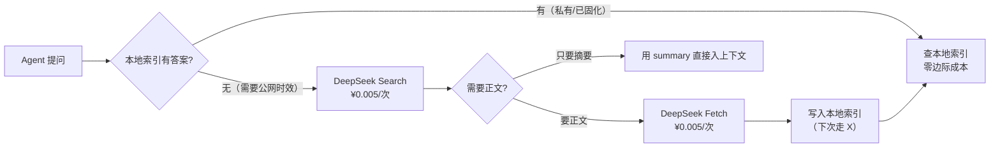

# 成本曲线与选型

## 两种成本形态

| | XERJ | DeepSeek Search / Fetch |
|---|---|---|
| 形态 | **固定成本**：一次索引 + 一台机器（F-010） | **线性成本**：¥0.005/次成功请求（F-028） |
| 边际成本 | 近乎零（电费与运维时间） | 每次调用都计费 |
| 计量维度 | 无（不按 token、不按次） | 按**成功请求次数**，不按 token、不按结果条数（F-028） |
| 重复查询 | 不额外收费 | **照收**（F-036） |
| 扩容方式 | 加机器 / 加内存（受本机约束，F-042） | 提高 QPS 上限（Search 100 / Fetch 25，账号级，F-029） |

> **反常识**：DeepSeek 的 `count` 从 10 调到 50，**价格不变**——它省的是「按结果条数计费」的钱，不是「上下文」的钱。所以调大 `count` 不会让账单变厚，但**会让上下文变厚 5 倍**。

## 深研型任务里的量级

按 ¥0.005/次计（F-028），Agent 循环中的搜索调用非常频繁（F-037）：

| 场景 | 循环轮数 | 每轮搜索次数 | Search/Fetch 费用 | 量级判断 |
|---|---:|---:|---:|---|
| 单次事实核查 | 1 | 2 | ¥0.01 | 可忽略 |
| 常规代码任务 | 10 | 2 | ¥0.10 | 仍低于 token 费 |
| 深研型任务 | 50 | 2 | ¥0.50 | **与 token 费用同量级** |
| 深研型任务 | 50 | 4 | ¥1.00 | 超过部分单任务的全部模型费（对比 1017 max 档约 ¥1.3） |

这张表来自仓库内 [DeepSeek V4.1-Flash-1017](../../deepseek-v41-flash-1017/index.md) 束的搜索 API 篇与成本篇，**本束只做引用与对照**。

**工程结论**：在高轮次、多搜索的工作流里，Search/Fetch 不是「零钱」，而是与模型 token 费**并列**的成本项。降本三类手段：缓存重复查询结果、减少每轮无条件搜索、把批量检索移出 Agent 主循环。

> **这三条正好指向自建栈**：缓存、减少搜索、把批量检索移出循环——这三件事在本地索引上都是**零边际成本**的。

## 2026-11-01：一个真实的时点

这一条值得单独拎出来，因为它是**已经发生的变化**而不是规划（F-030）：

> 当前用户在 DeepSeek Harness / Claude Code / Codex 中使用 DeepSeek API 时，已经会通过 Server 端工具调用访问到 Search/Fetch 接口，这部分 Search/Fetch 接口调用**目前未计费**，并将于**北京时间 2026 年 11 月 1 日 00:00 起按次收取调用费用**。

含义：**「免费搭赠」的服务端工具调用会变成显性账单**。多数使用者的第一反应是「搜索是模型自带的」，直到账单出现。

**行动**（引用自同仓该束）：

1. 在代码里埋点统计 Search/Fetch 调用量；
2. 把搜索密度纳入成本模型。

> 这条对**自建栈也是一个提醒**：如果你的方案依赖「某模型厂商顺带提供的免费联网搜索」，那么这个方案的**成本模型是不完整的**——它建立在别人的定价策略上。

## 选型决策树

```
Q1: 要检索的东西归谁？
├─ 归我（内部日志/私有代码/内部 Wiki/我自己的记忆）
│   └─→ 自建（XERJ 或等价方案）。DeepSeek 结构上做不到。
├─ 归别人且在公网（上游项目最新实现/新闻/当前文档）
│   └─→ Q2
└─ 两者都要
    └─→ 串联：Search 定位 → Fetch 取正文 → 落本地索引 → 之后本地查

Q2（仅当答案是"公网"时问）: 需要可复现还是需要最新？
├─ 可复现（同一问题今天与下周答案必须相同）
│   └─→ 自建 + 固定快照。托管搜索的排序随时间变化，Agent 行为无法回归测试。
└─ 要最新
    └─→ 托管搜索。自建快照在信息更新后就是错的。

Q3: 这个查询会被重复问吗？
├─ 会（同一问题每周问一次以上）
│   └─→ 自建。DeepSeek 照收每次（¥0.005 × 重复次数）。
└─ 不会
    └─→ 托管搜索。按次成本可忽略。
```

### 三个判据的优先级

**Q1（归属）是硬约束**，Q2（可复现性）与 Q3（重复度）是成本与质量的软权衡。**先过 Q1，再谈 Q2/Q3**——这是 [01 语料归属](01-corpus-ownership.md) 的核心结论。

## 一个组合架构

最实用的形态往往不是二选一，而是**分阶段**（F-040）：



这个架构的关键性质：

- **一次性付费，多次命中**——把「会被重复问」的公网内容固化到本地后，后续查询走零边际成本路径；
- **私有语料永远走本地**——不出网，隐私边界不破；
- **时效内容仍能拿到**——公网路径保留。

它同时满足了两侧各自的最优：DeepSeek 的时效与覆盖面，XERJ 的成本与隐私。

## 成本与质量的权衡表

| 方案 | 一次性成本 | 边际成本 | 隐私 | 时效 | 可复现 |
|---|---|---|---|---|---|
| 纯托管搜索 | 0 | ¥0.005/次 | 检索词出网 | 实时 | 否 |
| 纯自建 | 机器 + 索引工程 | ≈0 | 默认不出网 | 快照 | 是 |
| 组合（推荐） | 机器 + 索引工程 | 混合 | 私有不出网 | 公网实时 | 固化部分可复现 |

## 落地清单

| 事项 | 动作 |
|---|---|
| 存量托管用量 | 埋点统计 Search/Fetch 调用量；2026-11-01 前完成 |
| 重复查询识别 | 找出被反复问的公网问题 → 固化为本地索引条目 |
| 检索词敏感性 | 盘点会进检索词的内部标识；敏感的部分改走本地 |
| 可复现性要求 | 明确哪些任务必须答案稳定（测试、回归）→ 走固定快照 |
| 计费口径 | 把「成功请求数」而非「token」纳入成本模型（F-028） |
| 失败成本 | DeepSeek 的 404 五因合一 → 预估误重试率，避免重复付费（见 [03](03-failure-semantics-and-boundaries.md)） |

## 相关概念

- [00 对比框架与结论](00-comparison-frame.md)：九个对照轴
- [01 语料归属](01-corpus-ownership.md)：第一决策轴
- [03 失败语义与可诊断性](03-failure-semantics-and-boundaries.md)：误重试的成本
- [01 组合检索回路实战](../examples/01-composed-retrieval-pipeline.md)：端到端示例
- 事实来源：[对比事实清单](/references/facts.md)
