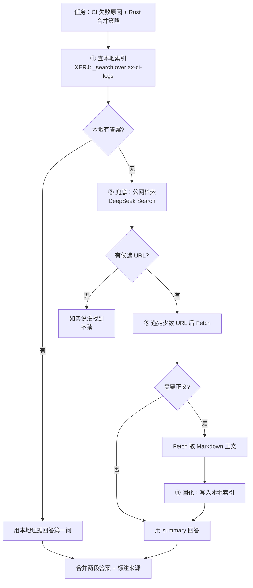

# 组合检索回路实战

## 场景

一个真实的 Agent 任务：

> 「我们上周的 CI 为什么在 `rotate WAL segment` 这步失败？另外看看 Rust 官方的 `segment` 合并策略最近有没有改。」

这句话里有**两类语料**：

| 片段 | 语料归属 | 只能靠谁 |
|---|---|---|
| 「我们上周的 CI 为什么失败」 | **我们**（内部 CI 日志） | 只能自建（F-034） |
| 「Rust 官方合并策略最近有没有改」 | **公网**（上游仓库/官方文档） | 托管搜索（F-016） |

这正是**组合架构**的典型场景。

## 回路



## 第 ① 步：查本地（私有语料）

```sh
curl -sXPOST http://localhost:9200/ax-ci-logs/_search \
  -H "Authorization: ApiKey $XERJ_API_KEY" \
  -H 'content-type: application/json' \
  -d '{
    "fields": ["_passage"],
    "_source": ["ax_path", "@timestamp", "level"],
    "query": {
      "bool": {
        "must":   [{ "match": { "message": "rotate WAL segment" } }],
        "filter": [
          { "term":  { "result": "fail" } },
          { "range": { "@timestamp": { "gte": "now-14d" } } }
        ]
      }
    },
    "size": 5
  }'
```

三个要点：

1. **`fields: ["_passage"]` 不能省**（F-004）——默认返回完整文档，CI 日志条目动辄几 KB，5 条就是几十 KB。
2. **`_source` 投影**只留路径、时间戳与级别，正文靠 `_passage` 给。
3. 私有日志**不出网**（F-011）——这是自建路线最硬的收益。

若本地返回 0 命中，**这就是诚实的答案**（第一问在本地无据），不要用公网结果去猜内部原因。

## 第 ② 步：公网兜底（时效语料）

```sh
curl -sXPOST https://api.deepseek.com/v1/tools/search \
  -H "Authorization: Bearer $DEEPSEEK_API_KEY" \
  -H 'content-type: application/json' \
  -d '{
    "query": "Rust segment merge policy site:github.com OR site:doc.rust-lang.org after:2026-09",
    "count": 5,
    "need_content": false
  }'
```

三个要点：

1. **用搜索语法收窄语料**（F-020）：`site:` 限定权威来源、`after:` 限定时间窗。这一步既提质量又减少后续 Fetch 次数。
2. **`need_content: false` 是默认值**（F-019），且此时 `content` 恒为空字符串——先用摘要判断是否值得取正文。
3. **按 `rerank_score` 与 `authority` 过滤**（F-021）：`rerank_score ≥ 1.5` 是官方口径的优质结果；`authority ≥ 3` 是极权威。对 `authority = -1`（未知）应设兜底而非直接丢弃。

## 第 ③ 步：只对选中的少数 URL 取正文

```sh
curl -sXPOST https://api.deepseek.com/v1/tools/fetch \
  -H "Authorization: Bearer $DEEPSEEK_API_KEY" \
  -H 'content-type: application/json' \
  -d '{"url": "https://github.com/rust-lang/rust/pull/12345"}'
```

**不要对 `count: 50` 的全部结果开 `need_content: true`**——那会把 50 篇全文塞进上下文。正确做法是：先看 `summary` 挑出 1～2 个真正相关的，再对它们 Fetch。

> ⚠️ **404 的五种成因**（F-026）：URL 不可用、被站点策略拦截、站点返回错误、内容类型不受支持、页面无可提取正文。**这五种需要不同反应**（换 URL / 换来源 / 等待重试 / 改用 summary / 换候选），而 API 把它们压成同一个码。实操上：**Fetch 404 就换候选 URL，不要重试同一 URL**。

## 第 ④ 步：固化回本地

```sh
# 1. 把抓到的正文存成文件
curl -sXPOST https://api.deepseek.com/v1/tools/fetch \
  -H "Authorization: Bearer $DEEPSEEK_API_KEY" \
  -H 'content-type: application/json' \
  -d '{"url": "https://github.com/rust-lang/rust/pull/12345"}' \
  | jq -r '.content' > ~/research/rust-segment-merge-12345.md

# 2. 索引这份语料（XERJ 的 autoindex 是纯 HTTP 客户端，可对任意文件夹工作）
xerj autoindex ~/research --prefix research
```

之后同一个问题走**本地路径**：零边际成本、答案可复现、检索词不出网。

> 这就是 [04 成本曲线与选型](../concepts/04-cost-model-and-selection.md) 里「一次性付费，多次命中」的具体形态。固化判断很简单：**这个问题会被重复问吗？** 会，就固化。

## 合并两段答案

工程上要保留**来源标注**：

| 片段 | 来源标注 | 证据形态 |
|---|---|---|
| CI 失败原因 | 本地 `ax-ci-logs`（file:line + `@timestamp`） | `_passage` 片段 |
| Rust 合并策略变化 | 公开 URL（`rerank_score` / `authority` 可附） | 摘要 + 正文引用 |

理由：两段证据的**可信度来源不同**（内部日志是事实记录，公网内容是他人陈述），且只有第一段能保证不出网。

## 成本账（这个回路一次跑完）

| 步骤 | 成本 |
|---|---|
| ① 查本地 | ¥0（自建，F-010） |
| ② Search 1 次 | ¥0.005（F-028） |
| ③ Fetch 1 次 | ¥0.005 |
| ④ 固化 + 索引 | 一台机器 + 一次索引 |
| **下次问同样的问题** | **¥0**（走本地） |

对比「每次都走公网」：同一个问题问 10 次是 ¥0.10，固化后是 ¥0.01 + 一次索引。

## 失败处理速查

| 场景 | 正确动作 | 依据 |
|---|---|---|
| 本地 0 命中 | 如实说本地无据，转公网 | — |
| XERJ 400（字段名错） | 按响应里给出的可检索字段改 | F-006 |
| XERJ 429 | 降并发、只重发被拒条目，继续 | F-009 |
| XERJ scroll 超限 | 改 `search_after` | F-008 |
| DeepSeek 429 | 退避重试；Fetch 注意域名级限流可能更早触发 | F-029 |
| DeepSeek 404 | **换候选 URL**，不要重试同一 URL | F-026 |
| DeepSeek 402 | 先充值 | F-027 |
| DeepSeek 408 / 5xx | 等待后重试 | F-027 |

## 相关概念

- [00 对比框架与结论](../concepts/00-comparison-frame.md)：九个对照轴
- [01 语料归属](../concepts/01-corpus-ownership.md)：为什么这个回路必然是组合的
- [02 上下文成本与接口契约](../concepts/02-context-cost-and-contracts.md)：`_passage` 与三档摘要
- [03 失败语义与可诊断性](../concepts/03-failure-semantics-and-boundaries.md)：404 五因与 429 语义差
- [04 成本曲线与选型](../concepts/04-cost-model-and-selection.md)：决策树与成本账
- 事实来源：[对比事实清单](/references/facts.md)
