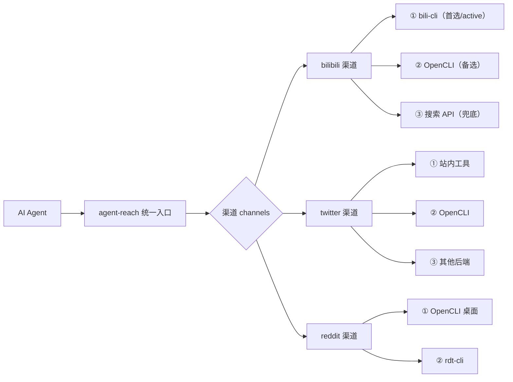

# 能力层架构：有序后端列表与 14 渠道全景

> 机制层（How）。本文解释"能力层"与单平台抓取工具的结构差异、有序后端列表的工作方式，以及 v1.6.0 的 14 个渠道如何分三级。事实均经 README、git tree 与 v1.5.0 tag 交叉核验。
> 渠道数为什么从 16 变 14、怎么读这类数字，见 [05](05-version-drift-and-channel-matrix.md)。

## 1. 能力层，不是"又一个工具"

博文把同类项目分成两种做法（F-010）：

- **工具层做法**：写一个工具帮你抓某个平台。项目寿命 = 它依赖的那条接入路径能活多久，平台一改反爬项目就坏，用户等作者修。
- **能力层做法（Agent Reach）**：自己不做抓取，只负责**选型、安装、体检、路由**；抓取动作由 Agent 直接调用上游工具完成，中间没有包装层。

项目作者在 README 中对这件事的表述是（F-012/F-080，属项目方自述 S）：

> "当下最稳的接入方式，我们替你选好、装好、体检好。接入方式会换代，你不用操心。"

推介作者把它翻译成架构语言（F-013，V 观点层）："把'易变的接入方式'封装在一层稳定接口后面——变的永远是实现，不变的是 agent-reach 这个入口和那些渠道名。"

需要注意的边界："当下最稳"是项目方的自我定位而非第三方评测结论；README 含 6 家赞助商区块（Bright Data、RapidProxy、BrowserAct、腾讯云 OpenClaw、CoreClaw、优刻得星图，F-116），读者评估其中立性时应知悉这一背景。

## 2. 核心结构：每渠道一个有序候选后端列表

实现非常朴素：`channels/` 目录下每个平台一个 Python 文件，每个渠道维护**一个有序的候选后端列表**——第一个是首选，后面依次是备选；渠道通过 `active_backend` 字段上报"现在实际在用哪个后端"（F-016/F-084，经 README 与官方文档核验）。

这一结构带来两个直接性质：

1. **换接入方式 = 调整列表顺序，不是重写代码**（F-016）。某个上游失效，把备选提前即可，渠道名和入口不变。
2. **可单独覆盖、互不影响**：可以用环境变量（渠道名 + `_backend` 形式）单独指定某渠道后端；不信任某条路就改对应的 channel 文件，其他渠道完全不受影响（F-017/F-038）。

推介作者由此给出一条可迁移的工程建议（F-018，V）：面对"上游随时会变"的依赖，不要写 `if upstream_a ... else ...` 分支（分支数量随上游爆炸），而应写"有序候选列表 + 探测选主"。

> ⚠️ **目录规模勘误**：博文画的 channels/ 树是 9 个文件的**示意**（F-015）。地面真值随后续版本变化：v1.5.0 tag 为 15 个 py = 13 个渠道模块（F-106）；main@2026-10-08 为 20 个 py = 16 渠道 + mcporter 承载（F-107）；**v1.6.0 为 17 个 py = 3 个框架文件（`__init__`/`base`/`_opencli_site`）+ 14 个渠道实现**（F-108）。三组数字都能自洽，差别只在版本——引用时必须带版本号。

## 3. 真实故障案例：yt-dlp 被 B站 412，用户零感知

博文用一个有官方记载的案例说明结构差异（F-023~F-026、F-085）：

- **2026 年 6 月**，B站风控升级，yt-dlp 拉取 B站内容全面返回 HTTP 412，直接废掉。
- Agent Reach 的 bilibili 渠道后端列表本就是 **bili-cli → OpenCLI → 搜索 API**：yt-dlp 退役，bili-cli 顶上，**用户什么都不用做**。
- v1.5.0 README 的选型表写得很硬："yt-dlp 被 B站风控 412 封死（2026-06 实测）"——该注记经核验确实存在于官方 README（F-115），第二篇博文的"412"细节也有出处。

README 设计理念段还记载：**2026 年 3 月**有一批单平台 CLI 集体停更，项目整体换了一轮路由（F-026）。

| 渠道 | 首选 | 备选（有序） | 备注 |
|------|------|-------------|------|
| B站 | bili-cli | OpenCLI → 搜索 API | yt-dlp 因 412 于 2026-06 退役 |
| Twitter/X | 站内工具 | OpenCLI → 其他后端 | 实验档，反爬更严 |
| Reddit | OpenCLI（桌面） | rdt-cli | 匿名接口被封、官方 API 审批制 |
| 小红书 | OpenCLI | xiaohongshu-mcp → xhs-cli | 复用登录态；v1.6 首次复制该站 Cookie（F-113） |
| LinkedIn | mcp-server-linkedin | Jina Reader | README 当前选型 |

> 推介作者据此给出的判断标准（F-027，V）："判断一个 Agent 基建项目值不值得用，别看它现在支持多少平台，去看它的 CHANGELOG 里有没有'后端换了一轮但用户无感'这类记录。"Agent Reach 从 v1.4.2「诚实瘦身」到 v1.6.0 的渠道增删，正是这类记录（F-103/F-108）。

## 4. 现行 14 渠道三级矩阵

v1.6.0 的平台表按**风险与配置成本**分三级（F-108）。这比"支持 N 个平台"更有信息量：它把"随时可能坏"的渠道单独标出来。

### 第一档：默认（5 个，装好即用）

| 渠道 | 能力 | 上游 / 说明 |
|------|------|------------|
| web | 网页搜索、网页阅读（保底） | Jina Reader（`r.jina.ai`）等 |
| youtube | 视频信息、搜索、字幕 | yt-dlp；语音转文字需 Groq/OpenAI Key（F-114） |
| github | 搜仓库、读仓库/README、issue 与 PR | gh CLI |
| bilibili | 搜索、视频信息、热门、字幕 | bili-cli；字幕需扫码登录 |
| v2ex | 热门、节点、帖子与回复、用户 | 直连 |

> ⚠️ **旧口径已废**：v1.5 时代是"默认激活 6 个（含 RSS、Exa）"，博文另有"7 个零配置"的说法（F-061）。v1.6.0 中 **RSS 与 Exa 全网搜索都已退役**，默认档变成 5 个。若你装的是 1.5，仍会看到 RSS/Exa；判断依据是 `agent-reach version`（F-111）。

### 第二档：可选（6 个，说一句"帮我加 X"）

| 渠道 | 能力 | 需要什么 |
|------|------|---------|
| xiaohongshu | 搜笔记、读正文、看评论 | 登录 |
| xueqiu | 行情、搜股票、热帖、热股 | 行情免登录；热帖热股需登录 |
| boss | 搜职位、读 JD | 登录 |
| xiaoyuzhou | 播客转文字 | Groq Key（F-114） |
| linkedin | 搜职位、读职位详情 | 公开职位免登录；站内搜索需登录 |
| reddit | 搜帖子、读正文、评论、版块 | 登录 |

### 第三档：实验（3 个，能用但可能随时失效）

**twitter、facebook、instagram**。官方原文把它标注为"平台反爬更严，可能随时失效"（F-108）。这一档的存在本身就是风险披露：把不稳定的渠道从"支持列表"里降级，比继续声称"全覆盖"更可信。

> **关于"不读浏览器 Cookie"的更正**：早期文档与两篇文章都写过"只使用用户已有浏览器会话/不读取 Cookie"。v1.6.0 的会话文档把机制写明了：首次访问某站时，若 Chrome 已连 OpenCLI 扩展，会**把该站 Cookie 复制一次**到专用浏览器；不复制整个浏览器目录、其他站点或密码库，也不改动来源浏览器（F-113）。因此准确说法是"**隔离复制、按站复制**"，不是"不读"。账号风险提示见 [04](04-team-rollout-and-compliance.md) 与 [examples/02](../examples/02-login-channels-and-cookie-safety.md)。

## 5. 边界与小结

- Agent Reach 统一的是**入口、渠道名、体检与路由**；真正干活的仍是 yt-dlp、gh、bili-cli、OpenCLI 等上游工具，所以上游工具自身的封号、失效风险并不因此消失，只是被隔离在可替换的后端层。
- "最稳选型""零 API 费"是 README 口径（S）；本知识包核验了渠道与文件的**存在性**和故障史的**文字记载**，但未逐一实测 14 个渠道的当前可用性（F-099/F-116）。
- 下一篇看这套结构如何被"体检"：[02 · doctor 真体检与安全模型](02-doctor-health-and-security-model.md)。
