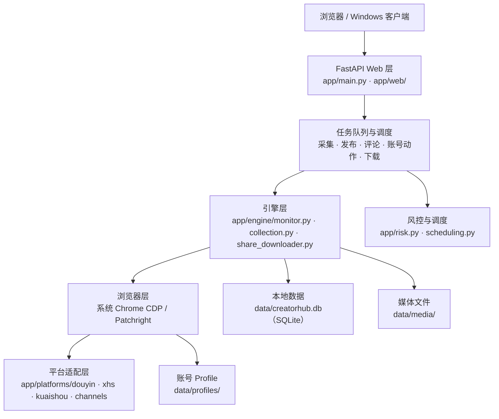

# 本地优先架构：FastAPI + 浏览器后端 + SQLite

> 机制层。回答三个问题：面板怎么组织任务、浏览器怎么被驱动、账号与数据为什么能留在本地。能力清单见 [02](02-platform-capability-matrix.md)，风控细节见 [03](03-task-queue-and-risk-control.md)。

## 总体结构

对应事实：Python + FastAPI 提供统一 Web 界面（F-029）；浏览器按平台使用系统 Chrome CDP 或 Patchright（F-030）；数据目录为 SQLite + media + profiles（F-032）；代码分层覆盖 main/engine/browser/platforms/web（F-033）。

## 四个层次

### 1. Web 面板层

FastAPI 负责账号、监控、采集、发布、通知等 API 与页面组织（F-029）。前端不是独立 SPA 工程，而是 `app/web/` 下的原生 JS（`app.js` 486,951 字节、`workbench.js` 328,125 字节）与 HTML/CSS（F-033）。这意味着：

- 部署简单：一个 Python 进程 + 静态资源，不需要 Node 构建（Node 仅在小红书 `api` 发布兼容模式需要，F-055）。
- 定制成本低：界面逻辑集中在少数大文件，改造成本可控，但也意味着可维护性依赖作者纪律。

### 2. 浏览器层：CDP 与 Patchright

官方口径：**按平台使用系统 Chrome CDP 或开源 Patchright，业务层统一使用兼容的 Playwright API**（F-030）。依赖清单里是 `patchright==1.61.2`，没有 `playwright` 包（F-031）。

为什么不是“直接 Playwright”：

- Patchright 是 Playwright 的兼容分支，API 基本一致，针对反自动化检测做了补丁；项目把它当作“Playwright API 的另一实现”。
- 小红书默认 `xhs_browser_mode: auto`：优先启动**系统 Chrome 的 CDP 会话**，每个账号独立、可见、长期复用 Profile；Chrome 缺失时回退可见 Patchright Chromium（F-051）。
- 抖音/快手/视频号可走系统 Chrome 或 Patchright；非小红书还可选 fingerprint-chromium（F-052）。

这解释了一个常见误解：**“用浏览器自动化”不等于“无头批量请求”**。小红书路径使用**有头、可见、单机串行**的浏览器，以降低设备验证概率；代价是必须依赖桌面环境与真实窗口（F-051、F-055）。

### 3. 平台适配层

`app/platforms/` 按平台分目录：`douyin/`（client、extract、publish、qrlogin、signing）、`xhs/`（client、comments、creator_api、publish、browser_writes、cookies）、`kuaishou/`、`channels/`（extract、publish、resolve）（F-033）。

平台差异被收敛在适配层：统一的任务与数据模型在上层，签名/选择器/发布流程在下层。因此平台改版时，修复范围通常限于对应平台目录，而不是全系统（F-033）。

> 小红书 API 能力实现参考了开源项目 `Spider_XHS`（README 致谢）。这属于实现来源披露，不改变本项目的许可状态（F-023）。

### 4. 本地数据层

| 路径 | 内容 | 敏感性 |
|---|---|---|
| `data/creatorhub.db` | SQLite：账号、任务、作品、评论、弹幕、事件、风控状态 | 高（含账号标识与行为记录） |
| `data/media/` | 下载的图片/视频/音频 | 中高（版权与隐私） |
| `data/profiles/` | 每账号浏览器 Profile：Cookie、缓存、LocalStorage、登录态 | **最高（等同账号登录权限）** |
| `config.yaml` | 运行配置（扫描间隔、并发、代理、风控参数） | 高（可能含代理凭据） |

`config.yaml` 首次启动从 `config.example.yaml` 生成；config、数据库、登录态、媒体默认不提交 Git（F-032）。备份项目时应一并备份 `config.yaml` 与 `data/`（F-059）。

## 账号隔离：Profile 是边界

- 每个账号使用独立浏览器 Profile，Cookie、缓存、本地存储互不共享（F-030）。
- 每个 Profile 有跨进程占用保护，避免两个进程同时写坏同一登录态（F-053）。
- 代理可绑定到账号；代理失败时**失败关闭**，不静默直连，避免“以为走了代理、实际裸奔”（F-050）。
- 同一出口下多账号集中触发风险会启用出口组熔断，防止连锁封号（F-053）。

> 隔离解决的是“账号之间不串”，不解决“平台是否允许”。同一设备、同一出口、同一操作节奏仍可能被平台关联；降低频率与分出口只是风险缓解，不是豁免（F-048、F-050）。

## 启动与运行形态

- 源码：`.\start.cmd`（Windows）或 `./start.sh`（macOS/Linux），首次自动创建 venv、安装依赖与 Chromium、生成 config，打开 `http://127.0.0.1:8000`（F-035、F-055）。
- Windows 安装版：双击安装，桌面快捷方式启动，首次自动下载浏览器组件（F-054）。
- 服务只监听本机回环地址，官方示例为 `127.0.0.1:8000`（F-035、F-056）。不要把面板暴露到公网——它持有全部账号登录态。

## 设计取舍（可迁移视角）

| 取舍 | 做法 | 代价 |
|---|---|---|
| 本地优先 | 数据、登录态、媒体全部落本机 | 无多端同步、无云端备份，设备故障即丢失 |
| 真实浏览器 | CDP/Patchright 驱动可见页面 | 依赖桌面环境与浏览器内核，资源占用高 |
| 单机串行 | 小红书可见操作整机同一时刻只执行一个 | 吞吐低，换来风控稳定性 |
| 平台适配层 | 每平台独立目录 | 平台越多维护面越大，但故障隔离 |
| 无外部数据库 | SQLite + 文件 | 单机易部署，不适合多人并发 |

这些取舍共同指向一个定位：**个人/小团队的本地运营工作台**，不是多租户 SaaS，也不是高并发采集集群（F-016、F-029）。

## 下一步

- 平台能力与限制：[02-platform-capability-matrix.md](02-platform-capability-matrix.md)
- 风控参数如何生效：[03-task-queue-and-risk-control.md](03-task-queue-and-risk-control.md)
- 实际启动：[源码运行](../examples/01-source-run.md)
