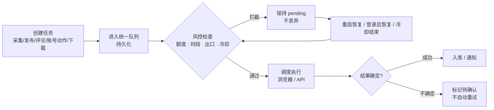

# 任务队列与保守风控模型

> 机制层（Why it doesn't get banned immediately）。所有参数与行为来自官方 README 的“任务队列与平台风控”章节；本文解释设计逻辑与使用纪律，不提供绕过风控的方法。

## 一条任务的生命周期

依据：任务队列统一展示采集、发布、自动评论、账号动作、下载，支持筛选；所有平台操作经过持久化调度与风控检查（F-047）。被额度、时段、代理状态或冷却拦下的任务保持 `pending`，服务重启后继续恢复；登录态失效时任务保留等待重新登录（F-049）。提交结果不确定时不自动重试（F-043）。

## conservative 模式到底保守在哪

默认 `risk_control.mode: conservative`（F-048）。四条保护线：

1. **同账号写操作共享间隔与额度**：评论、账号动作、私信、发布共用一套写操作间隔与额度；即使点“立即执行”也不能绕过冷却（F-048）。
2. **同出口串行**：使用同一网络出口的账号串行访问；未配置代理的账号统一归入 `direct` 出口组（F-048、F-050）。
3. **保护线不可放宽**：写间隔、小时/每日额度、同出口并发是保护线，配置 `0` 表示沿用保护线；只有切到 `custom` 才完全按自定义值执行（F-048）。
4. **阶梯冷却 + 渐进恢复**：命中 403/429/461/471、验证码或明确风控提示后按阶梯冷却；结束后先间隔式轻量探测，连续成功再逐级恢复（F-049）。

> 这套设计隐含一个判断：**平台风控是状态机，不是布尔值**。账号进入“冷却/观察/恢复”状态后，继续重试只会加深风控；正确做法是让任务停在 pending，等状态恢复。

## 为什么会话失败要“待确认”而不是重试

发布、私信、评论都是**有副作用**的写操作。请求超时、浏览器断连、页面反馈缺失时，无法判断平台是否已经执行：

- 自动重试可能导致**重复发布 / 重复私信 / 重复评论**。
- 直接标失败会让人误以为没发，手动再发一次，同样重复。

官方选择是标记“结果待确认”，由人到平台核对后再决定（F-043、F-049）。这是正确的工程取舍：**副作用不确定时，把决策权交回人**。

## 代理与出口

- 支持 HTTP、HTTPS、SOCKS5 与账号密码认证（F-050）。
- 代理不可连接或认证失败时**失败关闭**，不静默改走本机直连（F-050）。
- 建议同一账号长期保持稳定出口；出口漂移或基线过期后，写任务保留在队列，重新验证后再执行（F-050、F-053）。
- 账号页“测试代理”记录出口 IP、国家、ASN 与时区（F-053）。

> 失败关闭很重要：很多“账号异常”来自代理悄悄失效后直连，设备画像瞬间变化。宁可任务停住，也不要裸奔一次。

## 风控中心与人工干预

风控中心集中展示六类账号状态：正常、冷却、渐进恢复、登录失效、代理异常、网络熔断，并提供触发原因、冷却截止、恢复进度、任务级受阻原因、网络出口与事件时间线（F-053）。

规则页可调整读取间隔、冷却阶梯、恢复探测、写操作额度、出口组熔断与活跃时段；配置保存到本地数据库并立即生效；人工解除、规则修改、人工探测都写入审计记录（F-053）。

## 浏览器画像与指纹

- 存量账号继续用 `legacy` 浏览器画像，避免 Profile 漂移；新扫码/Cookie 账号用 `native` 模式（F-030、F-052）。
- `native` 账号的发布、评论、关注、私信会检查系统 Chrome、有头页面、独立 Profile 与代理出口基线（F-052）。
- 非小红书可选 fingerprint-chromium；小红书固定系统 Chrome/CDP，拒绝第三方指纹内核混用（F-052）。
- 新指纹 Profile 首次会打开 `browserscan.net` 体检页，供核对 IP、时区、WebRTC 与指纹；该第三方站点会看到出口 IP 与浏览器特征（F-052）。

## 使用纪律（比参数更重要）

1. **先小规模**：新账号、新代理、新发布流程先跑 1–2 条，确认平台反馈与账号状态正常再放量（F-018、F-059）。
2. **不要对抗保护线**：把 conservative 的保护线改成 0 或切 custom 放大额度，是用账号换吞吐；除非你清楚后果。
3. **写操作集中在一个时间段**：活跃时段内集中处理，比全天候零散操作更接近真人节奏，也便于观察冷却。
4. **登录失效先停**：不要反复重登触发验证；先确认代理与设备画像是否稳定（F-049、F-050）。
5. **备份再升级**：升级前备份 `config.yaml` 与 `data/`，尤其是 `data/profiles/`（F-059）。

## 已知边界

- 风控是**概率性缓解**，不是保证。平台规则、账号历史、内容类型、出口质量都会影响结果。
- 参数与状态机可能随版本变化；本文对应 v0.2.4（2026-10-16）与 main 分支 README。
- 未实机复跑：冷却阶梯的具体秒数、出口组熔断阈值以 `config.example.yaml` 的 `risk_control` 段与你当前版本为准（F-058）。

## 下一步

- 合规与许可边界：[04-boundaries-license-and-compliance.md](04-boundaries-license-and-compliance.md)
- 实操排障：[examples/03-download-publish-and-transfer.md](../examples/03-download-publish-and-transfer.md)
