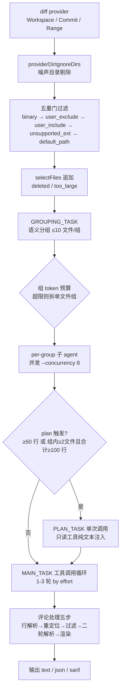

# 官方运行时模型 — 确定性前置 × 语义后置

本章依据官方《架构》与《工具》两页重建 OCR 的运行时心智模型。既有 [01-architecture.md](01-architecture.md) 采用「六阶段」划分，本章给出官方文档自身的口径，两者差异记录在[官方文档勘误表](../references/official-doc-corrections.md) E-11。事实编号 F-xxx 指代[官方文档事实清单](../references/official-doc-facts.md)。

> **与本章配套的兄弟页**：本章讲「OCR 实际怎么跑」，[14-verification-playbook.md](14-verification-playbook.md) 把同一套结构抽象为可迁移模式并给出验证手册；[13-integration-contracts.md](13-integration-contracts.md) 讲「怎么把 OCR 接进别的 agent」。初次阅读顺序建议：先本章建心智模型，再读 14 章的模式与手册，需要接宿主 agent 时再读 13 章。

## 1. 分工边界：把「确定」与「语义」切开

官方首页把架构定义为两半的混合体（F-037）：

| 归确定性工程模块 | 归 LLM Agent 推理 |
|------------------|-------------------|
| 任务拆分、文件过滤、行号定位、规则路由、异步调度 | 风险检测、上下文探索、问题分类 |

这条分界线是理解 OCR 全部设计取舍的主轴：凡能被规则判定的事情，OCR 不交给模型；凡能被穷举验证的事情，OCR 不靠模型自觉。官方另有两个补充描述：评论定位由独立行级定位模块配合三级渐进式 LLM 策略完成，并设有独立反射模块拦截幻觉与知识漂移（F-038）——即「定位」是工程模块，「判定是否值得报」才是模型的事。

## 2. 流水线全景（官方口径）

**逐段要点**：

1. **diff provider**（F-010 ~ F-013）：`internal/diff/git.go` 的 `Provider.mode` 枚举对应三模式；每条 diff 带 old/new path、old/new hunk、增删计数、二进制标志与重命名检测；`DiffContextLines` 固定 3；untracked 文件按整文件新增读取。
2. **噪声目录剔除**（F-019 ~ F-020）：`vendor/`、`node_modules/`、`target/` 等在 diff provider 层被剔除，preview 报告为 `provider_directory`，include 规则无法使其进入评审。该列表按路径前缀匹配，只覆盖仓库根目录；嵌套同名目录走 per-file 过滤并落在 `default_path`。
3. **五重门过滤**（F-014 ~ F-017）：`whyExcluded` 只返回 `binary` / `user_exclude` / `unsupported_ext` / `default_path` 四类原因；`user_include` 命中即保留并绕过最后两道门；`deleted` 与 `too_large` 不由 `whyExcluded` 产出，由 `selectFiles` 在各门之后追加。
4. **语义分组**（F-021 ~ F-023）：一次 LLM 调用只吃文件元数据（路径、状态、增删行数），不喂 diff 内容；每文件恰属一组，单组 ≤ 10 文件；调用失败 / 返回空 / 仅 1 文件时退化为每文件一组；组内 token 超限时 `enforceGroupTokenBudget` 拆为单文件组。
5. **plan + main 两阶段**（F-025 ~ F-028）：见第 3 节。
6. **评论处理五步**（F-034）：见第 5 节。
7. **三道 token 守卫**（F-018、F-035、F-055）：见第 6 节。

## 3. plan 与 main：为什么要拆成两段

plan 不是「先想再审」的泛化说法，官方把它实现为**一次不带工具的 LLM 调用**（F-026）：

- 触发条件是纯数值门槛：组内单文件变更行数 ≥ 50，**或** 组内文件数 ≥ 2 且合计变更行数 ≥ 100（F-025）。小 diff 静默跳过 plan。
- plan 调用**不发送 Tools 字段**，模型在 plan 期间不能调工具；只读工具子集 `code_search` / `file_read_diff` / `file_find` 以纯文本经 `{{plan_tools}}` 占位符渲染进提示词，让模型预先知道后续可用什么。
- plan 产出的清单经 `{{plan_guidance}}` 进入 main prompt。

main 循环是真正的工具调用循环（F-027 ~ F-030）：

- 轮数由 effort 决定：`low` = 1 轮、`medium` = 2 轮（默认）、`high` = 3 轮。
- 第 2 轮起剥离 plan 结果（避免它成为召回上限），并把上一轮已确认的评论作为「已发现」上下文回传，驱动模型找**新**问题。
- 某一轮没有新增发现，或已确认评论数达到上限时提前停止。

官方对 plan 阈值的取舍在 FAQ 中给出反直觉结论：调**高**阈值才省钱，调低会让更多组进入规划、反而更贵；`PLAN_MODE_LINE_THRESHOLD` 为 0 或负数意味着恒定规划，是最贵的设置（S9）。

## 4. 五个退出条件：Agent 循环的收口设计

main 循环的退出条件（F-030）：

| # | 退出条件 | 语义 |
|---|---------|------|
| 1 | 调用了 `task_done` | 模型主动收工 |
| 2 | `MAX_TOOL_REQUEST_TIMES` 耗尽 | 默认 100 轮工具调用上限 |
| 3 | 连续 3 轮无有效工具结果 | `maxConsecutiveEmptyRounds = 3` |
| 4 | context 被取消 | 外部取消信号 |
| 5 | `addNextMessage` 返回 false | 压缩无法把消息缓冲区压回警告阈值以下 |

无论走哪条出口，已收集的 `code_comment` 调用都成为评审评论。官方对条件 2 的诊断口径是：模型用尽 100 轮仍未调 `task_done`，已发出的评论仍被收集并渲染；成因通常为模型不遵循「完成后调 `task_done`」指令、某工具持续报错而模型持续重试、或文件过大导致 100 轮不够（S9）。

工具集共六个（F-036）：`task_done`、`code_comment`、`file_read`、`file_read_diff`、`file_find`、`code_search`——前三个属于「产出与上下文」类，后三个是只读检索类，plan 阶段仅后三个可用。

## 5. 评论处理五步与「未锚定」信号

F-034 记录的处理链：

1. **行解析**（worker 内）：`existing_code` 用滑动窗口算法与 diff 匹配，计算精确 `start_line` / `end_line`；匹配失败则两者为 `0`。官方明确 `0` 行范围是「未锚定」评论的隐式信号——没有存储标志，下游消费者需自行检查 `start_line == 0`。
2. **重新定位任务**（可选回退）：行解析在复杂 diff 上失败时，运行 `RE_LOCATION_TASK` 请模型重新锚定片段，对改写过 `existing_code` 字符串的评论有用。
3. **评审过滤**：main 循环结束、worker 池排空后，`REVIEW_FILTER_TASK` 对照 diff 检查已收集评论，移除可证明为错的评论；此处错误被记录并忽略。
4. **第二轮行解析**：`Agent.Run` 返回后，顶层命令对完整评论集重跑 `diff.ResolveLineNumbers`，覆盖跨多文件或被重定位步骤更新过的评论。
5. **渲染**：按 `--format` 输出 text / json / sarif。

评论处理的并发形态是固定大小的 `CommentWorkerPool` goroutine 池，使主工具调用循环不阻塞在后处理上。

## 6. 三道 token 守卫与三分区记忆压缩

**三道守卫**：

| 位置 | 判定 | 后果 |
|------|------|------|
| `selectFiles`（分组前） | 该文件 diff 单独超过 `MAX_TOKENS` 的 80% | 报为 `too_large` 并剔除，不进入分组 |
| 组内 `enforceGroupTokenBudget` | 一组 diff 合计超限 | 拆为单文件组 |
| 发起 LLM 请求前（fail-fast） | `countMessagesTokens(messages) > MaxTokens * 4 / 5` | 记录 `token_threshold_exceeded` 警告并跳过该组 |

超限的组以非致命警告形式报告，并在 JSON 输出的 `warnings` 数组中出现（F-069）。

**三分区压缩**（F-032、F-033）：一「轮」定义为一条 assistant 消息加上其后的工具结果消息。`partitionMessages` 从末尾向前遍历，保留能装入 `(0.80 × MAX_TOKENS) - reservedTokens` 的尽量多的轮，更早的内容进入 compress 区。compress 区被渲染为 XML，用 `MEMORY_COMPRESSION_TASK` 交给模型，摘要以 `<previous_review_summary>` 标签追加到原始 user 消息。压缩后消息结构为 `frozen[2] + compressed_user_msg + active`。

阈值与动作（F-032）：

| 阈值 | 常量 | 动作 |
|------|------|------|
| `MAX_TOKENS` 的 60% | `tokenSoftThreshold` | 启动**异步**后台压缩，当前循环不中断 |
| `MAX_TOKENS` 的 80% | `tokenWarningThreshold` | 发送下一请求前**同步**运行压缩 |

异步路径让 main 循环在后台压缩运行时继续产出工具调用；当下一次 token 检查发生时已就绪的摘要经 `tryApplyPendingCompression` 应用；若比例在异步任务完成前越过警告阈值，循环停顿并同步压缩。

**预算的两个上限必须分开看**（F-055）：`max_tokens` 只约束**提示词**，模型输出上限由 `MAX_COMPLETION_TOKENS`（默认 16384）单独控制，`--max-tokens-budget` 另管单次运行的输入 + 输出总量。三者互不换算——调高 `--max-tokens` 不会放大输出预算。

## 7. 六个 prompt 模板

位于 `internal/config/template/task_template.json`（F-031）：

| Key | 用途 | 阶段 |
|-----|------|------|
| `GROUPING_TASK` | 把变更文件聚成语义相关的组 | 分组 |
| `PLAN_TASK` | 产出清单 | plan |
| `MAIN_TASK` | main 评审循环，产出 `code_comment` | main |
| `MEMORY_COMPRESSION_TASK` | 压缩早于 active 区的对话 | 压缩 |
| `REVIEW_FILTER_TASK` | 对照 diff 移除可证明为错的评论 | 收尾 |
| `RE_LOCATION_TASK` | 重新锚定 `existing_code` 片段 | 收尾（回退） |

六个模板共用一套占位符机制（`{{plan_tools}}`、`{{plan_guidance}}` 等），plan 阶段与 main 阶段复用同一批工具定义——差别在 plan 不发 Tools 字段、只发纯文本描述。

## 8. 与既有「六阶段」叙述的对照

既有 [01-architecture.md](01-architecture.md) 的六阶段划分与官方口径的差异（E-11）：

| 既有表述 | 官方口径 | 差异性质 |
|---------|--------|---------|
| 六阶段审查流水线 | 官方未使用阶段计数，改为「provider → 噪声剔除 → 五重门 → 分组 → plan → main → 评论五步 → 渲染」+ 三道守卫 | 阶段边界不同，事实不冲突 |
| 单文件维度判断 plan 跳过 | 双条件：单文件 ≥ 50 行，或组内 ≥ 2 文件且合计 ≥ 100 行 | 既有表述不完整（E-08） |
| 内存压缩「三区」 | 冻结 / 压缩 / 激活三区，阈值 60% 异步、80% 同步 | 一致，且官方补充了「压缩后消息结构 = frozen[2] + compressed_user_msg + active」 |

**结论**：既有章节的叙述骨架可继续使用；涉及阈值、常量、门序的细节一律以本章与事实清单为准。

## 9. 本章边界

- 本章全部内容取自官方《架构》《工具》《FAQ》《CLI 参考》四页，**未执行本地安装与实机评审**。
- 官方架构文档包含「源码地图」章节，本章引用其中的包名、文件名、函数名与常量名，未逐行核对仓库源码。
- 遥测 span / metric 名称属于另一层观测模型，见[会话持久化、遥测与查看器](05-session-telemetry.md)；本文只覆盖与流水线内生相关的 token 守卫。
