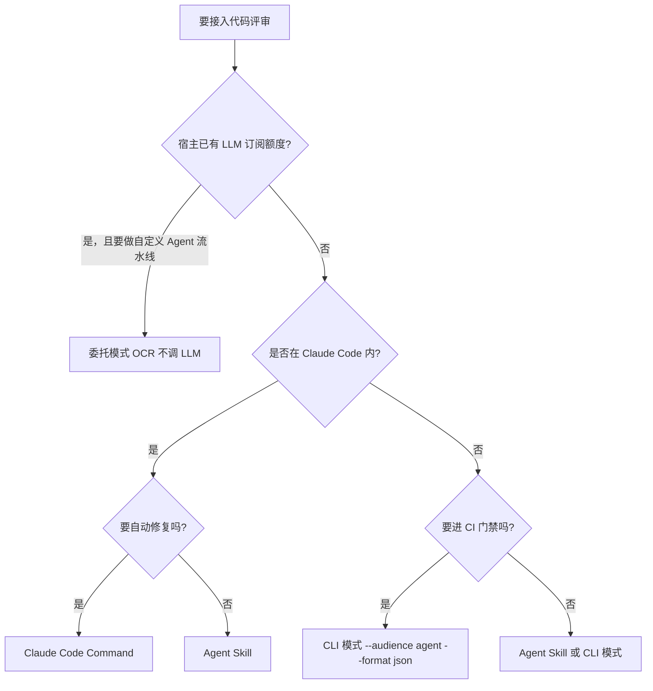

# 集成契约 — 谁调 LLM、谁做分级、谁动代码

官方文档把集成层拆成三种形态（F-076），加上基础的 CLI 自跑模式，OCR 对外共有四条路径。四者的差别不在「功能多少」，而在**三个权力位的归属**：LLM 由谁调、评论由谁分级、代码由谁改。选错路径的典型症状是「评审结果没法接进我的流水线」或「它擅自改了代码」。

## 1. 四形态契约总览

| 维度 | 基础 CLI（review / scan） | 委托模式（delegate） | Agent Skill | Claude Code Command |
|------|------------------------|-------------------|-------------|---------------------|
| 谁调用 LLM | OCR | **宿主 Agent** | OCR | OCR |
| OCR 端是否需配 LLM | 必需 | **不需要** | 必需 | 必需 |
| 输出去向 | stdout（text / json / sarif） | 宿主 Agent 自行评审 | JSON → 宿主分级 | JSON → 宿主分级 |
| 分级由谁做 | OCR 内置（High/Medium/Low 出现在 skill 与 command 层） | 宿主 Agent | 宿主 Agent 按 SKILL.md 标准 | 宿主 Agent 按 command prompt 标准 |
| 是否自动改代码 | 否 | 由宿主决定 | **默认先询问** | **默认自动修复** |
| 适合场景 | CI 门禁、自建流水线 | 复用订阅额度、自建 Agent 流水线 | 通用编码 agent 接入 | Claude Code 内「评审并清理」 |

三种官方集成形态的对照（委托模式 / Agent Skill / Command）在官方《委托模式》页以「谁调用 LLM」列直接给出（F-076）。

## 2. 基础 CLI 模式：`review` 与 `scan`

`ocr review` 面向 diff 增量评审，`ocr scan` 面向工作树全量扫描（F-073）。CLI 层的关键契约是**输出形状**：

- `ocr review --format json` 始终向 stdout 写出**恰好一个 JSON 对象**，绝不输出裸数组（F-070）。调用方据此可以直接 `jq` 而不必处理「数组还是对象」的分叉。
- 顶层 `comments` 是数组；`summary.files_reviewed` 表示实际评审文件数；`warnings` 承载非致命警告（F-069、F-070）。
- 终态读取推荐用 `manifest.terminal_state`；无合格文件时 `status` 为 `skipped`，`message` 为 `Review skipped: no items were selected.`（F-071）。manifest-less 路径省略 `summary` 与 `manifest`，`message` 为 `No supported files changed.`，`tool_calls` 始终存在；`ocr scan` 始终走 manifest-less 路径（F-072）。
- 官方明确提醒：不同运行的可选顶层字段可能不同，**不要依赖对象形状或某个可选 key 的存在来区分**状态，应使用 `summary.files_reviewed` 或 `manifest.terminal_state`（S9）。
- `--audience agent` 完全抑制进度行，只打印最终摘要或 JSON；`--audience human` 在 `--format json` / `sarif` 时把进度行输出到 stderr，保持 stdout 为单个可解析文档（F-067）。

**契约要点**：机器读 → `--audience agent --format json`；人读 → 默认 text。

## 3. 委托模式：OCR 只交付确定性脚手架

委托模式是四种路径中最特别的一种：OCR 端**不调用任何 LLM**（F-077），因此无需配置模型或 API Key。官方定位它为「订阅制 AI 编码代理」设计——Claude Code、Codex、Cursor、Open Code、Qoder 等已内置订阅额度，委托模式直接复用宿主额度。

委托模式把 OCR 的确定性能力拆成两个只读子命令：

### 第 1 步 `ocr delegate preview`

输出（F-078）：

- `mode` —— workspace / range / commit
- ref 元数据 —— from、to、commit、merge_base
- 可审查文件列表 —— 路径、状态、插入/删除行数
- 已排除文件 —— 及排除原因

### 第 2 步 `ocr delegate rule <path...>`

传入第 1 步的可审查文件路径，输出按规则**内容分组**的规则集——共享相同规则的文件归为一组，避免重复（F-077、F-078）。

### 第 3 步 宿主取 diff

官方对 Git 调用给出统一规范（F-079）：全部使用 `git --no-pager`，并附加 `--no-ext-diff --no-textconv --no-color` 以取得纯文本补丁。

| 模式 | 命令 |
|------|------|
| Range（有 merge_base） | `git --no-pager diff --no-ext-diff --no-textconv --no-color <merge_base>..<to> -- "<path>"` |
| Commit | `git --no-pager show --no-ext-diff --no-textconv --no-color <commit> -- "<path>"` |
| Workspace（已跟踪） | `git --no-pager diff --no-ext-diff --no-textconv --no-color HEAD -- "<path>"` |
| Workspace（未跟踪） | `cat "<path>"` |

上下文查询用 `git --no-pager log --no-color --oneline -- "<path>"`、`git --no-pager blame --no-textconv -- "<path>"`、`git --no-pager show --no-ext-diff --no-textconv --no-color "<ref>:<path>"`。大 diff 可加 `--output="<absolute-diff-file>"` 落盘，官方要求选择仓库外的唯一绝对路径并先创建父目录；Git 以退出码 0 结束后分块读取，命令失败或超时则重试或标为 `skipped` 并记录错误（F-079）。

### 第 4 步 宿主逐文件审查

对每个可审查文件：取 diff → 参照匹配到的规则组作审查清单 → 深入审查并按需探索上下文。

### 第 5 步 宿主报告

报告必须包含四个字段（F-080）：`total_files`、`reviewed_files`、`skipped_files`、`coverage_rate`。每个 preview 条目要标为 `reviewed` 或 `skipped`，跳过需说明原因。

**严重度分级由宿主执行**（F-081）：

- Critical/High —— Bug、安全问题、数据丢失风险，**始终报告**
- Medium —— 性能问题、错误处理缺失，附带上下文报告
- Low —— 风格建议、细微改进，**静默丢弃**，除非确有价值

委托模式也支持通用标志：`--from` / `--to` / `-c, --commit` / `--repo` / `--rule` / `--exclude` / `-b, --background` / `-B, --background-file`（F-074）。

## 4. Agent Skill 模式：分级与修复交给宿主

安装（F-082）：

```bash
npx skills add alibaba/open-code-review --skill open-code-review
```

技能清单位于仓库 `skills/open-code-review/SKILL.md`，它是一份 prompt，由调用方 agent 加载后**自行执行**步骤。七步流程（F-083、F-084、F-085）：

1. **前置检查** —— `which ocr` 确认 CLI 在 `PATH`，`ocr llm test` 确认 LLM 可达。
2. **CLI 缺失则自动安装** —— `which ocr` 报 "NOT INSTALLED" 时直接 `npm install -g @alibaba-group/open-code-review` 并继续，**不提示用户**（视为常规设置步骤）。
3. **无 LLM 配置则停下询问** —— `ocr llm test` 失败时**不编造凭证**，向用户展示环境变量与 `ocr config set` 两种方式并等待 API key。
4. **提取业务上下文** —— 识别评审目标（commit / 分支 / 工作副本）并生成简短的 `--background` 字符串。
5. **运行评审** —— `ocr review --audience agent --background "…" [--commit | --from/--to]`。
6. **分类与报告** —— 按 SKILL.md 的 High / Medium / Low 标准分类 JSON 评论，渲染 Markdown 摘要。
7. **按需修复** —— 用户说「评审**并**修复」时才对 High/Medium 项内联应用安全修复；否则修改代码前先询问。

**契约要点**：skill 自身是「安全默认值」——自动装 CLI，但绝不自动改代码。

Anthropic Agent SDK 接入（F-089）：

```python
from anthropic_agent_sdk import Agent

agent = Agent(
    skill_paths=["/path/to/open-code-review/skills/open-code-review"],
)
agent.run("Review my staged changes — focus on race conditions.")
```

其他 agent 框架可摄入同一份 `SKILL.md`——它只是带 frontmatter 的 markdown；若框架期望不同 schema，markdown 正文仍可作 prompt 模板使用（F-082）。

## 5. Claude Code Command 模式：同源不同默认值

安装（F-086）：

```bash
# 方式 1：plugin marketplace（推荐）
/plugin marketplace add alibaba/open-code-review
/plugin install open-code-review@open-code-review

# 方式 2：直接复制命令文件
mkdir -p .claude/commands
curl -o .claude/commands/open-code-review.md \
  https://raw.githubusercontent.com/alibaba/open-code-review/main/plugins/open-code-review/claude-code/commands/review.md
```

plugin 方式注册为 `/open-code-review:review`，直接复制方式注册为 `/open-code-review`。三步（F-087）：

1. **运行评审** —— 以推断出的参数调用 `ocr review --audience agent`（有需求上下文时加 `--background`），输出在 5 分钟超时内捕获。
2. **过滤与评估** —— 把每条评论分为 High / Medium / Low，低置信评论（疑似误报、吹毛求疵、缺上下文）静默丢弃。
3. **修复** —— 对值得采纳的 High/Medium 项**自动应用修复**。

命令文件是带单个 frontmatter 字段的纯 markdown，无 Claude Code 专有内容；支持 command 约定的其他 agent 可直接复制使用（F-086）。

## 6. 关键差异：同一 skill，两种默认值

这是官方文档中最容易被忽略、也最具工程价值的一处设计（F-088）：

| | Agent Skill | Claude Code Command |
|---|-------------|---------------------|
| LLM 调用方 | OCR | OCR |
| 分级标准来源 | SKILL.md | command prompt |
| 修复 High/Medium | **修复前先询问** | **默认自动修复** |
| 语义定位 | 「给我看 diff」 | 「评审并清理」 |

两者共用同一 CLI 与同一底层 prompt，差别只在默认值。官方给出的选择依据是：想要「评审并清理」工作流选 Command；想要「先看再决定」选 Skill。想收紧任一行为，直接编辑本地 prompt 副本（Claude Code 每次调用都重新读取命令，无需重启）。

## 7. 选择决策规则



补充规则：

- **CI / 流水线** —— 首选 CLI 模式的 `--audience agent --format json`，理由是输出形状稳定（恰好一个 JSON 对象）。
- **不配置 LLM 也能用** —— 委托模式是唯一路径，但宿主必须自己实现分级与报告（`total_files` / `reviewed_files` / `skipped_files` / `coverage_rate`）。
- **想复用已有额度** —— 委托模式；想复用已有 agent 框架 —— Agent Skill。
- **审计陌生代码库** —— `ocr scan`（不依赖 Git diff）。

## 8. 权限与安全边界

- **diff 是唯一外流内容**：官方记录发送到 LLM 的是 diff 文本（S9）。
- **查看器有 DNS-rebinding 防护**：`ocr viewer` 对照 loopback 白名单（`localhost`、`127.0.0.1`、`::1`）校验 `Host` 头；具体绑定主机自动加入白名单，通配绑定（`:3000`、`0.0.0.0`、`::`）不加入并返回 `forbidden host`；`OCR_VIEWER_ALLOWED_HOSTS` 可配置允许主机名（F-090、F-091）。
- **凭证文件权限**：`chatgpt` provider 的凭证文件在 Unix 上为 `0600`、目录为 `0700`；Windows 上依赖用户配置文件目录继承的 ACL，OCR 不设置也不校验 DACL（F-095）。`config.json` 中的 `api_key_cmd` 会被当作 shell 命令执行，OCR 以 `0600` 写入该文件（F-053）。
- **Agent Skill 不编造凭证**：`ocr llm test` 失败时停下询问用户（F-084）——这是集成层的第一条安全纪律。
- **修复权限默认关闭**：Skill 默认询问、Command 默认自动修复（F-088）；在共享仓库中启用 Command 前应先审阅其分级标准。

## 9. 本章边界

- 本章内容取自官方《委托模式》《Agent Skill》《Claude Code 集成》《CLI 参考》《FAQ》《配置》六页，未实机安装与运行。
- 官方把委托模式的适用对象列为 Claude Code、Codex、Cursor、Open Code、Qoder 等订阅制代理；除 Claude Code 外，其余代理的命令 / skill 约定未在官方文档中给出安装方式。
- 分级标准（High / Medium / Low）的具体判定条目位于仓库 `skills/open-code-review/SKILL.md` 与 `plugins/open-code-review/claude-code/commands/review.md`，本 bundle 未收录这两个文件的正文。
