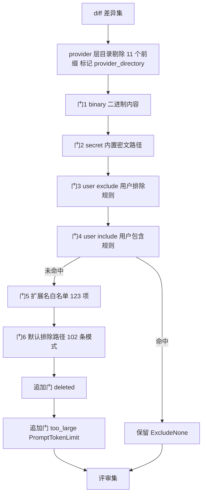

# 源码层运行时模型 — 从 diff 到评论的六段实现链

本章是[官方运行时模型](12-official-runtime-model.md)的**源码侧对照**。第 12 章讲「官方文档声明的运行时长什么样」，本章讲「commit `375f64cd` 的代码实际怎么写的」。两章在多处结论上一致，但有四处数值分歧——分歧清单见[源码层与文档层的四处口径差](../references/source-code-facts.md#源码层与文档层的四处口径差)。

> **口径边界**：本章全部结论来自**静态源码阅读**，未运行 `ocr` 二进制、未调用任何 LLM、未发起任何网络请求。凡涉及运行期行为的描述，一律以「代码中如此声明」为限。**本章 F-1xx 编号均指源码层（F-101 起），非文档层 F-001~F-100**。证据等级 L1/L2/L3 的定义见[信源登记页](../references/source-code-layer.md#4-六主题覆盖矩阵)。

> **与本章配套的兄弟页**：本章讲「代码怎么跑」（运行时实现链）；[16 章](16-source-code-extension-contracts.md) 讲「provider / 工具 / 输出 / 扩展面的契约」；[17 章](17-source-code-verification-playbook.md) 讲「怎么核验这些说法、怎么裁决口径冲突」。需要「怎么用 OCR」请先看[官方验证手册](14-verification-playbook.md)。

## 1. 差异获取链：三模式 + provider 层目录剔除

OCR 的 diff 获取有三种互斥模式，由 `internal/diff/git.go` 的 `Mode` 枚举固定（F-103）：

| 模式 | 语义 | 构造函数 | 底层 git 调用 |
|------|------|----------|---------------|
| **workspace** | staged + unstaged + untracked | `NewWorkspaceProvider`（F-104） | tracked 差异与 untracked 文件差异两段拼接，逐文件追加并以空行分隔（F-107） |
| **commit** | 单提交相对其父提交 | `NewCommitProvider`（F-104） | `git show` 附加 `--diff-merges=first-parent`（F-106） |
| **range** | `merge-base(from,to)..to` | `NewProvider`（F-104） | `git diff --no-ext-diff --no-textconv --find-renames ... -U3 --end-of-options <base> <to> --`，merge-base 为空时返回错误（F-105） |

**两处细节值得单独记住**：

1. **commit 模式必须加 `--diff-merges=first-parent`**。源码注释记明：普通 `git show` 对合并提交产出 `diff --cc` 组合差异，**解析器无法解析**（F-106）。这是「为了让旧解析器继续工作而加的 git 开关」——不是新解析能力。
2. **上下文行数是硬编码常量**：`const DiffContextLines = 3`（F-101），与 range 模式 `-U3` 参数一致。

**provider 层目录剔除发生在最前面**：11 个目录前缀（`.idea/`、`.vscode/`、`.svn/`、`.git/`、`vendor/`、`node_modules/`、`target/`、`.happypack/`、`.cachefile/`、`_packages/`、`rpm/`）在 diff provider 层无条件排除（F-102）。被排除的差异**不丢弃**——`DiffSet` 用 `Included` / `Excluded` 双集合承载，`excludedAt` 记录被排除项在混合流中的原始序号，`ForEachInOrder` 保证遍历顺序稳定（F-108）。这样 preview 报告能给出 `provider_directory` 原因码，评审集则完全看不到它们。

### gitignore 语义与路径引号

- `.gitignore` 匹配按 git 语义执行：按文件顺序遍历、**最后一条匹配者决定结果**、`!` 前缀反转该条判定、目录型模式（尾随 `/`）不作用于文件、否定型目录模式被跳过（F-109）。
- git 对非 ASCII 与含特殊字符路径输出 C 风格引用，源码实现 `unquoteGitPath` 处理反斜杠转义与八进制转义（F-110）。**没有这一步，含中文路径的文件名会在后续的路径比较中静默失配。**

## 2. 文件选择：六道静态门 + 两道追加门

`selectFiles` 是一个**纯函数**——不产生输出、不做变更、不访问 git 或 LLM；源码注释记明 `--preview` 与真实运行消费同一份选择结果（F-111）。这意味着 preview 的文件清单与实际评审的文件清单**在设计上必然一致**，不是两套代码的巧合。

静态过滤门按**固定顺序**执行六道（F-112）：

> **`provider_directory` 不经六道门**：它由 provider 层剔除产出（在第 1 节），既不是静态门的结果，也不是两道追加门的结果——它独立于 `whyExcluded` 的判定链。

**门 2 的位置是安全语义，不是实现细节**。源码注释原文写明：「没有任何 include 通配符可以放行凭据路径，也没有任何用户 exclude 能以别的理由声称它」（F-113）。密文路径门排在两道用户规则**之前**，因此：

- 用户 include 命中时函数立即返回 `ExcludeNone`，**只跳过后续的扩展名白名单与默认排除路径两道门**（F-114），不跳过密文门；
- 用户 exclude 也不能「顺带」把密文路径标成别的排除原因——它在门 2 就被截住。

这是[官方文档层](12-official-runtime-model.md)第 2 节「五重门过滤」口径的**源码修正**：文档层记 5 道，源码层记 6 道，且新增的门插在 binary 之后、user_exclude 之前（D-2）。

### 排除原因码：8 个非空字面量

`internal/model/preview.go` 定义 8 个非空原因码，未排除时取空串（F-115）：

`user_exclude`、`unsupported_ext`、`default_path`、`secret_exclude`、`provider_directory`、`deleted`、`binary`、`too_large`

其中 `provider_directory` 来自第 1 节的 provider 层剔除（F-102），`secret_exclude` 来自门 2（F-113），`deleted` 与 `too_large` 不由静态门产出，而由 `selectFiles` 在各门之后追加（F-120、F-121）。文档层记 7 种，缺 `provider_directory`（D-3）。

### 体积门的两条特殊分支

- 单文件体积门的上限取 `PromptTokenLimit(MaxTokens)`；**仅在配置了上限时**才对 diff 做分词计数，`max_tokens=0` 时**跳过整个分词过程**，超限标记为 `ExcludeTooLarge`（F-121）。
- 删除文件被标记为 `ExcludeDeleted` 但**保留在 agent 的工作差异集合中**——源码注释写明删除文件不携带待评审的新内容，但仍属于提示词展示的变更文件清单（F-120）。

### 规则优先级与匹配能力

规则解析优先级为 custom → project → global → system，合并后构建同一个 `FileFilter`（F-122）。扩展名判定大小写不敏感；默认排除模式支持 `**` 递归匹配、`*` 单段通配与 `{a,b,c}` 花括号展开，由 `doublestar.Match` 执行（F-117）。白名单与默认排除模式由两份内嵌 JSON 提供，均以 `//go:embed` 引入，条目数分别为 **123** 与 **102**（F-116）。

默认排除模式按生态分组，覆盖测试文件（`*_test.go`、`*.test.{js,ts}`、`__tests__/**` 等）、前端依赖与构建产物、Ruby/Java/Rust/Python/JavaScript 包管理目录、C/C++ 产物目录、Python 虚拟环境与缓存目录、iOS 依赖目录、.NET 产物目录、Haskell/Julia/Nim/Solidity/Vyper 测试与生成物（F-118）。

## 3. 语义分组：只喂元数据的契约

这是源码层最反直觉的一段实现。分组请求体的字段只有三个：`Model`、`Messages`、`MaxTokens`——**请求不含 diff 内容**（F-124）。喂给模型的是一份文件清单，每行格式为 `[序号] 路径与变更统计`，序号从 0 起，是模型分组时使用的索引（F-127）。

> **图注**：图中 `file_list` 是分组提示词的唯一占位符，源码字面值以双花括号包裹（`{{file_list}}`，F-126）；图中为渲染安全省略花括号，字面值以正文表格与事实清单为准。

关键行为：

| 行为 | 源码口径 |
|------|----------|
| 文件数 ≤ 1 | 直接构造单文件分组，**不发起分组 LLM 请求**（F-123） |
| 分组请求 `MaxTokens` | 未指定时取 **4096**（F-125） |
| 提示词注入 | 唯一占位符 `{{file_list}}`，以 `strings.ReplaceAll` 注入（F-126） |
| 响应格式 | JSON 数组，元素含 `label` 与 `files`（`files` 是**整型索引数组**而非路径数组）（F-128） |
| 解析前置 | 先剥离 markdown 代码围栏，再 `json.Unmarshal`（F-128） |
| 解析失败 | 返回错误并**回退到逐文件派发**；被补全上限截断的响应也走此路径（F-128） |
| 越界 / 重复索引 | 跳过（F-129） |
| 未覆盖文件 | 各自成为单文件分组，Label 取该文件的新路径（F-130） |
| 单组文件数上限 | 常量 **10**；超限的组按 10 个一组切片，**Label 保持不变**（F-131） |
| 组级 token 预算 | 超限的组被拆为每文件一组，**Label 追加拆分后缀**（F-132） |

> **降级方向是单向的**：分组失败只会让粒度变细（每文件一组），不会变粗。模型分组是**优化**，不是**前提**。这与「先让模型理解 diff 再决定怎么审」的直觉相反——OCR 的分组阶段根本不给模型 diff。

## 4. plan / main 双阶段与停止原因

### plan 的双阈值写在模板里

评审模板 `internal/config/template/task_template.json` 的 `PLAN_MODE_LINE_THRESHOLD` = **50**、`PLAN_MODE_GROUP_LINE_THRESHOLD` = **100**，语义是「单文件变更行数 ≥ 50，**或** 组内文件数 ≥ 2 且合计变更行数 ≥ 100」（F-133）。这与[官方文档层](12-official-runtime-model.md)第 3 节的口径一致。

### 轮次与停止

- main 阶段轮次上限由模板常量 `MAX_REVIEW_ROUNDS` 给出，默认 **2**；effort 档位覆写该值，low=1、medium=2、high=3（F-134）。
- 主循环的**连续无有效结果**上限为 **3 轮**，达到即停止（F-135）——注意这是「连续」计数，不是总轮次。
- 停止原因以枚举区分，至少含 `StopNone`、`StopMaxRounds`、`StopEmptyRounds`、`StopCompression` 与 token 预算类停止；停止原因在 agent 层归类为预算失败或未知失败（F-136）。

### 三条上限各属不同层

| 上限 | 值 | 归属层 |
|------|-----|--------|
| `MAX_REVIEW_ROUNDS` | 2（effort 覆写 1/2/3） | 模板常量（F-134） |
| `maxConsecutiveEmptyRounds` | 3 | 主循环代码常量（F-135） |
| `maxFilesPerGroup` | 10 | 分组代码常量（F-131） |
| `maxTokens`（分组请求） | 4096 | 分组代码默认值（F-125） |

前两者是**可调旋钮**（模板/档位），后两者是**硬编码结构约束**（改需要改代码）。区分这两类，是判断「能否用配置解决」的前提。

## 5. 与官方文档层的口径对照

| 维度 | 官方文档层 | 源码层 | 差异编号 |
|------|-----------|--------|---------|
| 静态过滤门 | 5 道（binary → user_exclude → user_include → unsupported_ext → default_path） | **6 道**（binary 与 user_exclude 之间插入 secret 门） | D-2 |
| 排除原因码 | 7 种 | **8 种**（多 `provider_directory`） | D-3 |
| provider 数 | 25 个 | **30 个** | D-1 |
| `MAX_TOOL_REQUEST_TIMES` | 单一值 100 | **review 100 / scan 60** 两套 | D-4 |
| 上下文行数 | 3 | 3（`const DiffContextLines = 3`） | 一致 |
| plan 双阈值 | 50 / 100 | 50 / 100 | 一致 |
| 单组文件上限 | 10 | 10（`const maxFilesPerGroup = 10`） | 一致 |
| 分组只喂元数据 | 是 | 是（请求体仅 3 字段） | 一致 |

**四处差异的共同形状**：文档站描述的是**面向用户的稳定契约**（看得见的门、看得见的 provider、看得见的工具上限），源码描述的是**当前 commit 的实现全集**（含文档未覆盖的 provider、含凭据保护门、含 scan 路径的独立上限）。差异全部是「源码更多」，没有一处「源码更少」——**文档站没有过期，反而是文档站在有意收敛叙述范围**。

> **引用规则**：引用 OCR 当前行为以源码层为准；引用「文档站声明了什么」以文档层为准；两者不得互相静默覆盖。详见[17-verification-playbook](17-source-code-verification-playbook.md)。

## 6. 本章的未覆盖边界

以下属[信源登记页](../references/source-code-layer.md#5-未读边界)列出的未读范围，本章不作结论：`internal/agent/agent.go` 的 L284–L443、L629–L856、L1189–L1241、L1379–L1559 区段；`internal/llmloop/loop.go` 的 L95–L280、L660–L880 区段；`internal/diff/parser.go`、`hunk.go` 的解析细节；全部 `*_test.go` 文件。
