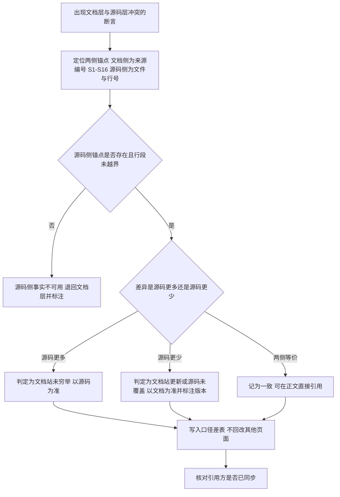

# 源码层验证与口径裁决手册

本页是[官方验证手册](14-verification-playbook.md)的**源码侧补充**：官方手册给出的是「怎么把 OCR 用起来、怎么调成本—召回」，本页给出的是「怎么核验关于 OCR 的说法、遇到文档与源码冲突时听谁的」，并从源码实现中萃取四条可迁移模式。

> **本层解决什么问题、不解决什么问题**：
> - **解决**：关于 OCR 的一切数值型断言（清单数、默认值、字段集、顺序、门数）都可落到具体 commit 的具体行号；文档层与源码层的分歧有裁决流程；跨项目可复用的四条实现级模式在此成文。
> - **不解决**：OCR 怎么安装、怎么配置、怎么调成本——那是[10 章](10-installation.md)、[11 章](11-usage.md)与[官方验证手册](14-verification-playbook.md)的职责。本层**不是**使用手册。
> - **不解决**：运行期实证——本轮未运行 `ocr` 二进制，行为类结论一律为「代码中如此声明」。

> **口径边界**：全部结论来自**静态源码阅读**，未运行 `ocr` 二进制、未调用任何 LLM、未发起任何网络请求。事实编号 `F-1xx` 指代[源码层事实清单](../references/source-code-facts.md)。

## 1. 三层引用规则

本 bundle 现有三个信源层。引用任何关于 OCR 的说法时，先判定它属于哪一层：

| 层 | 信源 | 回答的问题 | 权威范围 |
|----|------|-----------|---------|
| **① 源码层** | commit `375f64cd` 的 Go 源码 | 「代码此刻实际是这样写的」 | 常量、清单、字段、顺序、默认值 |
| **② 官方文档层** | `open-codereview.ai` 文档站（2026-10-21 采集） | 「官方声明产品是这样工作的」 | 用户可见契约、行为语义、推荐用法 |
| **③ 二手迁入层** | 微信文章 + SpecWeave 学习库三源整合稿 | 「此前社区是这样转述的」 | 叙述脉络与溯源链（数值受勘误表约束） |

### 判据：问题决定层，不是「哪个更权威」

| 你要回答的问题 | 取信层 | 理由 |
|---------------|--------|------|
| 内置 provider 有几个？ | **源码层** | 这是清单型事实，文档站是发布时刻的快照 |
| `--max-tokens` 默认是多少？ | **源码层** | 默认值以模板常量为准 |
| 用户该怎么配置？ | **文档层** | 配置建议是文档的产品职责 |
| review 与 scan 的 token 上限一样吗？ | **源码层** | 两套模板常量，文档层未区分 |
| 「OCR 会不会自动改我的代码？」 | **文档层 + 源码层交叉** | 文档层讲集成形态与授权，源码层讲 `--audience` 与输出分支 |
| 官方文档站说了什么？ | **文档层** | 描述文档站本身时，文档层是唯一信源 |

> **禁止的做法**：因为「源码更权威」就把文档层整层作废。本 bundle 的四处口径差全部是**源码更多**，不是源码更少（见第 2 节）——作废文档层会丢掉「官方如何向用户表述」这一层信息。

### 引用时的最小标注

任何源码层断言必须携带：① commit 坐标；② `文件:起-止` 行号锚点；③ 证据等级（L1 直接读值 / L2 片段读值 / L3 声明转述）。三者缺一，该断言在跨版本引用时会失效。

## 2. 四处口径差的裁决流程

源码层与文档层的全部分歧集中在[事实清单末尾的 D-1 ~ D-4](../references/source-code-facts.md#源码层与文档层的四处口径差)：

| # | 对象 | 文档层 | 源码层 | 差异性质 |
|---|------|-------|--------|---------|
| D-1 | 内置 provider 数 | 25 | **30** | 源码多 5 个：edenai、z-ai-coding、ollama-cloud、litellm、mistral |
| D-2 | 静态过滤门道数 | 5 | **6** | 源码在 binary 后、user_exclude 前插入 secret 门 |
| D-3 | 排除原因码数 | 7 | **8** | 源码含 `provider_directory` |
| D-4 | `MAX_TOOL_REQUEST_TIMES` | 单一 100 | **review 100 / scan 60** | scan 路径单独一套 |

### 裁决流程（机械四步）

> **★ 关键纪律**：口径差**只写进差异表**，不回改其他页面的既有表述。本 bundle 的做法是——文档层页保持原貌，差异集中登记在两张表里（`official-doc-corrections.md` E-01 ~ E-11 与 `source-code-facts.md` D-1 ~ D-4），引用方按表取用。**回改会让「谁在什么时间说了什么」不可追溯**，而这恰恰是文档层与源码层各自的证据价值所在。

### D-2 的特殊性：差异不只是数量

D-2 不是「多了一道门」，而是**多了一道不可被用户规则覆盖的门**。源码注释原文写明：「没有任何 include 通配符可以放行凭据路径，也没有任何用户 exclude 能以别的理由声称它」（F-113）。用户 include 命中时只跳过后续两道门，不跳过 secret 门（F-114）。

**因此 D-2 的裁决结论不能写成「源码有 6 道门」就了事**——必须连同「secret 门不可绕过」一起引用，否则下游读者会按「用户 include 能放行一切」去配置，白名单与凭据路径的关系被误解。

## 3. 四条源码级可迁移模式

以下模式从 commit `375f64cd` 的实现中直接抽出，不依赖任何文档表述。每条含触发场景、核心步骤、反模式、检验标准与迁移面。

### 模式 M-1 · 元数据契约式分组（Metadata-Contract Grouping）

**模式陈述**：当需要把一批异构对象分桶交给 LLM 时，**只传对象的元数据索引，不传对象内容**，让模型在「结构视图」而非「内容视图」上做决策。

- **触发场景**：对象数量多、单个对象体积大、分桶代价远高于分桶收益，且分桶决策只需元数据即可做出。
- **核心步骤**：
  1. 定义稳定的对象索引格式（OCR 用 `[序号] 路径与增删行数`，序号从 0 起，F-127）；
  2. 请求体只保留最少字段（OCR 用 `Model` / `Messages` / `MaxTokens` 三字段，F-124）；
  3. 用**字符串占位符替换**注入清单（OCR 用 `strings.ReplaceAll` + `{{file_list}}`，F-126）；
  4. 要求模型返回**索引数组**而非路径数组（OCR 的 `files` 为整型索引数组，F-128）；
  5. 解析前剥离 markdown 围栏，解析失败即降级（F-128）。
- **反模式**：把 diff 正文一并喂给模型做分组——这会让模型自己做「读内容 + 分类」，分组从「确定性的结构视图」退化为「模型的一次自由阅读」，同时成本与不确定性双升。OCR 源码明确不含 diff 内容。
- **检验标准**：分组请求体的字段集合可枚举（≤ 3 个）；分组请求体中不含任何对象的正文片段；模型返回的分组标识与输入索引一一对应。
- **迁移面**：批量日志分级、文档聚类、任务路由、代码库切片——凡「分类依据在元数据上」的场景均可套用。

### 模式 M-2 · 单向降级链（Monotonic Degradation）

**模式陈述**：把 LLM 步骤设计成**只降精度、不降可用性**的降级链——失败时粒度变细、结果变保守，而不是整体失败。

- **触发场景**：LLM 调用不稳定（超时、解析失败、被输出长度上限截断），但流程必须继续。
- **核心步骤**：
  1. 定义「最细粒度」作为兜底形态（OCR 兜底为「每文件一组」，F-128、F-130）；
  2. 保证降级产物**等价于跳过优化步骤**的结果，而非错误（每文件一组等价于不分组）；
  3. 兜底路径**不依赖模型可用**（OCR 的兜底路径不需要任何 LLM 请求，F-123 的 ≤1 文件分支同样不发起请求）；
  4. 降级发生时**留痕**（OCR 的 `comment_args_repaired` warning 模式，F-158）。
- **反模式**：分组失败即整轮评审失败——把「优化步骤」当成「必要步骤」。这会让一个可容忍的解析错误升级为整次评审的失败。
- **检验标准**：每个 LLM 调用点都能说出「它失败时会发生什么」；该答案永远是「粒度更细」或「结论更保守」，不会是「流程中止」。
- **迁移面**：任何「LLM 做加分项，不做及格线」的流水线——分类、路由、摘要、排序。

### 模式 M-3 · 分层输出契约（Layered Output Contract）

**模式陈述**：把「进程是否成功」「业务是否产出」「覆盖率是否完整」拆成**三层互不替代的信号**，并让每一层都能被机器独立消费。

- **触发场景**：同一工具存在多种运行路径（部分成功、无产出、失败），下游需要区分它们。
- **核心步骤**：
  1. **进程层**：退出码集合保持最小（OCR 是 `{0, 1}`，F-162）——不试图用退出码表达所有状态；
  2. **业务层**：JSON 输出恒为 stdout 上的**单个对象**，顶层字段固定（F-160）；「无评论」与「无文件」用**互斥的 message** 区分（F-161）；
  3. **覆盖层**：独立 manifest 记录 `terminal_state`（complete/partial/failed/skipped）与五个**集合**构成的 coverage（F-164）；
  4. **路径隔离**：并非每条路径都有全部层（OCR 的 scan 路径 `RunManifest()` 恒返回 nil，F-175）——缺失的层要显式缺失，不填假值。
- **反模式**：只用退出码表达全部状态——OCR 的 review 场景「部分覆盖」时退出码仍为 0（F-162），只看退出码的 CI 会把部分失败判为成功。反面错误是「所有路径都硬造一个 manifest」——scan 路径的 nil manifest 正是「有意不在 v1 范围内」的显式声明（F-175）。
- **检验标准**：进程层能被 shell 单独消费；业务层能被 `jq` 单独消费；覆盖层能被脚本做集合运算；缺失的层有显式声明而不是默认值。
- **迁移面**：任何有「多种结果状态」的 CLI / 任务——CI 报告器、批处理任务、数据同步管道。

### 模式 M-4 · 不可覆盖安全门（Non-Overridable Safety Gate）

**模式陈述**：在「用户可配置规则」与「敏感资源」共存时，**敏感判定必须排在用户规则之前**，且用户规则的 include 只覆盖选择性门、不覆盖安全门。

- **触发场景**：系统允许用户用通配符扩展范围（include 白名单、路径前缀、额外监听地址），同时系统内含不应被扩展触及的资源（凭据文件、内部端口、宿主机）。
- **核心步骤**：
  1. 把门拆成两类——**选择性门**（binary、user exclude、扩展名白名单、默认排除路径）与**安全门**（secret 路径、Host 白名单）；
  2. 安全门**排在所有用户规则之前**（OCR 的 secret 门在 user exclude 之前，F-112）；
  3. 用户 include 命中时只跳过后续选择性门，立即返回 `ExcludeNone`（F-114）；
  4. 安全门的判定独立于用户规则体系（`IsSecretPath` 是独立函数，F-119；Host 白名单是独立机制，F-171）；
  5. 安全门被绕过时要有告警（如 MCP 工具与内置工具同名时跳过并告警 `conflicts with built-in tool`，F-168）。
- **反模式**：把安全判定做成用户规则链中的一环——一旦用户写了一条宽 include，凭据路径就进入了评审上下文。同理，查看器的通配绑定（`0.0.0.0`）不自动加入 Host 白名单（F-171），避免「为了方便访问而默认放开跨站请求」。
- **检验标准**：用户 include 的语义被明确写为「只放宽选择性门」；安全门的判定代码路径中不含任何用户规则分支；文档中对该限制有显式说明。
- **迁移面**：插件权限、文件访问、网络监听、密钥管理——凡是「用户能扩范围 + 系统有禁区」的系统。

## 4. 零成本起步的源码核验八步法

本轮核验的实际流程，可直接复用：

| 步 | 动作 | 本轮产物 |
|----|------|---------|
| 1 | **固定信源坐标** | 记录 commit hash、提交时间、`git describe`（`v1.13.2-4-g375f64c`）、模块名、许可证；对外只用不可变 commit URL。**固定坐标必须与行号锚点成对使用**——坐标保证可回溯，行号只在同一 commit 内有效 |
| 2 | **拓扑清点** | `git ls-files` 按顶层目录归组得文件数（受控文件 1125），据此写出仓库拓扑表——**不采用 README 里的数字** |
| 3 | **清单型事实机械计数** | provider 30（按 registry 花括号配对区间提取）、扩展名白名单 123、默认排除模式 102、原因码 8、工具 6（+ `unknown` 哨兵）、CLI 子命令 11、viewer 路由 5、遥测 span/metric 名——全部脚本计数 |
| 4 | **逐条记锚点与字面值** | 每条事实记 `文件:起-止` + 字面值 + 等级；字面值必须逐字来自源码 |
| 5 | **行级核验** | 脚本校验：文件存在、行段不越界（EOF）、字面值在锚定行段内命中；不通过即回退修正 |
| 6 | **口径差归集** | 源码与文档的每处差异单列一行，**不回改对方页面** |
| 7 | **边界显式化** | 列出未读文件与区段，宁可留白也不推测 |
| 8 | **元数据与导航对账** | frontmatter 齐备、`toctree` 覆盖全部内容页、分类索引与总索引计数核对（**既有 bundle 内部增补不改变分类束数**） |

> **★ 计数纪律**：清单型事实（provider 数、工具数、白名单条目数）**必须由脚本对源码清单计数得出**，不采用文档、注释或 README 中的数字——本轮 D-1（25 vs 30）正是这类偏差的实例。

## 5. 源码层学习路径

给三类读者的推荐顺序：

| 读者 | 路径 | 目标 |
|------|------|------|
| **想改 OCR 行为的人** | 15 → 16 → `internal/agent/selection.go` → `internal/agent/grouping.go` → `internal/llmloop/loop.go` | 理解「哪些事不交给模型」，再动手 |
| **想把 OCR 接进宿主 agent 的人** | 16（第 2、3、4 节） → 13 → `plugins/open-code-review/` 下对应宿主目录 | 搞清输出契约与 `--audience` 分支 |
| **想验证「文档说的对不对」的人** | 本页第 1、2 节 → 17 → `references/source-code-facts.md` → `references/source-code-layer.md` | 建立可追溯的口径裁决能力 |

**阅读源码层的通用建议**：先读 `internal/config/template/task_template.json`（约 45 行，含全部关键阈值常量，F-133、F-134、F-175），再读 `internal/tool/definitions.go`（工具清单，F-152），再读 `internal/llm/providers.go` 的注册表（F-137）。这三处能在数百行内建立全局骨架。

## 6. 本层未覆盖的边界

以下内容本轮**未读**，任何相关结论不在源码层事实清单内（完整清单见[信源登记页](../references/source-code-layer.md#5-未读边界)）：

- `internal/llm/` 的 `keycmd*.go`、`api_error.go`、`browser_*.go`、`lock_*.go`、`gen/`（provider 常量前端代码生成器）
- `internal/llm/client.go` L652–L1795（流式响应解码逐行实现）
- `internal/agent/agent.go` 的 L284–L443、L629–L856、L1189–L1241、L1379–L1559 区段
- `internal/llmloop/loop.go` 的 L95–L280、L660–L880 区段
- `internal/mcp/` 除 `client.go`、`provider.go` 外的文件；`internal/viewer/handler.go`、`store.go`
- `acp/internal/` 全部 Go 源码（仅读 `acp/go.mod` 与 `acp/README.md`，等级 L3）
- `extensions/frontend|idea|vscode` 实现源码（仅读清单字段）
- `examples/` 中 `codeup`、`bitbucket`、`gitflic` 三示例的完整文件
- 全部 `*_test.go` 文件（测试可作为行为的第二证据源，本轮未系统读取）
- `pages/src/content/docs/` 除 `zh/` 外的四个语言目录（en/ja/ko/ru）

> **下一步的自然延伸**：读取 `*_test.go` 是提升本层等级的最短路径——测试用例通常以「输入 → 期望输出」形式固化了行为断言，可把大量 L2 片段读值升级为 L1 断言级证据。
