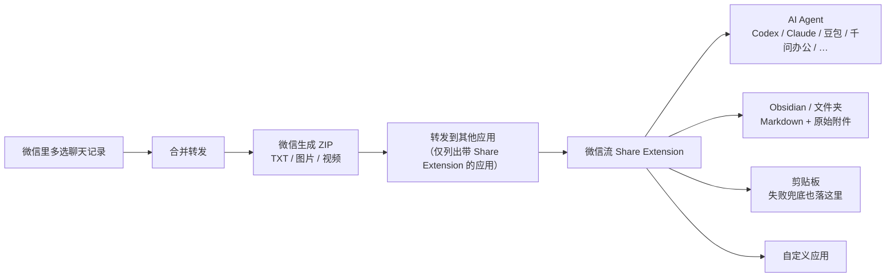

# 转发链路与权限模型：合并转发 → Share Extension → 目标

> 本篇讲**机制**。链路图依官方 README 的 flowchart 重绘（F-081），权限说明逐字引用官方六条（F-082~F-084）。
> 凡标注「源文措辞」处，均为推介文概括而非官方引文，不得加引号当作项目方原话。

## 1. 全链路

四个环节（F-013、F-025、F-080、F-081）：

1. **微信侧产生归档**：macOS 微信 4.1.13 起，多选聊天记录后可「合并转发」给第三方应用，
   微信生成一份包含 **TXT、图片和视频** 的 ZIP（F-013、F-081）。源文写作「文字、图片和视频」（F-013），语义相同。
2. **系统只列 Share Extension 应用**：官方逐字说明「系统的『转发到其他应用』列表只显示带有 Share Extension 的应用，
   大多数 AI 工具并不在里面。微信流补上了这层入口」（F-080）。
3. **微信流接管**：Share Extension 负责接收这份 ZIP（F-028）；配置模块管场景提示词与目标，记录模块管批次追溯与文件定位（F-027、F-029、F-030）。
   架构是「Share Extension + 场景配置 + 本地记录」的组合（F-027）。
4. **送达目标**：AI Agent / Obsidian 或文件夹 / 剪贴板 / 自定义应用（F-081）。
   官方目录结构中确有 `WeChatBridgeShare/`（macOS Share Extension），
   且 `macos/Scripts/make-app.sh` 会把主程序与**十二个** Share Extension 组装成完整 `.app`（F-095、F-096）。

## 2. 为什么这层入口是必要的（事实，不是推断）

| 事实 | 出处 |
|------|------|
| 系统「转发到其他应用」列表只显示带 Share Extension 的应用 | F-080（官方逐字） |
| 大多数 AI 工具不在这个列表里 | F-080（官方逐字） |
| 微信流的定位是「补上这层入口」 | F-014、F-080 |
| 官方用十二个 Share Extension 分别对应十二个入口 | F-096（组装脚本说明） |

> 以上是可以直接回查的陈述。「因此微信流的设计比读取数据库更安全」属于**作者观点**（F-049、F-050），
> 本篇不把它当机制事实。

## 3. 隐私设计六条（官方逐字要点）

官方「隐私设计」章节以「聊天记录只在你的电脑上流转」领起，共六条（F-082）：

| # | 官方要点 | 说明 |
|---|---------|------|
| 1 | 聊天内容只来自微信主动导出的文件 | 输入边界：只接 ZIP，不主动去取 |
| 2 | 不读取微信数据库，不解密、不注入、不修改微信进程 | 与微信进程的边界 |
| 3 | 聊天归档、场景和记录保存在本机 | 存储边界 |
| 4 | **Share Extension 在 macOS 沙盒中运行且没有网络权限** | 网络边界：扩展本身不能外发 |
| 5 | 屏幕录制权限只用于识别微信标题栏中的聊天名，图像仅在内存中处理 | 权限用途，见 §4 |
| 6 | 辅助功能权限只用于激活目标应用和执行粘贴 | 权限用途，见 §4 |

源文的对应表述是「不读微信数据库、不调微信接口，只接管你主动转发的那份归档，全程在本机完成」（F-026）
与「不碰数据库、不调接口、不改微信，全部本地完成」（F-051）。
二者语义相近，但**「不调微信接口」不是官方逐字措辞**（F-082）——引用官方立场时请用上表六条，
把源文说法标为「推介文概括」。这是 [verification.md ④ 引文逐字核对表](../references/verification.md) 的 V-4/V-5/C-4 项。

## 4. 两项系统权限的逐字用途

> **屏幕录制权限**：「屏幕录制权限只用于识别微信标题栏中的聊天名，图像仅在内存中处理。」（F-083）
>
> **辅助功能权限**：「辅助功能权限只用于激活目标应用和执行粘贴。」（F-084）

这两句在 [verification.md](../references/verification.md) 里做了逐字核对，本 bundle 原样引用。
相关但不同的事实：

- 本地构建若无可用签名证书会退到 ad-hoc 签名，「macOS 可能要求重新授予辅助功能权限」（F-093）。
- 目标未安装或权限不足时，文件仍会保留在剪贴板（F-035、F-075）——这就是失败兜底，见 [03 篇](03-scenes-skills-and-deposition.md)。

**源文缺口**：推介文完全没有提到沙盒、无网络权限、屏幕录制与辅助功能权限（F-037）。
这四项是本次 P0 核验从官方补齐的，属于「官方补充」而非「源文修正」。

## 5. 三模块与官方目录的对应

| 源文模块（F-027~F-030） | 官方目录（F-095） | 备注 |
|----------------------|------------------|------|
| Share Extension 接收 ZIP | `macos/Sources/WeChatBridgeShare/` | 十二个扩展由 `make-app.sh` 组装（F-096） |
| 配置模块：场景提示词 + 目标管理 | `macos/Sources/WeChatBridgeApp/`（主应用、设置、转发编排与权限管理） | 场景/技能细节见 [03 篇](03-scenes-skills-and-deposition.md) |
| 记录模块：批次追溯 + 文件定位 | `macos/Sources/WeChatBridgeCore/`（批次、场景、归档和剪贴板核心逻辑） | 批次细节见 [04 篇](04-batch-collection-and-records.md) |
| — | `shared/`（多端共用资产与契约，含 `Skills/`） | 源文未提，官方补充（F-095） |

## 6. 本篇边界

- 官方 README 只给出六条隐私要点，更完整的能力边界指向 `PRODUCT_CAPABILITIES.zh-CN.md`（F-101），
  本次未抓取该文档正文，故本 bundle 的隐私结论**以六条为限**。
- 「Share Extension 无网络权限」不等于「整个应用无网络」——官方只对 Share Extension 作了该声明（F-082）。
  本 bundle 不把这句话外推到主应用或更新机制（官方致谢 Sparkle 提供更新能力，F-097）。
- 源文「完全本地：不经过任何第三方服务器」（F-031）与官方六条一致，但「不经过任何第三方服务器」
  属推介文的绝对化措辞，正文以官方六条为准。
