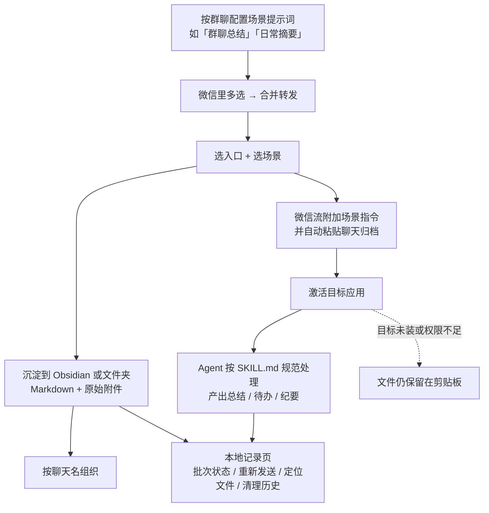

# 场景提示词、SKILL.md 与本地沉淀

> 本篇讲「转发之后发生了什么」。源文的三大能力里，「AI 处理」与「本地沉淀」都落在这一层（F-017、F-019、F-020）。
> 官方用「场景与技能」「Obsidian 沉淀」「自定义目标」「本地记录」「失败兜底」五项覆盖（F-075）。

## 1. 沉淀链全貌

注意图中两条路径：**Agent 路径**（激活应用并粘贴）与**笔记路径**（写 Markdown 与附件）是并列的目标类型，
不是「先 AI 总结再存笔记」的串联。官方流程图把二者画成 `微信流 → AI Agent` 与
`微信流 → Obsidian / 文件夹` 两个分支（F-081），源文「一键转发 / AI 处理 / 本地沉淀」的表述容易让人误读成串联，
这里按官方流程图澄清。

## 2. 场景提示词

| 事实 | 出处 |
|------|------|
| 为不同群聊保留不同的场景指令，转发时自动带上 | F-032（源文）、F-087（官方） |
| 官方示例场景名：「群聊总结」「日常摘要」 | F-087 |
| 官方「场景与技能」能力：为不同群聊保留场景提示词，并管理兼容 Agent 的 `SKILL.md` | F-075、F-087 |
| 转发时「选一个就行」——演示路径为「选『发给 Codex』和场景」 | F-077、F-087 |
| 分批收集时，目标是「收齐后一次选择目标和场景」 | F-072 |
| 配置模块负责场景提示词和目标管理 | F-029 |

源文把价值描述为「原来每次都要解释背景，现在一句话带过」（F-044）、「AI 一上来就懂上下文」（F-032）——
这是**作者的价值判断**，不是机制事实；机制事实只到「转发时自动带上场景指令」为止。

## 3. 技能管理（`SKILL.md`）

- 源文：「管理兼容 Agent 的 `SKILL.md`，让 Agent 按你的规范处理聊天内容」（F-033）；
  功能模块表写作「维护 Agent 的 SKILL.md，原来格式混乱，现在有统一规范」（F-045）。
- 官方：「场景与技能——为不同群聊保留场景提示词，并管理兼容 Agent 的 `SKILL.md`」（F-075、F-087），
  并称「还能给 Agent 装技能包，读懂群里的链接和视频」（F-087）。
- 官方目录结构里 `shared/Skills/` 为「技能目录与技能包」，是多端共用资产（F-095）。
- 官方「技能中心」出现在截图标注中，但**截图内容不可补全**（F-038）。

> ⚠️ 不要把本项目的 `SKILL.md` 与 SpecWeave 仓库 `.agents/skills/` 下的 Skill 体系混为一谈：
> 前者是被管理工具的**用户资产**（F-033），后者是方法论工作流定义。二者只是同名文件格式约定。

## 4. 本地沉淀的两种落点

| 落点 | 官方行为 | F 编号 |
|------|---------|--------|
| **沉淀到 Obsidian** | 「创建 Markdown 笔记并保存原始附件，通知可打开笔记」；核心能力表另写「生成 Markdown 笔记，保存原始 ZIP，并按聊天名组织内容」 | F-070、F-075 |
| **沉淀到文件夹** | 「写入选定目录中的 Markdown 与附件，通知可在访达中定位」 | F-071 |

源文只提到 Obsidian（F-020、F-024、F-043），「沉淀到文件夹」是官方新增的第九个入口（F-071）。
另外注意官方对同一行为有两种措辞：「保存原始附件」（F-070）与「保存原始 ZIP」（F-075）——
本 bundle 并列登记，不合并成一个断言（见 [verification.md ③ C-6](../references/verification.md)）。

## 5. 本地记录与失败兜底

**本地记录**（源文 F-036、F-046；官方 F-075）：
查看批次状态、重新发送、复制、定位文件、清理历史。记录模块负责批次追溯和文件定位（F-030）。

**失败兜底**（源文 F-035；官方 F-075）：
逐字为「目标未安装或权限不足时，文件仍会保留在剪贴板」。
这解释了为什么十二个入口里同时存在「复制到剪贴板」（F-073）——
剪贴板既是显式目标，也是自动降级后的落点，用户不会「白转一场」（F-035）。

**未完成的收集**可在记录页继续，失败可重试（F-086），见 [04 篇](04-batch-collection-and-records.md)。

## 6. 本篇边界

- 官方未在 README 给出场景提示词与 `SKILL.md` 的**文件格式规范**（只有「兼容 Agent」的定性描述，F-087）；
  更细的定义指向 `PRODUCT_CAPABILITIES.zh-CN.md`（F-101），本次未抓取。本 bundle 不臆造文件结构或示例内容。
- 「Agent 收到聊天记录并开始总结」「回车就出总结、待办和纪要」是官方演示图的说明文字（F-065 相关演示），
  属项目自述的**效果描述**，不是独立实测结论；本 bundle 不作效果保证。
- 源文「系统演示」中 Obsidian 效果与技能配置的截图内容不可补全（F-038）。
