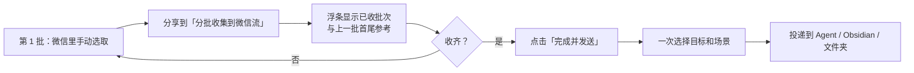

# 100 条限制、分批收集与本地记录

> **这是源文完全没写、由官方核验补齐的一块**（F-056 登记为源文缺口）。
> 它恰好解释了源文那条前提「核心场景是主动转发你选中的聊天，不是全量自动归档」（F-054）为什么成立。

## 1. 约束：微信单次最多转发 100 条

官方逐字：「超过 100 条也不怕：微信一次最多转发 100 条，用『分批收集到微信流』分几批选，收齐后一次发出去。」（F-085）

| 事实 | 值 | F 编号 |
|------|----|--------|
| 微信单次合并转发上限 | 100 条 | F-085 |
| 应对机制 | 入口「分批收集到微信流」 | F-068 / F-072 |
| 该入口行为 | 「连续分享多批原始 ZIP，收齐后一次选择目标和场景」 | F-072 |
| 原始媒体 | 图片、视频保留在 ZIP 中 | F-086 |

> 100 条是**微信侧**的限制，不是 WeChatBridge 的限制；官方把「分批收集」作为绕开该限制的产品机制。
> 本 bundle 不把 100 写成源文事实——源文未提（F-056），它是 H 类官方补充事实（F-085）。

## 2. 分批收集流程（官方逐字要点）

按官方「分批收集」段落（F-086）逐条：

1. **每批在微信手动选取并分享到「分批收集到微信流」** —— 注意是人工分批，不是自动抓取。
2. **浮条显示已收批次和上一批首尾参考** —— 用首尾参考帮助人判断批次边界，避免重选/漏选。
3. **收齐后点击「完成并发送」**，随后「一次选择目标和场景」（F-072）。
4. **原始图片、视频保留在 ZIP 中**，不在分批过程中拆解丢失。
5. **未完成的收集可在记录页继续，失败可重试**（F-086）。

## 3. 与「主动转发、非全量归档」前提的关系

源文给了四条前提（F-052~F-055），其中第三条是「核心场景是主动转发你选中的聊天，不是全量自动归档」（F-054）。
官方的分批机制与之完全同向：

| 源文前提 | 官方机制佐证 |
|---------|-------------|
| 主动转发选中的聊天（F-054） | 每批「在微信手动选取」（F-086）；聊天内容「只来自微信主动导出的文件」（F-082） |
| 不是全量自动归档（F-054） | 无数据库读取、无进程注入（F-082）；100 条上限来自微信侧人工转发（F-085） |
| 目标为 Agent 时须装好并授权（F-055） | 入口行为是「激活目标应用并粘贴」（F-069）；失败兜底为留在剪贴板（F-075） |

这不是「官方补充修正了源文」，而是**官方机制为源文前提提供了可验证的支撑**。

## 4. 本地记录页承担的四类动作

| 动作 | 出处 |
|------|------|
| 查看批次状态 | F-075（官方核心能力表）、F-030（记录模块负责批次追溯） |
| 重新发送 | F-036、F-046、F-075 |
| 复制 / 定位文件 | F-036、F-075 |
| 清理历史 | F-036、F-046、F-075 |
| 未完成的收集继续 / 失败重试 | F-086（分批收集段落） |

源文的六行功能模块表把这一项写作「查看批次、重新发送、定位文件、清理历史，原来转完就忘，现在可追溯」（F-046）。
官方多出「复制」与「查看批次状态」两个词（F-075），属粒度差异，不是冲突。

## 5. 失败兜底的两个层次

1. **投递失败**：目标未安装或权限不足 → 文件仍保留在剪贴板（F-035、F-075）。
2. **批次失败**：未完成收集可在记录页继续，失败可重试（F-086）。

两者都指向「不留半途丢失」的设计，但落点不同：前者是剪贴板，后者是记录页的批次状态。

## 6. 本篇边界

- 官方 README 未给出批次上限、批次合并后的 ZIP 结构、或断点续传的持久化格式；
  本 bundle 只登记「可在记录页继续、失败可重试」这一层描述（F-086），不臆造实现细节。
- 「浮条」的 UI 形态来自官方文字描述（F-086），非截图实测；源文四张截图内容不可补全（F-038）。
- 分批收集的可照做步骤整理在 [examples/02](../examples/02-scenes-skills-and-batch-workflow.md)，
  但**未实机验证**，以官方使用指南为准（F-101）。
