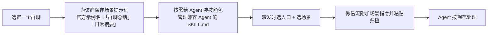

# 配置场景/技能与分批收集工作流

> ⚠️ **操作来源声明**：本篇整理自官方 README 的**文字描述**（F-032~F-036、F-072、F-075、F-085~F-087），
> **不是源文作者实测、不是本知识包实机验证**。
> 官方「场景管理页」「技能中心」「入口设置页」均以截图呈现，源文「系统演示」亦为截图，
> 图片内文字未随页面返回（F-038），所以本篇**不描述任何 UI 控件名称、菜单位置或按钮样式**，
> 只登记文字可证实的动作与顺序。实际界面以官方使用指南为准（F-101）。

## 工作流 A：为某个群配置固定处理方式

| 步骤 | 文字依据 | F 编号 |
|------|---------|--------|
| 1 | 「为不同群聊保留场景提示词」；示例场景名「群聊总结」「日常摘要」 | F-087 |
| 2 | 「并管理兼容 Agent 的 `SKILL.md`」；「还能给 Agent 装技能包，读懂群里的链接和视频」 | F-075、F-087 |
| 3 | 演示路径为「选『发给 Codex』和场景」；分批收集为「收齐后一次选择目标和场景」 | F-077、F-072 |
| 4 | 「激活目标应用，附加场景指令并自动粘贴聊天归档」 | F-019、F-075 |
| 5 | 源文表述「让 Agent 按你的规范处理聊天内容」 | F-033 |

> **不可补全**：场景提示词的具体文本、`SKILL.md` 的字段格式、场景与技能的绑定方式、
> 配置界面的控件名——官方 README 未给文字规范，截图内容不可补全（F-038、F-101）。
> 本篇不臆造配置文件示例。

## 工作流 B：超过 100 条时的分批收集

官方逐字约束：「微信一次最多转发 100 条，用『分批收集到微信流』分几批选，收齐后一次发出去。」（F-085）

| 步骤 | 动作 | 文字依据 | F 编号 |
|------|------|---------|--------|
| 1 | 在微信里**手动选取**第 1 批聊天记录 | 「每批在微信手动选取」 | F-086 |
| 2 | 分享到入口「**分批收集到微信流**」 | 入口行为「连续分享多批原始 ZIP」 | F-072、F-086 |
| 3 | 观察**浮条**：已收批次 + 上一批首尾参考 | 官方逐字描述 | F-086 |
| 4 | 重复 1~3 直到收齐 | 同上 | F-086 |
| 5 | 点击「**完成并发送**」 | 官方逐字 | F-086 |
| 6 | 一次选择**目标和场景** | 「收齐后一次选择目标和场景」 | F-072 |
| 7 | 如需中断：未完成的收集可在**记录页继续**，失败可**重试** | 官方逐字 | F-086 |

**数据保全**：「原始图片、视频保留在 ZIP 中」（F-086）——分批不拆解媒体。
**入口对应关系**：第 2 步用的是十二入口中的第 10 个「分批收集到微信流」（F-068、F-072），
它是收集器，不是最终投递目标；最终目标在第 6 步才选。

> 该流程与源文前提「主动转发选中的聊天，不是全量自动归档」（F-054）一致：
> 每一批都由人在微信里手动选取，工具不主动去读聊天记录。

## 工作流 C：投递失败后的接手顺序

| 情况 | 官方/源文给出的落点 | 建议接手动作 | F 编号 |
|------|-------------------|-------------|--------|
| 目标未安装或权限不足 | 「文件仍会保留在剪贴板」 | 从剪贴板取回，补齐目标/权限后再处理 | F-035、F-075 |
| 想完全手工处理 | 入口「复制到剪贴板」=「保留文件，交给用户手动粘贴」 | 直接用该入口 | F-073 |
| 已投递但想再来一次 | 本地记录「重新发送」 | 到记录页操作 | F-036、F-046、F-075 |
| 找不到归档文件 | 本地记录「定位文件」 | 到记录页操作 | F-036、F-075 |
| 批次没收齐就中断 | 「未完成的收集可在记录页继续，失败可重试」 | 到记录页续传 | F-086 |

> 「建议接手动作」一列是本知识包对官方文字的**操作排序**，不是官方 UI 指引；
> 具体按钮名称因截图内容不可补全（F-038）而未登记。

## 三个工作流的共同边界

1. **无实机验证**：本知识包未在 macOS 执行任何一步，不提供结果样例、耗时或成功率。
2. **无成效数字**：源文与官方 README 均未提供提效倍数/节省工时（F-063、F-107），本篇不作效果承诺。
3. **UI 细节空白**：官方只给文字描述与截图标题（「场景管理」「技能中心」「入口开关」），图片内容不可补全（F-038）。
4. **版本漂移**：入口数量在 6 周内从九个变为十二个（F-018、F-067），工作流里引用的入口名按 2026-11-06 口径，
   到期复核见 [concepts/05 §6](../concepts/05-boundaries-selection-and-patterns.md)。
