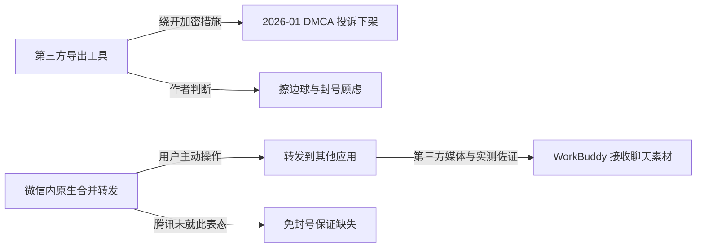

# 官方入口、四步路径与「不怕封号」的证据边界

> 本篇是**事实时间线层**。所有数字与产品名回指 [原文事实清单](../references/article-source.md) 的 F 编号；核验结论与勘误见 [P0 核验报告](../references/verification.md)。带 **S** / **V** 标记的内容是作者自述或观点，不是产品官方事实。

## 1. 事件时间线（What / When / Who）

| 时点 | 事件 | 依据 | 证据等级 |
|------|------|------|---------|
| 2025-03-25 | 微信派就「多选聊天信息」功能答复上限：iOS 100 条、安卓 99 条 | F-102 | 平台官方口径（媒体/政务号转述） |
| 2026-01-22 | 腾讯向 GitHub 发 DMCA 投诉函，要求下架一批微信聊天记录导出/分析开源项目；腾讯回应「部分项目绕开加密措施，用户隐私和安全受威胁」 | F-107 / F-108 | 官方回应 + 多家媒体 |
| 2026-03-09 | WorkBuddy（腾讯云 CodeBuddy 团队）上线 | F-119 | 厂商官网 + 开发者社区 |
| 2026-08-25 | 微信鸿蒙原生版 8.0.20.46 尝鲜版支持消息「合并转发至其他鸿蒙应用」 | F-105 | 媒体旁证（鸿蒙端） |
| 2026-09-04 | 钛媒体报道：PC 微信更新至 **4.1.13** 后，多选合并转发可选「转发到其他应用」调入 WorkBuddy | F-103 | 第三方媒体快讯 |
| 2026-09-04～09-06 | 多篇第三方实测文描述同一路径，并提到列表中另可出现「元宝」 | F-104 | 独立旁证 |
| 2026-10-10 | 本文发布，称「微信最近多了一个入口」，第一个是腾讯 WorkBuddy | F-003 / F-013 / F-014 | 被核验博文 |
| 2026-11-06 | 本次核验：未检索到微信/腾讯官方公告，也未检索到任何「免封号」官方说明 | F-106 / F-111 | 核验结论 |

**时间线结论**：文章「最近多了一个入口」与 2026-09 的媒体报道时间吻合（F-013/F-103），路径描述与多篇实测文一致（F-016/F-104）。但文章本身**没有给出任何版本号**（F-096），而该能力依赖 PC 微信与 WorkBuddy 双端版本（F-104）——这是本束 `stale_after` 定在 2026-12-31 的主要原因。

## 2. 四步路径（原文照录，非实机复现）

作者把整条路径概括为四步（F-016，01 节原文）：

> 长按多选，合并转发，转发到其他应用，选 WorkBuddy，最后说一句「整理日报」或者「帮我辟谣」。四步就完事。

拆解后的动作序列与证据：

| 步 | 动作 | 博文依据 | 外部佐证 |
|----|------|---------|---------|
| 1 | 长按消息 → 多选（或 PC 端框选） | F-016 | F-103/F-104 第三方实测 |
| 2 | 点「合并转发」 | F-016 | F-103/F-104 |
| 3 | 在弹窗选「转发到其他应用」→ 选 WorkBuddy | F-013/F-014/F-016 | F-103/F-104/F-105 |
| 4 | 在 WorkBuddy 中说 `整理日报` 或 `帮我辟谣` | F-016 / F-075 / F-077 | 仅博文单源（提示词属作者自造 skill） |

作者强调这条路径「不用装第三方工具，不用扫码登录，不碰协议也不跑脚本，从头到尾都是你自己点的转发」（F-015，**S**）。第三方实测文同样把它描述为微信内原生操作（F-104），但**这一步是流程描述，不构成腾讯的免责声明**。

> ⚠️ 上述路径为**原文照录 + 第三方报道对照**，本次未在本机安装或实跑两个 zip（正文无下载链接，F-040/F-099/F-100）。因此本束不设 `examples/`，也不提供「照着做就能成功」的保证。

## 3. 100 条上限：三种口径必须收窄（勘误 E-3）

文章两次写「微信一次最多只能选 100 条」（F-018/F-033）。核验发现这不是一条全平台统一硬规则：

| 口径 | 具体值 | 附加条件 | 来源 |
|------|--------|---------|------|
| 企业微信官方帮助（docid=19221） | 多选转发最多 **100 条** | 另有 **2MB** 消息体积上限（文本/图片等结构合计）；v5.0.2 起移动端引用消息完整展示 | F-101 |
| 微信派对个人微信「多选聊天信息」的答复（2025-03-25） | **iOS 100 条 / 安卓 99 条** | 针对该次上线的多选功能 | F-102 |
| 本文写法 | 100 条 | 未提端差异、未提 2MB 体积上限 | F-018 |

**正确表述**：在本文语境（PC 端微信合并转发到 WorkBuddy）下，「单次约 100 条」的量级判断成立，但严格上限随端与产品形态不同；个人微信安卓端报道为 99 条，企业微信帮助另有 2MB 体积约束。作者据 216 条推出「至少分三次转」（F-047）在算术上成立，但同样依赖这个被简化的口径。

## 4. 分批转发、拼接与去重（作者设计自述）

| 机制 | 博文表述 | 类型 | 可复核性 |
|------|---------|------|---------|
| 分批 | 聊得多的群分几次转，WorkBuddy 出现好几张「转发内容」卡片 | F-019 / **S** | 无卡片截图文字 |
| 拼接 | 按时间把多段拼回一条完整时间线，先转后转不用管 | F-020 / **S** | 无算法或源码（F-098） |
| 去重 | 选重了的自动去重 | F-020 / **S** | 无规则说明 |
| 分层 | 数字由脚本算、判断交给模型、版式固定成长图 | F-022 / **S** | 设计自述，见 [01 篇](01-daily-report-skill.md) |

这四点是**作者对自己 skill 的描述**，不是 WorkBuddy 的平台能力。本束把它作为「可迁移设计思路」收录（见 [03 篇](03-transferable-patterns-and-boundaries.md)），不作为已验证的产品特性。

## 5. 从野路子到官方入口，以及 2026 年初的下架事件

作者先铺陈旧方案的不安（F-024~F-029）：把外部工具归为「模拟登录 / 读本地数据库 / 挂协议跑自动化」三类（F-025），称其「在微信的规则外面打擦边球」（F-026，**V**），并用「今年年初，这类工具被腾讯投诉下架了一大批」（F-028，**T**）作为转折。

核验结果（F-107~F-110）支持这一背景：

- 2026-01-22 界面新闻、澎湃新闻、钛媒体报道腾讯向 GitHub 发 DMCA 投诉函，报道口径为 **30 余个**项目；
- 腾讯当日回应称部分开源项目「绕开加密措施，用户隐私和安全受威胁」（F-108）；
- GitHub `SuxueCode/WechatBakTool` README 有明确「下架通知」（F-109），`chatlog_alpha` README 称云端仓库仅保留 README、不再公开源码（F-110）——后者也印证了作者结尾提到的「去年我那套 Chatlog 方案」（F-032）。

> 图中「免封号保证缺失」是本束核验结论（F-111），不是原文陈述。

## 6. 核心声明「不怕封号」的证据边界（勘误 E-1）

标题《微信聊天记录终于能正经交给 AI 了，**官方开的口子不怕封号**》与正文 F-030「门是微信自己开的，封号这层顾虑，直接没了」构成文章的主结论。核验结论是：

1. **入口本身有多源佐证**：F-103/F-104/F-105 支持「微信提供了转发到其他应用的能力，其中有 WorkBuddy」。
2. **腾讯的官方表态对象是另一类行为**：F-108 的回应针对「绕开加密措施」的第三方开源项目。用户主动在微信里合并转发，与模拟登录/读本地数据库不是同一类行为（F-025）。
3. **但「不是同一类行为」不等于「官方保证不封号」**：检索未发现微信或腾讯就该路径给出任何「不会封号 / 不受账号策略影响」的承诺、帮助说明或免责声明（F-111）。
4. 因此 F-030 是**作者由「官方入口」直接推到「免封号」的因果跳跃（V）**，属无官方依据的绝对化推断；本束所有文档一律写「作者推断，无官方依据」，禁止写成「不会封号」。

**这也不等于判定入口有风险**：本束不下「会封号」的结论，只指出「不会封号」这一断言缺乏官方依据。读者应按自身账号使用场景自行判断，不要把博文标题当作平台承诺。

## 7. 官方公告缺口（勘误 E-6）

F-013 描述的功能，目前可引用的最好证据是钛媒体快讯（F-103）与 2026-09 的多篇个人实测文（F-104），以及鸿蒙端的跨应用转发旁证（F-105）；**没有检索到微信或腾讯的官方公告、帮助文档或更新日志原文**（F-106）。因此：

- 本文的「官方入口」应理解为「微信客户端内提供的原生入口」，而非「腾讯已发布正式公告并作出承诺的产品能力」；
- 客户端版本、可选应用集合（F-014「第一个就是 WorkBuddy」、F-104 提到另有「元宝」）、条数上限都属于易变的呈现细节；
- 复核时若出现官方公告，应把 F-013 的引文替换为官方源，并把 E-6 升级为 ✅（见 [核验报告](../references/verification.md) §5）。

## 8. 本篇结论：三层可信度

| 层级 | 内容 | 处置 |
|------|------|------|
| **可直接采信** | 路径存在、四步动作序列、2026-01 DMCA 事件、WorkBuddy 产品定性、100 条量级 | 引用时附 F 编号与外部信源 |
| **需收窄后引用** | 100 条的端差异与 2MB 体积上限、列表排序、版本号、官方公告缺口 | 一律加限定词，不写全平台硬规则 |
| **不可当事实** | 「不怕封号」、分批拼接/去重/脚本算数的产品化描述、全部实测数字 | 标作者推断/自述，见 [核验报告](../references/verification.md) 与 [log.md](../log.md) |
