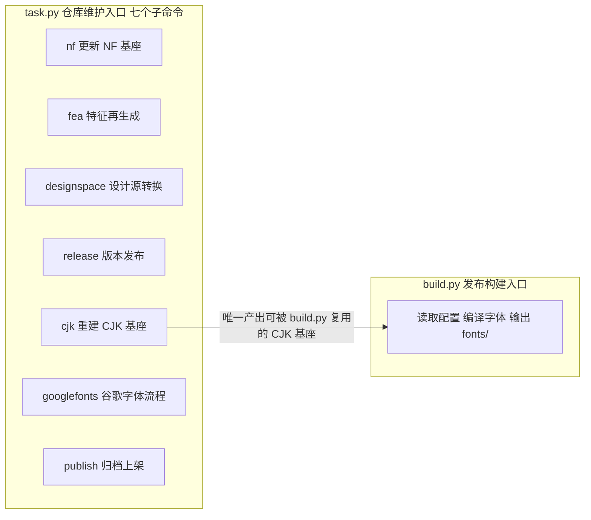

# Maple Mono 总体介绍

## 1. 字体定位

Maple Mono 是一款面向编程场景的等宽字体，设计目标包括：

- **变量字重**：以 `wght` 轴提供从 Thin 到 ExtraBold 的连续字重；
- **智能连字**：通过 `calt` 与 `cvXX` / `ssXX` 提供可选的连字与字形变体；
- **Nerd Font 图标**：内置约 1 万个图标字形，形成 `NF` / `NFMono` / `NFPropo` 三种图标间距变体；
- **CJK 扩展**：v8 将中文（简/繁）、日文、韩文纳入同一构建体系，并以 2:1 宽度比与拉丁字符对齐；
- **可定制构建**：宽度、连字、字形预设、特征冻结、行高、字重映射、Unicode 别名均可配置。

## 2. 版本线：v7.9 与 v8

| 维度 | v7.9（稳定） | v8（开发中） |
|------|--------------|--------------|
| 分支 | 发布分支 | `variable` 分支 |
| 包管理分发 | Scoop / Homebrew / Arch / Nix / CDN | 尚未发布，仅源码构建 |
| 内嵌版本 | `7.900` | `8.003`（`v8.0-beta.3`） |
| CJK 范围 | 以简体中文为主，`--cn*` 选项 | 简中/繁中/日/韩四语种，`--cjk*` 选项 |
| 字符宽度 | 单一宽度 | `default`(600) / `narrow`(550) / `slim`(500) |
| 代码组织 | `source/py/` 平铺模块 | `scripts/` 分包（config / pipeline / feature / cjk / font_ops / task / utils） |
| 特征冻结 | 成品后处理 | 源准备期跨 master 冻结 |
| 构建缓存 | 无统一阶段缓存 | 可选 `--cache` + `build-cache.json` |

> 本文档描述 v8。若你安装的是发行版包管理器中的版本，实际运行的是 v7.9，命令与目录与本包不同。

## 3. v8 的主要新增能力

1. **四语种 CJK**：`--cjk cn,jp,tc,kr`，每种语言有独立预设、基座缓存与输出目录。
2. **三档字符宽度**：`--width default|narrow|slim`，并贯穿 Variable、NF 与 CJK 输出。
3. **标准零号语义**：`--standard-zero` 恢复“默认点零、启用 `zero` 显示斜零”的 OpenType 惯例。
4. **旧字重类兼容**：`--legacy-thin-weight-class` 为 Thin/ExtraLight 静态字体使用 250/275，规避 Windows JetBrains IDE 的 GDI 伪粗体。
5. **直接编辑特征文件**：`--apply-fea-file` 读取 `sources/features/{regular,italic}{_cn,}.fea`。
6. **可选阶段缓存**：`--cache` 命中需要阶段身份、输出清单、文件存在性与内容摘要全部匹配。
7. **文档重构**：README 精简为特性介绍，构建指南迁入 `documentation/`（上游 #850）。

## 4. 仓库布局

```
maple-font/
├── build.py                 # 发布构建入口（薄封装 → scripts.pipeline.main）
├── task.py                  # 仓库维护任务入口（薄封装 → scripts.task.main）
├── config.json              # 默认构建配置（JSON Schema 见 sources/schema.json）
├── documentation/           # 用户文档：build / build-options / cli / cjk / choose / ...
├── resources/               # 预览图与静态资源
├── scripts/                 # 构建系统源码
│   ├── config/              # 配置模型、CLI、解析器、运行时上下文
│   ├── pipeline/            # 编排、Fontmake、派生输出、Nerd Font、CJK 集成、缓存
│   ├── feature/             # OpenType 特征 AST、规则、编译器、应用
│   ├── cjk/                 # CJK 配置、预设、源处理、变量/静态构建、解析回退
│   ├── font_ops/            # 字体操作：命名、度量、合并、子集、hinting、OpenType
│   ├── task/                # task.py 子命令适配器
│   └── utils/               # 文件、进程、归档、下载、日志、版本
├── sources/                 # 源与生成物
│   ├── *.designspace, *.ufo # 已提交的设计源
│   ├── features/*.fea       # 签入的特征文件（文件式构建路径）
│   ├── MapleMono-NF-Base*.ttf  # 三份预构建 Nerd Font 基座
│   ├── cjk/<locale>/        # CJK 预设配置、变量基座、静态实例与摘要
│   └── schema.json          # config.json 的 JSON Schema
└── fonts/                   # 构建输出（生成物，不入库）
```

## 5. 两种入口的分工

| 入口 | 职责 | 典型命令 |
|------|------|----------|
| `build.py` | 发布构建：读取配置、编译字体、输出 `fonts/` | `uv run build.py --format ttf --debug` |
| `task.py` | 仓库维护：特征再生成、设计源转换、NF 基座、CJK 基座、发布与上架 | `uv run task.py fea`、`uv run task.py cjk --preset cn` |

`task.py` 拥有 7 个子命令：`nf`、`fea`、`designspace`、`release`、`cjk`、`googlefonts`、`publish`。其中只有 `cjk` 会产出可被 `build.py` 复用的 CJK 基座，其余多为维护或发布流程。



## 6. 依赖与运行环境

- Python `>= 3.10`；
- 运行时依赖：`fontmake~=3.12`、`fonttools[woff]~=4.63`、`glyphsLib~=6.13`、`skia-pathops~=0.9`、`ttfautohint-py~=0.6`、`py7zr~=1.1`；
- 开发依赖：`fontbakery`、`gftools`、`pyrefly`、`questionary`、`ruff`；
- 使用 FontForge 动态修补 Nerd Font 时，需要额外安装 `fontforge`（以及可能的 `python3-fontforge`）。

推荐使用 `uv`：`uv sync` 后以 `uv run build.py` 执行，可保证依赖与锁文件一致。

## 7. 下一步

- 想理解一次构建的完整阶段：[构建流水线](01-build-pipeline.md)
- 想直接跑一次最小构建：[基本构建示例](../examples/basic-build.md)
- 想定制特征或 CJK：[特征冻结](05-freeze-mechanism.md)、[CJK 字体合并](07-cjk-font-merge.md)
