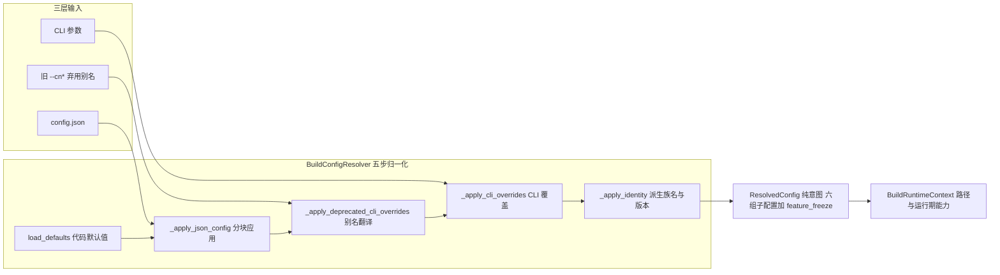

# 配置系统

## 1. 三层输入，一次归一化

- **优先级**：CLI > `config.json` > 代码默认值；
- **归一化位置**：全部在 `scripts/config/` 内完成，阶段函数不再判断参数来源；
- **校验位置**：`sources/schema.json` 声明 JSON 结构，解析器负责类型与取值校验。

## 2. ResolvedConfig 的六组子配置

`ResolvedConfig` 是一个聚合 dataclass，按职责拆为六组，另有独立的 `feature_freeze` 映射。

| 子配置 | 类 | 主要内容 |
|--------|----|----------|
| `behavior` | `BuildBehaviorConfig` | 归档、debug、缓存、最少样式、`--apply-fea-file`、CJK 输出形态、基础格式列表、`cjk-both` |
| `feature` | `FeatureBuildConfig` | `normal`、`standard_zero`、`legacy_thin_weight_class`、`feat`、`hinted`、`liga`、`infinite_arrow`、`remove_tag_liga`、`line_height`、`width` |
| `nerd_font` | `NerdFontBuildConfig` | `enable`、`version`、`mono`、`propo`、`variable`、`use_font_patcher`、`glyphs`、`extra_args` |
| `cjk` | `CJKBuildSelection` | 四语种开关、自定义条目、公共选项（`with_nerd_font`、`fix_meta_table`、`clean_cache`、`narrow`、`use_hinted`、`scale_factor`） |
| `identity` | `BuildIdentityConfig` | 基础族名、族名、紧凑名、版本标签、语义版本、内嵌字体版本、beta 标识 |
| `metrics` | `BuildMetricsConfig` | 字重映射、Unicode 别名、垂直度量、字形宽度、CJK 窄宽度、ttfautohint 参数、进程池大小、GitHub 镜像 |

`feature_freeze: dict[str, str]` 单独保存每个特征（`cvXX` / `ssXX` / `zero`）的三态值：`enable` / `disable` / `ignore`。

## 3. config.json 的关键字段

| 字段 | 类型 | 默认 | 作用 |
|------|------|------|------|
| `family_name` | string | `Maple Mono` | 字体族名 |
| `font_version` | string | `8.003` | 内嵌三位版本号 |
| `formats` | array | `["ttf","otf","woff2"]` | 请求的基础格式；Variable 始终构建 |
| `use_hinted` | bool | `true` | NF / CJK 静态合并使用 hinted 还是 unhinted 基座 |
| `legacy_thin_weight_class` | bool | `false` | Thin/ExtraLight 使用 250/275 |
| `standard_zero` | bool | `false` | 恢复标准零号语义 |
| `pool_size` | number | `4` | 并行任务数；Codespace 下解析为 1 |
| `github_mirror` | string | `github.com` | 资源下载镜像 |
| `infinite_arrow` | bool | `true` | 无限箭头连字 |
| `remove_tag_liga` | bool | `false` | 移除 `[TODO]` 等纯文本标签连字 |
| `line_height` | number | `1.0` | 行高缩放因子 |
| `width` | string | `default` | `default`(600) / `narrow`(550) / `slim`(500) |
| `weight_mapping` | object | 100…800 | 静态字体字重映射 |
| `codepoint_alias` | object | `{}` | Unicode 码点别名，如 `{"U+E000":"U+E001"}` |
| `feature_freeze` | object | 全 `ignore` | 每个特征的冻结模式 |
| `nerd_font` | object | 见下 | Nerd Font 构建参数 |
| `cjk` | object | 全部关闭 | CJK 选择与公共选项 |

`nerd_font` 默认值：`enable=true`、`version="3.5.0"`、`mono=false`、`propo=false`、`variable=false`、`use_font_patcher=false`、`glyphs=["--complete"]`、`extra_args=[]`。

`cjk` 默认值：`variable=false`、`locales={cn:false,jp:false,tc:false,kr:false,custom:[]}`、`with_nerd_font=true`、`fix_meta_table=true`、`clean_cache=false`、`narrow=false`、`use_hinted=false`、`scale_factor=[1.0,1.0]`。

## 4. CLI 参数分组

`config/cli.py` 把参数分为五组，便于 `--help` 阅读：

| 组 | 关键参数 |
|----|----------|
| 通用 | `-v/--version`、`-d/--dry`、`--debug` |
| 特征 | `-n/--normal`、`--standard-zero`、`--legacy-thin-weight-class`、`--feat`、`--apply-fea-file`、`--hinted/--no-hinted`、`--liga/--no-liga`、`--infinite-arrow/--no-infinite-arrow`、`--remove-tag-liga`、`--line-height`、`--width` |
| 构建 | `--format`、`--least-styles`、`--cache`、`--archive` |
| Nerd Font | `--nf/--no-nf`、`--nf-mono`、`--nf-propo`、`--nf-variable`、`--font-patcher` |
| CJK | `--cjk`、`--cjk-variable`、`--cjk-narrow`、`--cjk-scale-factor`、`--cjk-both`、`--cjk-hinted/--no-cjk-hinted` |

另有“Deprecated CN Options”组：`--cn`、`--no-cn`、`--cn-narrow`、`--cn-scale-factor`、`--cn-both`。它们先被解析为对应的 CJK 语义，再参与归一化，因此旧脚本仍可运行。

## 5. 解析器的职责边界

`BuildConfigResolver`（`config/resolver.py`）按顺序执行：

1. `load_defaults()`：从代码默认值构造 `ResolvedConfig`；
2. `_apply_json_config()`：读取并校验 `config.json`，分块应用到 identity / metrics / feature / behavior / nerd_font / cjk；
3. `_apply_deprecated_cli_overrides()`：把旧 `--cn*` 参数翻译成 CJK 选择；
4. `_apply_cli_overrides()`：按 behavior / feature / nerd_font 分块覆盖；
5. `_apply_identity()`：根据版本标签与 beta 标识派生族名、紧凑名与内嵌版本。

`resolve()` 是唯一公开入口；`resolve_project_config()` 用于只解析项目配置、不读取 CLI 的场景。

## 6. BuildRuntimeContext：从意图到路径

`BuildRuntimeContext.from_config(config)` 把配置解析为固定路径与运行期能力：

| 字段 | 值 |
|------|-----|
| `src_dir` | `sources` |
| `output_root` | `fonts` |
| `output_ttf` / `output_ttf_hinted` | `fonts/TTF` / `fonts/TTF-AutoHint` |
| `output_variable` / `output_otf` / `output_woff2` | `fonts/Variable` / `fonts/OTF` / `fonts/Woff2` |
| `output_nf` | 由 `NerdFontVariant.directory_name` 决定：`fonts/NF`、`fonts/NFMono` 或 `fonts/NFPropo` |
| `ttf_base_dir` | `use_hinted` 时取 `TTF-AutoHint`，否则取 `TTF` |
| `effective_github_mirror` | 归一化后的镜像主机 |
| `font_forge_bin` | FontForge 可执行路径或 `None` |
| `resolved_vertical_metric` | 解析后的垂直度量 |

它还提供 `feature_file_path(is_italic, is_cjk)`，用于定位 `sources/features/{regular,italic}{_cn,}.fea`；`to_dict()` 可输出可审计快照（`--dry` 即使用它）。

## 7. 可复现性要点

- `fonts/build-config.json` 记录本次解析后的配置，可用于复现；
- `--dry` 是检查归一化结果的唯一推荐方式，不要靠猜默认值；
- 改动 `config.json` 后，若使用 `--cache`，阶段身份会因相关配置变化而失配，从而自动重建相关阶段。

## 8. 相关文档

- 配置字段对应的 API：[ResolvedConfig 参考](../references/resolved-config.md)
- CLI 全量参数：[构建入口参考](../references/build-entrypoint.md)
