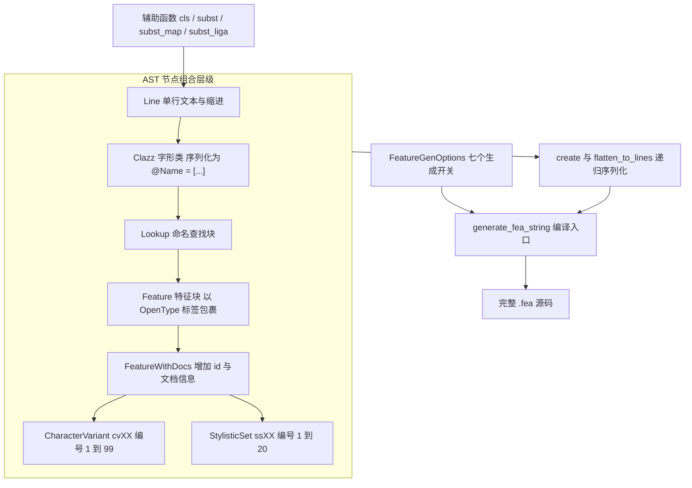

# 特征 AST 生成器

## 1. 设计动机

OpenType `.fea` 是声明式文本，但 Maple Mono 的特征需要按构建参数动态重组：

- regular / italic 的类与变体集合不同；
- CJK 构建需要追加 `cv96`–`cv99`；
- `--normal` 预设要换用另一组字形；
- `--no-liga`、`--no-infinite-arrow`、`--remove-tag-liga` 会改变 `calt` 内容。

若直接拼接字符串，缩进、闭合标签与查找引用极易出错。AST 生成器把“结构”与“文本”分离：先构造对象树，再统一序列化。

## 2. 核心节点

| 类 | 构造参数 | 作用 | 序列化结果 |
|----|----------|------|------------|
| `Line` | `text`, `level=0` | 单行文本与缩进层级 | 缩进后的文本行 |
| `Clazz` | `name`, `glyphs=None` | 可复用的字形类 | `@Name = [g1 g2 ...];` |
| `Lookup` | `name`, `desc`, `content` | 命名查找块 | `lookup Name { ... } Name;` |
| `Feature` | `tag`, `content`, `version` | OpenType 特征块 | `feature tag { ... } tag;` |
| `FeatureWithDocs` | `id`, `tag`, `desc`, `content`, `version`, `example` | 带文档信息的特征 | 同上，并参与文档生成 |
| `CharacterVariant` | `id`, `desc`, `content`, `version`, `example` | `cvXX`（`1 ≤ id ≤ 99`） | 附带 `cvParameters` 名称块 |
| `StylisticSet` | `id`, `desc`, `content`, `version`, `example` | `ssXX`（`1 ≤ id ≤ 20`） | 附带 `featureNames` 名称块 |

`Clazz.use()` 返回 `@Name` 引用；`Clazz.state()` 返回类声明行。`Lookup.use()` 返回 `lookup Name;` 引用，`state()` 返回完整定义。



## 3. 辅助函数

| 函数 | 签名要点 | 用途 |
|------|----------|------|
| `cls(glyphs, *rest)` | 接受字符串、`Clazz` 或序列 | 生成 `[a b c]` 类文本 |
| `subst(prefix, glyph, suffix, replace)` | 四段式 | 生成带可选上下文的替换行 |
| `subst_map(glyphs, source_suffix, target_suffix)` | 批量映射 | 为一组字形生成同后缀替换 |
| `subst_liga(source, target, lookup_name, ...)` | 连字 | 生成单个连字查找，可用于 `[TODO]` 类标签 |
| `create(content, indent=2)` | 节点列表 | 递归序列化为文本 |
| `flatten_to_lines(data)` | 任意嵌套 | 展平为 `Line` 列表 |
| `clone_empty(feature, desc_prefix)` | 复制空壳 | 生成占位特征 |
| `filter_empty(features, full)` | 过滤 | 移除空特征 |

### 示例：类 + 替换

```python
from scripts.feature.ast import Clazz, subst

cls_digit = Clazz("Digit", ["zero", "one", "two", "three"])
cls_digit.state()          # @Digit = [zero one two three];
subst(cls_digit.use(), "a", "b", "c")   # sub @Digit a' b by c;
```

### 示例：查找块

```python
from scripts.feature.ast import Lookup, subst

lookup_example = Lookup(
    name="example_lookup",
    desc="Example substitution",
    content=[subst("a", "b", None, "c")],
)
```

输出：

```fea
# Example substitution
lookup example_lookup {
  sub a b' by c;
} example_lookup;
```

### 示例：特征块

```python
from scripts.feature.ast import Feature, create

feature_example = Feature(tag="calt", content=[lookup_example], version="1.0")
print(create([feature_example]))
```

输出以 `feature calt {` 开始、以 `} calt;` 结束，内部查找保持独立闭合。

## 4. 编译入口

```python
from scripts.feature.compiler import generate_fea_string

fea_string = generate_fea_string(is_italic=False, is_cn=True)
```

`generate_fea_string` 也接受 `FeatureGenOptions` 对象：

```python
from scripts.feature.compiler import FeatureGenOptions, generate_fea_string

options = FeatureGenOptions(
    is_italic=False,
    is_cn=False,
    is_normal=False,
    is_calt=True,
    enable_infinite=True,
    enable_tag=True,
    remove_italic_calt=False,
)
fea = generate_fea_string(options)
```

| 参数 | 作用 |
|------|------|
| `is_italic` | 追加斜体专属类与 `cv31`–`cv45` |
| `is_cn` | 追加 CJK 专属 `cv96`–`cv99` |
| `is_normal` | 换用 `--normal` 预设字形集合 |
| `is_calt` | 是否保留 `calt` 上下文规则 |
| `enable_infinite` | 是否加入无限箭头规则 |
| `enable_tag` | 是否加入纯文本标签连字 |
| `remove_italic_calt` | 是否移除斜体专属上下文规则 |

编译器内部还维护：

- `NORMAL_ENABLED_FEATURES`：`--normal` 预设启用的 12 个特征（`cv01`、`cv02`、`cv33`–`cv36`、`cv61`、`cv62`、`ss05`–`ss08`）；
- `CJK_FEATURES`：`cv96`–`cv99`；
- `get_freeze_moving_rules()`：需要移入 `calt` 的冻结规则；
- `get_total_feat_dict()`、`get_cv_desc()` 等文档生成辅助函数。

## 5. 与文件式路径的关系

AST 生成器的输出最终写入 `sources/features/*.fea`（由 `task.py fea` 刷新）。构建时：

- 默认路径直接调用生成器；
- `--apply-fea-file` 读取签入的 `.fea` 文件。

两种方式共享同一套规则定义，因此差异只在于“何时生成文本”。

## 6. 相关文档

- 包结构与标签清单：[特征系统](03-feature-system.md)
- 参数级 API：[特征生成 API 参考](../references/feature-generator-api.md)
- 冻结如何改变输出：[特征冻结机制](05-freeze-mechanism.md)
