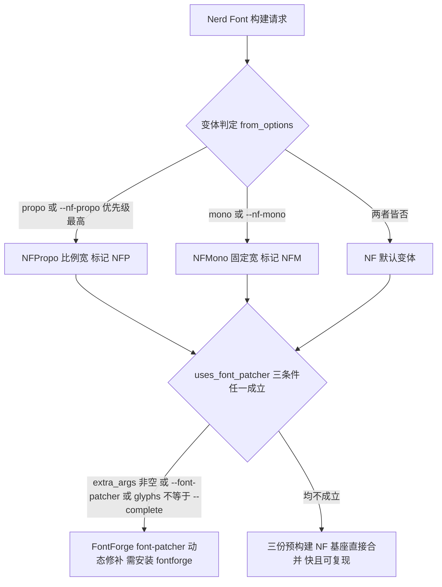

# Nerd Font 补丁

## 1. 三种图标间距变体

Nerd Font 图标的前进宽度与字形宽度可以不同，Maple Mono 因此提供三种变体：

| 变体 | 目录/包标签 | 文件名标记 | 含义 |
|------|-------------|------------|------|
| 默认 | `NF` | `NF` | 每个图标占一个拉丁字符前进宽度，字形宽度可变 |
| 固定宽 | `NFMono` | `NFM` | 图标固定为一个拉丁字符宽度 |
| 比例宽 | `NFPropo` | `NFP` | 图标使用可变宽度 |

`NerdFontVariant`（`scripts/font_ops/nerd_font.py`）统一解析后缀、符号与路径：

- `suffix`：`""` / `"Mono"` / `"Propo"`；
- `symbol`：`NF` / `NFM` / `NFP`；
- `directory_name`：`NF` / `NFMono` / `NFPropo`；
- `base_path`：`sources/MapleMono-NF-Base.ttf`、`MapleMono-NF-Base-Mono.ttf`、`MapleMono-NF-Base-Propo.ttf`。

`from_options(mono, propo, extra_args, reject_conflict)` 的判定顺序是：`propo`（或 `--variable-width-glyphs`）优先，其次 `mono`（或 `-s` / `--mono` / `--single-width-glyphs`），否则默认。`reject_conflict=True` 时同时指定 `mono` 与 `propo` 会直接报错。

## 2. 预构建基座优先

v8 在 `sources/` 下签入三份 NF 基座：

```
sources/MapleMono-NF-Base.ttf
sources/MapleMono-NF-Base-Mono.ttf
sources/MapleMono-NF-Base-Propo.ttf
```

常规构建直接把预构建基座与 Maple 字体合并，并应用命名与度量修正。相比每次调用 FontForge，这条路径显著更快，且结果稳定。

## 3. 何时回退到 font-patcher

`NerdFontBuildConfig.uses_font_patcher()` 在以下任一条件成立时返回真：

- `extra_args` 非空；
- `use_font_patcher=True`（对应 `--font-patcher`）；
- `glyphs != ["--complete"]`。

此时流水线会调用 FontForge 修补器，需要使用 `nerd_font.extra_args` 调整参数。默认参数为 `-l --careful --outputdir dir`；`propo` 为真时追加 `--variable-width-glyphs`，`mono` 为真时追加 `--mono`。运行环境需要安装 `fontforge`，可能还需要 `python3-fontforge`。

> 取舍：预构建路径快且可复现；修补器路径灵活但引入外部依赖与运行时间。只有确实需要自定义图标集或参数时才走后者。



## 4. 构建选项

| 选项 | 作用 |
|------|------|
| `--nf` / `--no-nf` | 构建 / 跳过 Nerd Font（默认构建） |
| `--nf-mono` | 固定宽图标（`NFMono`） |
| `--nf-propo` | 比例宽图标（`NFPropo`），优先于 `--nf-mono` |
| `--nf-variable` | 以变量字体形式构建 NF |
| `--font-patcher` | 强制使用 FontForge 修补器 |

对应 `config.json` 的 `nerd_font` 对象：

```json
{
  "nerd_font": {
    "enable": true,
    "version": "3.5.0",
    "mono": false,
    "propo": false,
    "variable": false,
    "use_font_patcher": false,
    "glyphs": ["--complete"],
    "extra_args": []
  }
}
```

`nerd_font.version` 必须与所下载的修补器版本匹配；`task.py nf` 会检查上游发布并同步该字段。

## 5. 输出目录

| 构建形态 | 输出目录 |
|----------|----------|
| 静态默认 NF | `fonts/NF/` |
| 静态固定宽 | `fonts/NFMono/` |
| 静态比例宽 | `fonts/NFPropo/` |
| 变量默认 NF | `fonts/Variable-NF/` |
| 变量固定宽 / 比例宽 | `fonts/Variable-NFMono/`、`fonts/Variable-NFPropo/` |
| NF + CJK | `fonts/NF-<LOCALE>/` 等（见 CJK 文档） |

静态 NF 的基座选择由 `use_hinted` 决定：为真时使用 `fonts/TTF-AutoHint/`，否则使用 `fonts/TTF/`。变量 NF 与 CJK 变量输出不受该静态 hinting 选择影响。

## 6. 维护 NF 基座

更新上游 Nerd Font 时：

```sh
uv run build.py --format ttf        # 先产出基础 TTF
uv run task.py nf                   # 检查上游版本、更新 config.json、下载修补器、重写三份基座
uv run task.py nf --no-update       # 版本已正确，仅重建本地 NF 输出
```

`task.py nf` 会更新 `nerd_font.version` 并写入 `sources/MapleMono-NF-Base*.ttf`；这些是签入产物，需要连同配置一起提交。

## 7. 相关文档

- 输出命名总表：[总体介绍](00-introduction.md)
- CJK 与 NF 的组合：[CJK 字体合并](07-cjk-font-merge.md)
- 动手构建：[Nerd Font 构建示例](../examples/nerd-font-build.md)
