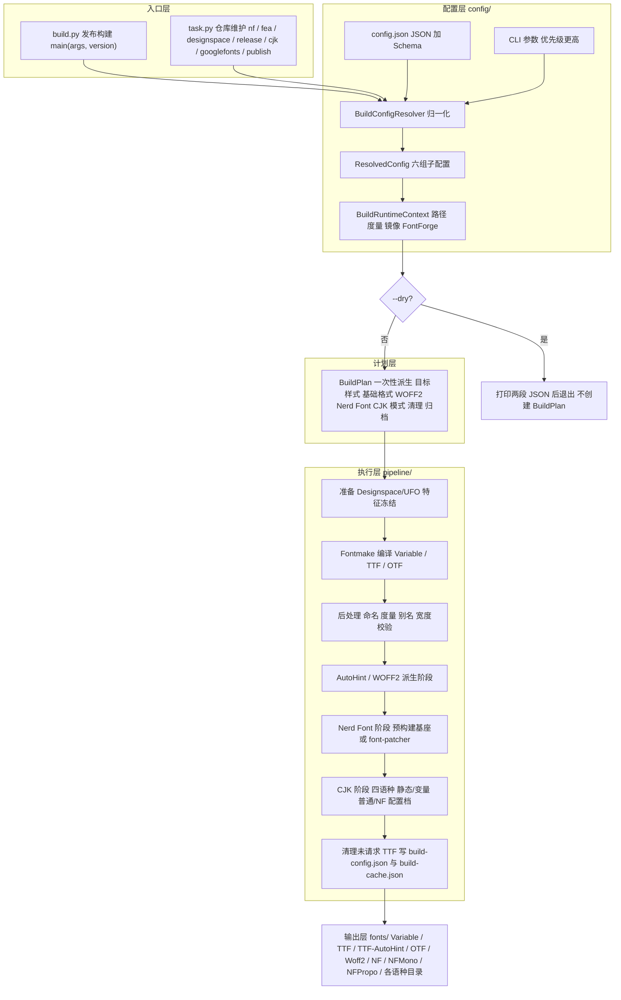

# Maple Mono Font Builder

> Maple Mono 是一款专为编程体验优化的开源等宽字体，支持变量字重、智能连字、Nerd Font 图标补丁与中日韩字符集嵌入。本知识包基于 Maple Mono **v8（8.003）** 构建系统源码与官方文档重写，覆盖构建流水线、配置解析、特征系统、CJK 子系统的完整架构。

本知识包按七概念方法论的 R→I→E 链路交付：先采集客观事实，再形成四元组洞察（现象+根因+影响+建议），最后原子化为概念文档、实战示例与 API 参考三层结构。

> **版本边界**：v8 目前位于上游 `variable` 分支，开发版本为 `v8.0-beta.3`（内嵌字体版本 `8.003`）；Scoop、Homebrew、Arch、Nix 与 CDN 分发的稳定包仍是 v7.9。本包描述的是 v8 构建系统，命令与目录均以 v8 源码为准。

## 快速导航

| 类别 | 数量 | 索引 |
|------|------|------|
| 📖 概念文档 | 9 | [概念文档索引](concepts/index.md) |
| 🧪 实战示例 | 4 | [实战示例索引](examples/index.md) |
| 📚 API 参考 | 3 | [API 参考索引](references/index.md) |

## 三分钟理解 v8 构建流水线



## 核心洞察

1. **“解析—计划—执行”三段分离**：`ResolvedConfig` 只表达用户意图，`BuildPlan` 只做一次性阶段决策，`MapleBuildPipeline` 只负责依赖顺序与缓存。三者职责互斥，使 `--dry` 能在不触碰构建逻辑的前提下完整审计输入，也让阶段策略可以独立测试。

2. **配置归一化前移**：JSON、CLI、旧版 `--cn*` 别名都在 `config/` 内归一化，阶段内部不再判断“用户是怎么传参的”。这避免了默认值散落在各阶段导致的不可复现构建。

3. **特征编译双轨 + 源准备期冻结**：默认路径用 Python AST 生成特征源码；`--apply-fea-file` 则读取 `sources/features/*.fea`。两条路径都在 Fontmake 编译前进入源准备，把启用的单一替换写入每个 UFO master，因此静态与变量输出共享同一套冻结轮廓，而不是在成品字体上做后处理。

4. **CJK 是独立子系统，不是一次合并步骤**：四语种各有预设、配置、变量基座、静态实例与独立摘要；主流水线只按“本地静态目录 → 本地静态归档 → 远程静态归档 → 本地变量 → 本地变量归档 → 远程变量归档 → 源重建”七级回退取用。这使 CJK 构建可以脱离主流水线单独维护与发布。

5. **缓存身份是一份显式契约**：阶段身份只包含相关解析配置、目标样式、Designspace 维度字典、生成特征文件指纹与上游阶段身份，**不包含**生成器源码、依赖版本、UFO 轮廓内容与 CJK 基座内容。改到这些未纳入身份的输入时，必须显式无缓存构建，否则会得到“看似命中、实际过期”的结果。

6. **预构建优先、动态修补兜底**：Nerd Font 默认使用三份签入的 NF 基座（默认 / Mono / Propo），只有自定义 glyph、`extra_args` 或显式 `--font-patcher` 才回退到 FontForge 修补器，显著缩短常规构建时间。

## 文档结构

```
maple-font/
├── index.md              ← 本文件（Bundle 首页）
├── log.md                ← 生成与更新日志
├── concepts/             ← 9 篇概念文档
│   ├── index.md
│   ├── 00-introduction.md
│   ├── 01-build-pipeline.md
│   ├── 02-config-system.md
│   ├── 03-feature-system.md
│   ├── 04-feature-ast-generator.md
│   ├── 05-freeze-mechanism.md
│   ├── 06-nerd-font-patching.md
│   ├── 07-cjk-font-merge.md
│   └── 08-parallel-build.md
├── examples/             ← 4 个实战示例
│   ├── index.md
│   ├── basic-build.md
│   ├── custom-feature-build.md
│   ├── nerd-font-build.md
│   └── cjk-build.md
└── references/           ← 3 篇 API 参考
    ├── index.md
    ├── build-entrypoint.md
    ├── resolved-config.md
    └── feature-generator-api.md
```

## 快速开始

如果你是 Maple Mono 构建系统的新用户，从 [基本构建示例](examples/basic-build.md) 开始。

如果你想理解架构，从 [构建流水线](concepts/01-build-pipeline.md) 开始按学习路径阅读；若只关心某一子系统，可直接跳到 [特征冻结](concepts/05-freeze-mechanism.md)、[Nerd Font](concepts/06-nerd-font-patching.md) 或 [CJK 合并](concepts/07-cjk-font-merge.md)。

```{toctree}
:hidden:
:maxdepth: 7

concepts/index
examples/index
references/index
log
```
