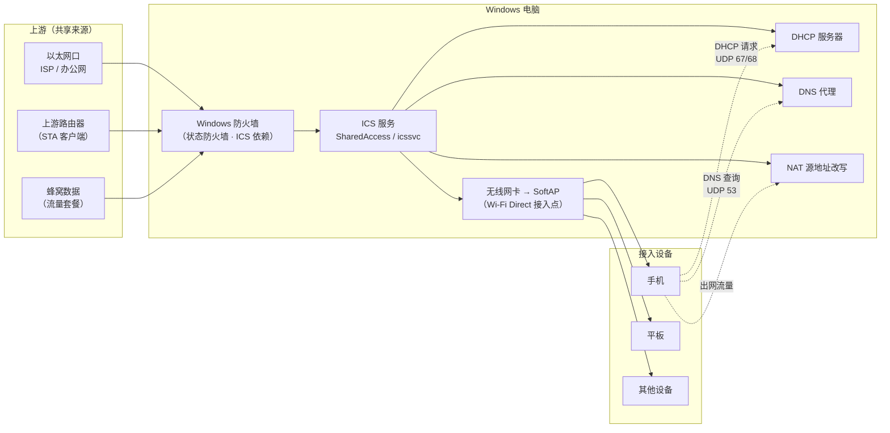

# ICS 共享出口机制：NAT、DHCP、DNS 代理与状态防火墙

## 一、术语速查

先把这几个词摊开，后面所有结论都建立在它们之上。

| 术语 | 一句话解释 |
|---|---|
| **ICS**（Internet Connection Sharing，Internet 连接共享） | Windows 的共享出口服务。移动热点的网络能力由它提供，服务名 `SharedAccess` / `icssvc` |
| **NAT**（网络地址转换） | 把内网私有地址改写成主机地址再发往公网，于是内网设备不需要各自的公网 IP |
| **DHCP**（动态主机配置协议） | 自动给接入设备分配 IP 地址、网关与 DNS 服务器 |
| **DNS 代理** | 主机代替客户端做域名解析，再把结果回传 |
| **状态防火墙**（stateful firewall） | 记住连接状态，允许「由内向外发起的会话的回包」通过，而不只是按端口放行 |
| **SoftAP / Wi-Fi Direct** | 让无线网卡自身变成一个接入点（AP），供其他设备连入 |
| **STA** | 无线网卡作为客户端去连接上游路由器 |
| **Hosted Network** | Windows 7 时代的「承载网络」，与当前的移动热点是两套独立技术（见 [辨析](frequency-and-compatibility.md#六hosted-network-辨析)） |

## 二、四项能力及其官方出处

移动热点之所以能「一个接口带全家上网」，是因为 ICS 在无线接口背后搭了一整套小网络。微软官方在四处独立表述中确认了它的能力：

### 2.1 DHCP 地址分配

> 官方学习文档明示：ICS 通过提供**本地私有网络服务**（名称解析与地址分配）来简化小网络的配置。
> —— F-016（L2，`s3-ms-learn-sr2003-network`）

> ICS 组件还为私网提供 **DHCP 与 DNS 服务**。
> —— F-018（L2，`s4-ms-learn-embedded-ics`）

> ICS 扮演 **DHCP 服务器**角色；防火墙必须放行 DHCP 流量——入向 UDP 源端口 68 目的端口 67（DISCOVER/REQUEST/INFORM），出向 UDP 源端口 67 目的端口 68（OFFER/ACK/NACK）。
> —— F-019（L4，`s5-ms-hw-compat`）

**这三条合起来是本包最重要的勘误依据**：DHCP 不是「路由器才有」的能力，而是 ICS 的内建职责，而且它对主机防火墙有**明确的端口级要求**。

### 2.2 DNS 代理

> ICS 充当 **DNS 代理**，接收客户端发往 UDP 53 的 DNS 查询并代为应答；主机防火墙须放行该方向流量。
> —— F-019（L4，`s5-ms-hw-compat`）

### 2.3 NAT 改写

> ICS 机器对来自私网、目的地为公网的报文做修改，使其在公网看来**发自 ICS 机器本身**。
> —— F-018（L2，`s4-ms-learn-embedded-ics`）

关键细节：这是**源地址改写**，不是端口映射。所以客户端能出网，但公网无法主动向客户端的某个端口发起连接——除非另有端口转发机制（ICS 不提供）。

### 2.4 状态防火墙（且是 ICS 的依赖）

> Windows 防火墙检查所有跨越「本网络 ↔ Internet」连接边界的通信，并对允许哪些来自 Internet 的响应做选择性放行。**若在 ICS 主机上启用了 Windows 防火墙，使用共享连接的 ICS 客户端会获得保护**，因为它们无法从网络外部被看到。**因此应始终在 ICS 主机上启用 Windows 防火墙。**
> —— F-016（L2，`s3-ms-learn-sr2003-network`）

> 当 ICS 启用时，**只有 ICS 主机对 Internet 可见**，ICS 客户端的地址对 Internet 隐藏。
> —— F-017（L2，`s3-ms-learn-sr2003-network`）

也就是说：**Windows 防火墙在 ICS 场景里不是「可选的额外防护」，而是这个功能的前置依赖之一**。官方文档还直接建议「在 ICS 主机上始终启用防火墙」。

## 三、拓扑结构

**读图要点**：客户端只与 AP 打交道，但拿到 IP、解析域名、访问公网这三件事，分别由主机上的 DHCP、DNS 代理、NAT 三个角色完成。**任一角色失效，症状都表现为「连上了但用不了」**。

## 四、客户端视角：接入后到底拿到了什么

一台设备连上热点后，从它的视角能观察到这些（这决定了排障时该看什么）：

| 客户端观察到的现象 | 对应主机侧角色 | 若不正常，先查 |
|---|---|---|
| 拿到了 IP，但 IP 是 `169.254.x.x` | DHCP 服务器未应答 | ICS 服务状态、主机防火墙是否放行 UDP 67/68、是否有第三方安全软件接管防火墙 |
| 拿到了 `192.168.137.x` 一类的私网地址 | DHCP 正常工作 | —（这说明 ICS 起来了） |
| IP 正常，能 ping 通 IP 但 ping 不通域名 | DNS 代理未应答 | UDP 53 是否被拦、是否有 VPN/安全软件劫持 DNS |
| IP 正常、域名也能解析，但网页打不开 | NAT 出口或上游链路问题 | 上游链路本身是否通、共享来源选得对不对 |
| 时好时坏、连上又断 | 驱动并发或信号问题 | 频段选择、驱动版本、共享来源与承载方式是否耦合 |

关于 `192.168.137.x`：这是社区普遍观察到的 ICS 默认网段，**但本包未找到微软官方文档确认**（F-036，L5，3 源一致；未闭环项 U-2）。相关注册表键 `HKLM\SYSTEM\CurrentControlSet\Services\SharedAccess\Parameters` 下的 `ScopeAddress` / `ScopeAddressBackup` / `StandaloneDhcpAddress` 可用于调整网段——**同样属社区口径**。

> **操作建议**：在企业网络、VPN 或与既有局域网网段重叠的环境里，网段冲突是真实存在的故障模式。但**默认不要动注册表**；先确认冲突是否真的发生（客户端拿到的是不是 `192.168.137.x`、上游是否同段），确认后再按 [未闭环项 U-2](boundaries-and-risks.md#五未闭环项) 的复核条件处理。

## 五、端口转发的真实边界

源文把「端口转发」列为路由器的能力，这个归因**是准确的**。原因是机制层面的：

- ICS 做的是 **NAT 源地址改写**（F-018），出网流量被改写成来自 ICS 主机的地址；
- NAT 共享**不维护端口映射表**，也就无法把公网的某个端口主动映射到内网某台设备的某个端口；
- 结果是：内网设备可以主动出网，但**外部无法主动向内网设备发起连接**。

这正是「端口转发 / 内网穿透」要补的那块能力。家用路由器的端口转发、DDNS、VPN 服务器等，ICS 一概不提供（除非另外装软件或用系统自带的「允许传入连接」规则，那属于另外的机制范畴）。

**一句话**：ICS 给你的是「**出口**」，不是「**入口**」。

## 六、这套机制对排障的直接含义

1. **不要反复开关 Windows 防火墙。** ICS 启用时会自行配置规则；防火墙是依赖而非变量。反复开关只会引入新的不确定性。
2. **按层定位，不要混着试。** 客户端 IP 异常 → DHCP 层；域名解析异常 → DNS 层；域名能解析但访问不通 → NAT/上游层。
3. **优先换共享来源。** 官方社区答复给出的处置顺序里，「改选另一个共享接口」排在「网络重置」之前（F-032）。
4. **第三方安全软件是高频干扰源。** 官方规范明确要求主机防火墙放行 DHCP 与 DNS（F-019）；若安全软件接管了防火墙，这两条放行规则可能失效，症状正是「拿到 IP 但解析不了域名」。
5. **「已连接」不等于「通了」。** 热点开关打开、客户端关联成功，只完成了 Wi-Fi 层的连接；IP、DNS、出口三段还需各自成立。
