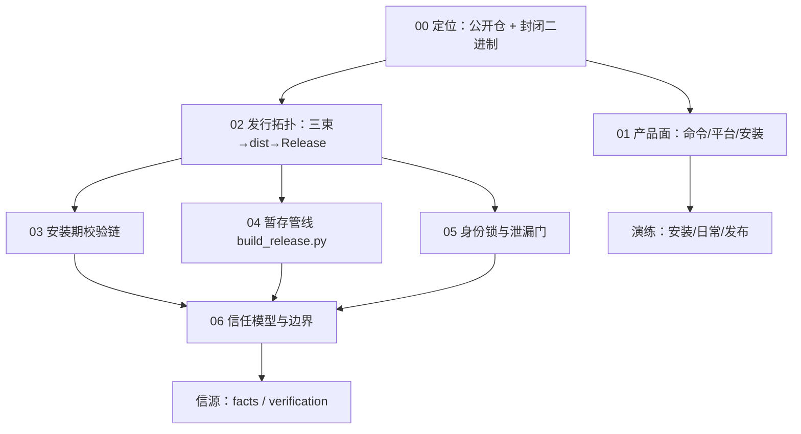

# 定位与全景

## 一句话定位

`skylinevpn-cli` 仓库**不是产品源码仓**，而是一个**公开发行仓**：它只包含「怎么把上游 CI 构建出来的三平台二进制包装成可信的 GitHub Release」以及「用户怎么安装和使用」。

由此得到本束的第一个判断：

> 学这个仓库，学的不是 VPN 客户端内部怎么实现，而是**一个封闭二进制产品如何建立可审计的交付链**。

依据：仓库根目录没有任何产品源码，只有 6 份 README、`CHANGELOG.md`、`LICENSE` 和 `tools/` 下四个脚本与一份发行手册（F-007）。

## 仓库里有什么

```text
skylinevpn-cli/                 （HEAD 415d0bb，2026-10-28）
├── README.md / README.zh-CN.md / README.zh-TW.md
│   README.ja.md / README.ru.md / README.fa.md      ← 6 种语言，同一内容
├── CHANGELOG.md                 ← v3.0.0（首个公开版）与 v3.0.1
├── LICENSE                      ← 专有许可：仅限有效订阅者使用
├── .gitattributes               ← sh/py/md 用 LF，ps1/cmd 用 CRLF
├── .gitignore                   ← 屏蔽 dist/、安装包、密钥、智能体文件
└── tools/
    ├── build_release.py         ← 暂存发布：校验、改写、扫描、出清单
    ├── check-identity.sh        ← 身份锁 + 泄漏门（提交期与发布期共用）
    ├── install-hooks.sh         ← 给本克隆装 commit-msg / pre-push 钩子
    ├── publish-release.sh       ← 发布门：多重前置条件 + 人工回打确认
    └── RELEASING.md             ← 维护者发布手册（六步 + 特例 + 测试法）
```

三个 CI 束（`Linux-CLI-*.zip`、`macOS-CLI*.zip`、`Windows-CLI*.zip`）在发行时临时放在仓库根，且被 `.gitignore` 屏蔽（F-011、F-031），所以它们**不会出现在 Git 历史里**。

## 三类读者各取什么

| 读者 | 关心的问题 | 建议路线 |
|------|-----------|---------|
| **使用者** | 怎么装、怎么连、出问题看哪里 | [01 产品面](01-product-surface.md) → [演练 00](../examples/00-install-verify-uninstall.md) → [演练 01](../examples/01-daily-usage-and-troubleshooting.md) |
| **维护者** | 一次发布要做哪些动作、哪些条件不满足必须停 | [02 发行拓扑](02-distribution-topology.md) → [04 暂存管线](04-release-staging-pipeline.md) → [05 身份与泄漏门](05-identity-and-leak-gates.md) → [演练 02](../examples/02-maintainer-release-runbook.md) |
| **研究者 / 评估者** | 这条交付链能证明什么、不能证明什么 | [06 信任模型与边界](06-trust-model-and-boundaries.md) → [核验报告](../references/verification.md) |

## 三个结构性特点

**其一，发布内容与产品实现彻底分离。** 仓库能证明的是「某个二进制被怎样打包、校验、发布」，不能证明「这个二进制做了什么」（F-007、[核验报告](../references/verification.md)第三节）。

**其二，构建脚本把「上游格式」当契约。** 所有改写都通过带命中次数断言的正则完成（F-046），上游安装器改一个标题格式，流水线就失败而不是静默产出坏包。这是本仓最值得迁移的工程习惯。

**其三，保密对象与门禁代码分离。** 禁止出现的实体名清单放在仓库外（F-057），仓库内只留执行逻辑。清单本身属于敏感信息，所以「缺清单即拒绝运行」是刻意设计。

## 这套知识不适用于什么

1. **想了解 VPN 协议或实现**：仓库没有源码，本束不提供任何协议层结论。
2. **想审计二进制安全性**：产品闭源（F-009），本束只能描述交付链的完整性，不能替代逆向或沙箱分析。
3. **想复用为通用发布框架**：脚本大量依赖上游安装器的具体变量名与步骤标记（F-047、F-062），迁移时改造成本高，应抽取模式而非照搬代码。

## 阅读地图



## 主题关联

- 同组 [钉钉工作区 CLI](../dingtalk-workspace-cli/index.md)：另一个「CLI 面向人与 Agent」的产品，但那个仓库有源码，本仓只有发行工程——两者正好构成「源码可读 / 仅二进制可验」的对照。
- 上级 [dev](../index.md)：开发与协作工具组。
- 相关方法：[verification.md](../references/verification.md) 中的对抗审查可视为「发布门禁设计」的反向检查表。
