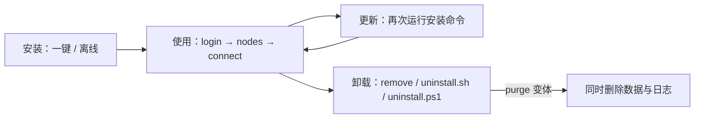

# 产品面

> 本篇全部内容为仓库 README 与 CHANGELOG 的**文档口径**（F-013 ~ F-030），本包未执行二进制。

## 平台矩阵

| 平台 | 系统 | 架构 | 依据 |
|------|------|------|------|
| Linux | Ubuntu 22.04+ / Debian 12+ | amd64、arm64 | F-013 |
| macOS | 12+ | Intel、Apple 芯片（universal） | F-013 |
| Windows | 10+ | x64 | F-013 |
| Windows | 11 | ARM64 | F-013、F-029 |

注意架构命名的两套写法：README 用 `x64`，包名与构建脚本用 `amd64`（C-5）。

## 命令模型

命令面可以按「会话」「连接」「配置」「账户」四类理解：

| 类别 | 命令 | 说明 |
|------|------|------|
| 会话 | `skyline login` / `skyline logout [--purge]` | 登录与退出；`--purge` 连本地登录数据一起删除（F-015） |
| 连接 | `skyline connect <编号>` / `skyline connect --best` / `skyline disconnect` | 指定节点或交给自动选择；断开（F-014） |
| 观察 | `skyline nodes [--refresh]` / `skyline status` | 节点列表与刷新、当前连接状态（F-014、F-015） |
| 配置 | `skyline mode smart\|global` / `skyline lang english\|chinese` | 路由模式与界面语言（F-015） |
| 账户 | `skyline me` / `skyline version` / `skyline --help` | 账户信息、版本、全部命令（F-015） |

**两种路由模式**是产品语义核心：`smart` 为智能分流（按规则决定哪些流量走代理），`global` 为全局模式（全部流量走代理）。仓库只给出两个模式的名称与切换命令，未给出分流规则的任何细节——这是本束不可越界之处。

**订阅边界**：CLI 内不能购买订阅，必须先在官网购买后用同一账号登录（F-016）。因此「登录失败」的第一排查项不是密码，而是**账号是否已在官网完成订阅**。

## 语言与界面

界面支持中英双语，安装时询问，之后可用 `skyline lang` 切换（F-019、F-015）。安装器还支持预先指定语言，供自动化部署跳过交互（F-020）：

```bash
# macOS / Linux
curl -fsSL https://github.com/skyline-projext/skylinevpn-cli/releases/latest/download/skyline-linux-install.sh | sudo bash -s -- --lang en
```

```powershell
# Windows（管理员 PowerShell），安装器已保存到本地后
powershell -ExecutionPolicy Bypass -File $env:TEMP\skyline-install.ps1 -Lang en
```

`zh` 为中文，`en` 为英文。注意：无论是否预指定语言，安装器都会**询问一次并保存**，预指定只是免去交互等待。

## 生命周期三段



| 阶段 | 关键事实 |
|------|---------|
| 安装 | 安装器检测架构、校验 SHA-256、安装后台服务、询问语言（F-019）；Windows 装完须开新终端，Linux 须注销重登以免 `sudo`（F-028） |
| 更新 | 「更新」就是再次运行安装命令，永远取最新版（F-024）——没有独立的 `skyline update` |
| 卸载 | 三平台各有 remove/purge 两档，purge 才清数据与日志（F-025） |

## 官方渠道与风险边界

1. **唯一官网** `www.skylinevpn.com`；`getskyline.org` 被明确声明为钓鱼站（F-017）。这是产品文档中最强的安全声明，优先级高于任何第三方教程。
2. **官方 Telegram 仅两个**：`@skyline_vpn`（公告）与 `@skyline_vpn_1`（通知）（F-018）。
3. **安装脚本只应从 GitHub Releases 获取**：README 的一键命令全部指向 `releases/latest/download/`（F-021）。
4. 仓库构建脚本还会把上游安装器里「从 Telegram 取地址」「发给开发群」一类措辞改写为官方 Releases 与官网客服（F-064）——这说明「渠道收敛」本身就是发布流程的一部分。

## 故障排除速查

| 症状 | 首查 | 依据 |
|------|------|------|
| Linux VPS/容器无法连接 | 是否存在 `/dev/net/tun`；容器是否加了 `--device /dev/net/tun --cap-add NET_ADMIN` | F-027 |
| macOS 提示「已添加背景项目」 | 系统设置 → 通用 → 登录项与扩展，允许 `skyline` | F-026 |
| 装完命令找不到 | Windows 开新终端；Linux 注销重登 | F-028 |
| 登录不上 | 是否已在官网购买订阅（CLI 不能购买） | F-016 |
| 需要提交日志求助 | `/var/log/skyline/`、`/Library/Logs/Skyline/`、`%ProgramData%\Skyline CLI\logs` | F-026 |

## 主题关联

- 下一篇 [02 发行拓扑](02-distribution-topology.md)：这些安装包从哪里来、如何与 tag 绑定。
- 演练 [01 日常使用与排障](../examples/01-daily-usage-and-troubleshooting.md)。
