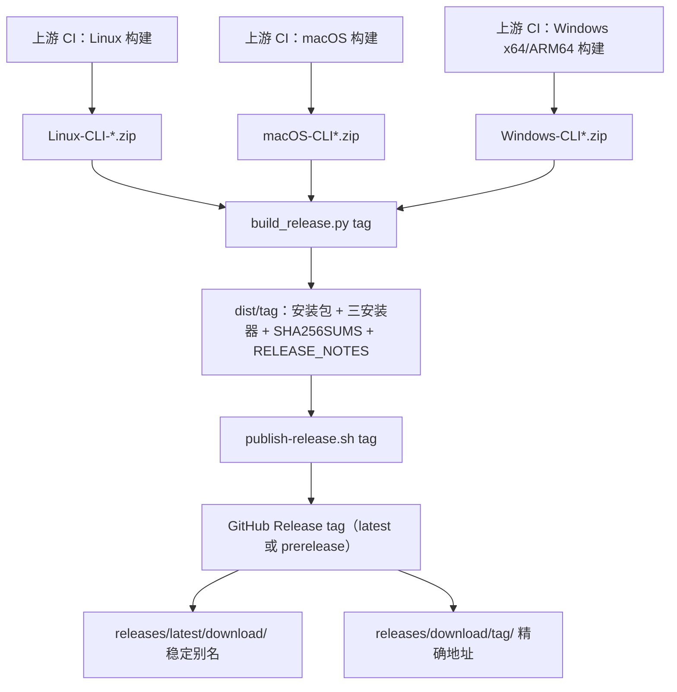
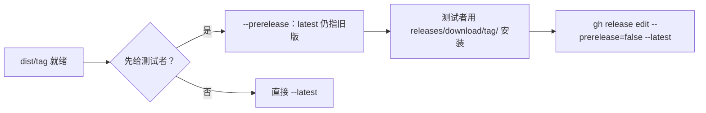

# 发行拓扑

## 全景

四个要点：

1. **输入不在仓库里**：三个 CI 束临时放仓库根，被 `.gitignore` 屏蔽（F-011、F-031）。
2. **中间态是目录**：`dist/<tag>/` 是唯一可发布单元；脚本先删旧目录再生成，失败时整目录删除（F-059）。
3. **两种寻址并存**：`releases/latest/download/<name>` 永远指向最新；`releases/download/<tag>/<name>` 锁定具体版本（F-021、F-034）。
4. **发布不是打包**：`publish-release.sh` 只做门禁与上传，不重新构建（F-037、F-072）。

## 资产构成

一次发布（`dist/<tag>/`）包含：

| 类别 | 文件 | 说明 |
|------|------|------|
| 平台安装包 | Linux `*.deb`（amd64/arm64 各一）、macOS `*.pkg`、Windows `*.zip`（x64，v3.0.1 起可选 ARM64） | 上游构建产物，逐字节保留（F-035、F-049 ~ F-053） |
| Linux 离线束 | `skyline-linux-cli-universal-*.tar.gz` | 内含 `install.sh` 与两个 deb；若安装器无需改写则原样复制 |
| 安装器 | `skyline-linux-install.sh`、`skyline-macos-install.sh`、`skyline-windows-install.ps1` | 被重写下载地址、注入进度条与声明（F-034、F-062、F-063） |
| 清单 | `SHA256SUMS.txt` | 覆盖目录内全部资产（F-060） |
| 说明 | `RELEASE_NOTES.md` | 防诈骗声明 + 官网 + 一键安装 + 资产表 + build 号（F-061） |

注意：资产数**不等于**平台数——macOS 束里的 tar.gz 不发布，Windows 束里的内部测试脚本不发布（C-4）。

## 核心设计：安装器与自己的包自洽

上游安装器里写着下载地址。如果直接把 v3.0.0 的安装器放到 v3.0.1 的 Release 里，用户会下载到旧包。`retag()` 的处理是：

- 把安装器内**所有** `/releases/download/<某tag>/` 统一改写为本次 `<tag>`（F-034）；
- 随后 `check_leaks()` 再断言安装器里**不存在**指向其他 tag 的地址（F-056）。

这一对动作构成闭环：**先改，再证明改干净了**。它比「人工检查一遍」可靠，因为断言是逐行正则匹配，漏一处就失败。

## 单版本保留策略及其代价

策略：新版本成为 latest 并通过核验后，删除上一个 Release，但**保留其 tag**（F-040）。

| 收益 | 代价 |
|------|------|
| Release 页只有一条，用户不会装错旧版 | 旧版本资产被删，无法回退安装（D-6） |
| 与 `releases/latest` 的「永远最新」语义一致 | 出问题时只能修新版本，不能「先退回上一版」 |
| 减少历史资产维护面 | 依赖旧版本行为的自动化脚本会失效 |

本束不把该策略写成「最佳实践」，只把它记为一种**明确的取舍**。

## tag 与版本号的关系

- tag 格式被强校验为 `vX.Y.Z[-预发布]`（F-045）；
- 三平台 app version 必须一致（F-054）；
- 但 **tag 版本号与 app version 不一致只提示不中止**（C-3）。

因此对外沟通版本时，以 `CHANGELOG.md` 的 Release 条目为准，不要用 tag 名反推产品版本。

## 发布前的两条分叉

预发布的价值在于：`releases/latest` 继续服务现网用户，测试者能装到新包，验证通过后再晋升（F-037、F-038）。这比「先发再回滚」更安全，因为回滚意味着删除 release——而旧资产已被单版本策略清掉。

## 主题关联

- [03 安装期校验链](03-installer-verification-chain.md)：资产到了用户机器上如何被验证。
- [04 暂存管线](04-release-staging-pipeline.md)：`dist/<tag>` 内部是怎么造出来的。
- [演练 02 发布 Runbook](../examples/02-maintainer-release-runbook.md)。
